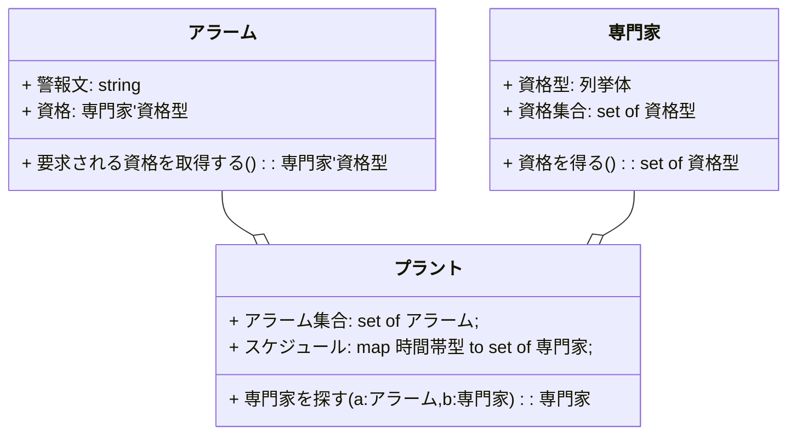

# はじめに

みなさんは数学はお好きですか？わたしは大好きです。というよりも大好きだったかなです。いまはあまりお付き合いがありませんでしたが、最近、数学的形式言語に手を伸ばした関係で、数学が気になりだしています。昔、ハードウェアエンジニアだったころ、数値計算ロジックを実装していましたが、Mathematica(の祖先ver2くらい)も使っていました。

https://qiita.com/advent-calendar/2023/remind

この記事は日本語構造化仕様記述言語 Re:Mind（リマインド）アドベントカレンダー2023の初日向けの記事です。

## この記事の概要
九州大学さんが作成されたVDM++開発手法ガイドライン1.0で解説されているアルゴリズムの陰定義の際に使われる関数・操作の事前条件、事後条件の数学的形式表現を構造化形式のロジック仕様記述言語に書き換えてみます。

## この記事内容の作業目的
内部仕様の記述用に設計したロジック仕様記述言語 Re:Mind（リマインド）が要求仕様記述用途で使用できるか、不足する言語仕様要件はなにかといった点を検討しています。要求仕様->内部仕様->実装で一貫した形式記述を採用することで、開発工程の生産性向上に寄与することが目標です。ここでいう「一貫した形式記述」とは、数学形式に限定されません。

## この記事内容の保証
※この記事には仕様的な情報が含まれます。各言語で書かれた引用ソースの妥当性は保証されません。また、自作言語は開発中（試作段階）のため、本記事に開示された仕様は予告なく変更される場合があります。
VDM/VDM++の構文はVDM++開発手法ガイドラインから引用しています。筆者による独自の解釈を含む場合があります。

# 化学プラントの例
VDM++開発手法ガイドラインでは化学プラントの簡単なアラームシステムの適用事例が説明されていて、UMLのクラス図として、「プラント」「専門家」「アラーム」の３つのクラスからなる構成が例示されています。

## 化学プラントアラームシステムの3つのクラス
それらのクラスをmermaidで記述しました。３クラスの関係としてはプラントクラスにアラームクラスと専門家クラスのインスタンス変数が含まれるとしています。


原文のクラス図ではクラス名に「〇〇クラス」と後装飾がされていますが、これは言語要件ではなく、わかりやすさのためにそのように命名しているものと解釈しています。mermaidで記述した上図のクラス図では、クラス名の「クラス」装飾は割愛しています。またお題の内容をわかりやすくするため、メソッド表記などは割愛しています。データ型の表記はVDM++に準じています。

# 化学プラントアラームシステムの3つのクラス定義を構造化形式言語に書き換える
## 「専門家」「アラーム」のクラス定義
本記事の本題であります、数学的形式言語の事前条件・事後条件を構造化形式言語で書き換えてみる前に、基本的なクラス定義を書き換えてみます。
構造化形式言語にはJava/C#経験者向けに設計されたロジック仕様記述言語 Re:Mind（リマインド）を使わせていただいております。Java/C#で英字で書き換えると対応関係がわかりづらくなりますので、日本語で設計されたRe:Mindを使用します。

### VDM++のクラス定義

以下にVDM++のクラス定義としてアラームクラス、専門家クラスの例を引用します。
```mind:VDM++
class アラームクラス
types
    public string = seq of char;
instance variables
    警報文: string;
    資格: 専門家クラス`資格型;
operations
    要求される資格を取得する:()==>  専門家'資格型
    要求される資格を取得する()==
        is not yet specified;
end アラームクラス

class 専門家クラス
types
    public 資格型= <機械> | <化学> | <生物> | <電気>;
instance variables
operations
    資格を得る:()==>  set of 資格型
    資格を得る()==
        is not yet specified;
...
end 専門家クラス

```
VDM++のクラス定義構文には下記のセクション定義があります。（すべてではありません。）
**types** VDMデータ型定義セクション
**instance variables** クラスのインスタンス宣言セクション
**operations** 操作の宣言・定義セクション

### Re:Mindのクラス定義
```mind:Re:Mind
▽class アラーム
    ・String　警報文
    ・専門家.資格の列挙 資格

    ▽public 専門家.資格の列挙 要求される資格を取得する()
        //未定義
    △
△

▽class 専門家
　   ▽public 列挙体 資格の列挙
        機械,
        化学,
        生物,
        電気
    △

    ▽public 資格[] 資格を得る()
        //未定義
    △
△
```
**・中点** は変数の宣言を意味します。型名、変数名の順で宣言します。
**▽** **△** はJava/C#のブロック文の開始と終了｛｝に相当します。

## 「プラント」のクラス定義
### VDM++のクラス定義
以下にVDM++のクラス定義としてプラントクラスの例を引用します。「専門家を探す」以外のメソッドは割愛しています。

```mind:VDM++
class プラントクラス
types
    public 時間帯型= token;
instance variables
    アラーム集合: set of アラームクラス;
    スケジュール: map 時間帯型 to set of 専門家クラス;
--不変条件
inv
    forall p in set dom スケジュール& スケジュール(p) <> {};
inv forall a in set アラーム集合&
    forall p in set dom スケジュール&
    exists ex in set スケジュール(p) &
    a. 要求される資格を得る() in set ex. 資格を得る();

operations
    専門家を探す: アラームクラス* 時間帯型 ==> 専門家クラス
        専門家を探す(a, p) ==
            is not yet specified;
        --事前条件
        pre a in set アラーム集合and
            p in set dom スケジュール
        --アラームはインスタンス変数アラーム集合に含まれる範囲にある。
        --時間帯型はスケジュールの中で考えられる必要がある。

        --事後条件
        post let ex = RESULT in
            ex in set スケジュール(p) and
            a. 要求される資格を得る() in set ex. 資格を得る();
        --任務についてしまっている専門家を返すべきではない。
        --専門家はアラームを扱うための正しい資格を持つべきである。
...
end プラントクラス
```
**--** VDM++単行コメント　原文にはなく本記事筆者が原文説明文より追加
**pre** 「専門家を探す」操作の事前条件
**post**「専門家を探す」操作の事後条件
**inv**　不変条件


### Re:Mindのプラントクラス定義
```mind:Re:Mind
▽class プラント
    ・アラーム[] アラーム集合
    ・スケジュール

    ▽public 専門家 専門家を探す(アラーム a,時間帯 p)
        //事前条件
        ◇
        //アラームはインスタンス変数アラーム集合に含まれる範囲にある。
        //時間帯型はスケジュールの中で考えられる必要がある。
        //未定義
        //事後条件
        //任務についてしまっている専門家を返すべきではない。
        //専門家はアラームを扱うための正しい資格を持つべきである
    △

△
```
**//** Re:Mind単行コメント

# おわりに
すみません。少しタイトル倒れとなっています。構造化言語の場合の集合的操作はラムダ式でのオブジェクト型リストの抽出などが該当すると考えています。このあたりの言語仕様を再考して出直します。

# 関連リンク
FMVDM　[VDMTools 付属文書](http://fmvdm.org/doc/index-ja.html)

FMVDM-> github [[PDF] VDMTools VDM++開発手法ガイドライン1.0 2016](https://github.com/vdmtools/vdmtools/raw/stable/doc-jp/guidelines/guidelines_a4J.pdf)

FMVDM-> github [[PDF] VDMTools VDM 言語マニュアル VDM++](https://github.com/vdmtools/vdmtools/raw/stable/doc-jp/lang-man/langmanpp_a4J.pdf)
