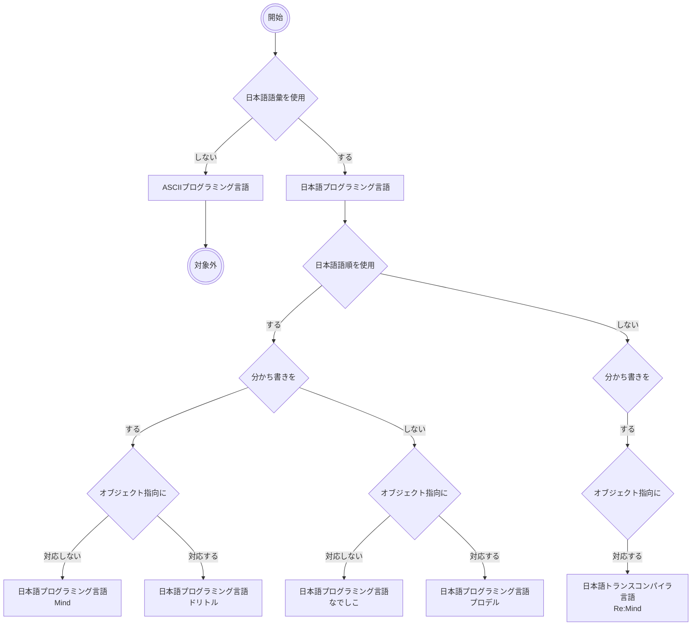

# はじめに

「日本語トランスコンパイラ言語 Re:Mind（リマインド）」という自作トランスコンパイラ言語[^1] の企画意図を再確認するため、主要な日本語プログラミング言語と差別化特徴をまとめています。

## 対象読者
日本語プログラミング言語に偏見のない方、むげに否定しない方

# 日本語プログラミング言語とは？
##  日本文字（日本漢字、ひらがな、カタカナ）を使ったプログラミング言語
あくまで形式言語の範疇で、主に英文字ではなく日本文字（日本漢字、ひらがな、カタカナ）を使ったプログラミング言語のことです。自然言語としての日本語の語順を取り入れるかは必須要件ではありませんが、これからご紹介する4言語は取り入れていて1言語(Re:Mind)は取り入れていない例です。

# 主要日本語プログラミング言語の特徴別系統図とRe:Mind（リマインド）のポジション

日本語語彙を使用する|しない→日本語語順を使用する|しない→分かち書きをする|しない→オブジェクト指向に対応する|しない　で分類した、非常にざっくりした系統図ですが、ドリトルがMind側に寄ったのはちょっと驚きでした。

# おわりに
「Mind」「プロデル」「なでしこ」この３つの日本語プログラミング言語の開発者は３名様ともQiitaユーザーさんでもあります。[^2] [^3] [^4]
本格的なコンパイラを実装することは非常にたいへんなことです。この記事を読んでいただいたQiitaユーザーのみなさん、ぜひ日本語プログラミング言語の開発者Qiitaユーザーさんを応援して、盛り上げていきましょう！

[^1]: Qiita [オープンな実装言語仕様 日本語トランスコンパイラ言語 Re:Mind（リマインド）2023 Lv1.1ドラフト](https://qiita.com/mylifewithviolin/items/ee1a16a363aaa4fe3f4c)　参照
[^2]: Qiita [まるで詩のような日本語で書いたプログラム - 実際に動きます](https://qiita.com/killy/items/0b5eb530fdceebd8c03e)　参照
[^3]: Qiita [なでしこでもっと美しくFizzBuzzを書く](https://qiita.com/kujirahand/items/4d6a0166f54e4d6290fc)　参照
[^4]: Qiita [日本語プログラミング言語「プロデル」でズンドコキヨシ](https://qiita.com/jpl_produire/items/e28a54709b7eb73cd201)　参照
