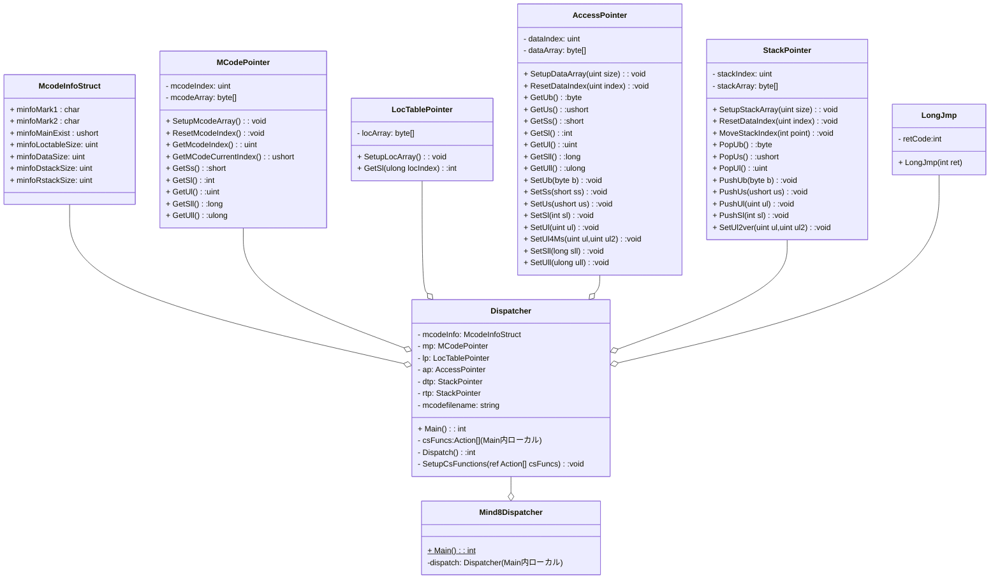

# はじめに
Mind8の中間コードディスパッチャ（の一部）をCからC#に書き換えてみるという野望の三段目のあたりとして、Cのディスパッチャ配下の関数配列のいくつかをC#で実装しています。

この対応もだいぶ長丁場となってきておりますので本記事ではおよそ５ヶ月前にご提示したMind8の中間コードディスパッチャ（の一部）をCからC#に書き換える（[具体的な実装構想ver1.0](https://qiita.com/mylifewithviolin/items/818de8aca51f6750da6c)）からの改修状況をまとめておきます。


# 前提条件
Windows11 Pro 22H2
VSCode(Visual Studo Code)　1.86.1
Microsoft Visual C++ 2008 Express Edition
Mind Version 8.0.08 for Windows
C# 12 
dotnet-sdk-8.0.204-win-x64

## VSCodeの拡張機能
C/C++ for Visual Studio Code 1.18.5 Microsoft 
C/C++ Extension Pack 1.3.0 Microsoft 
.NET Install Tool 2.0.2 Microsoft
Base language support for C# 2.18.16 Microsoft

C/C++のデバッガは直接使わないのですが、Cで実装されているMind8kernelの動作をデバッグ実行で探るために使用します。[こちらの記事](https://qiita.com/mylifewithviolin/items/2804356ae2f39b055b8c)の環境となります。

# お題のMind8の中間コードファイル
[こちらの記事](https://qiita.com/mylifewithviolin/items/7f0878469e068baccf90)をご参照ください。

# お題のC#ソースコードのクラス構成
ここでC#ソースコードのクラス構成とファイル構成をまとめておきます。
それらのクラスをver.1.0でmermaidで記述しました。構造の概念把握が目的なのであまり細かい点の表記は気にしていません。図としてはver.1.0からの変更はありません。メソッドの引数は割愛している場合があります。


## クラスの説明と対応ソースファイル構成
ver.1.0からの大きな変更は、C#デリゲートによる関数配列の実装を単一のCsFunctions.csから複数のソースファイルに分割しました。CsFunctions.csはprivate void SetupCsFunctionsの定義だけでとなっており、個々の関数の実装は各ファイルに分散しています。ファイル名の由来はオリジナルのCソースファイルです。

| クラス名 | 概要 | 対応ソースファイル |
|:-|:-|:-|
|Mind8Dispatcher|Windowsコンソールアプリのホストクラス|Mind8Dispatch.cs|
|Dispatcher|ディスパッチャ本体クラス|Dispatcher.cs|
||C#デリゲートによる関数配列(配列定義)|CsFunctions.cs|
||0ker.cのC#実装|CsFunctions0ker.cs|
||1ker.cのC#実装|CsFunctions1ker.cs|
||2ker0.cのC#実装|CsFunctions2ker0.cs|
||2ker2.cのC#実装|CsFunctions2ker2.cs|
||3ker.cのC#実装|CsFunctions3ker.cs|
||bunki.cのC#実装|CsFunctionsBunki.cs|
||compword.cのC#実装|CsFunctionsCompword.cs|
||dispword.cのC#実装|CsFunctionsDispword.cs|
|McodeInfoStruct|Mcode情報構造体|Dispatcher.cs|
|LongJmp|広域ジャンプ用のアプリケーション例外|Dispatcher.cs|
|MCodePointer|Mcode領域アクセスクラス|MCodePointer.cs|
|LocTablePointer|Locテーブルアクセスクラス|LocTablePointer.cs|
|AccessPointer|データ領域アクセスクラス|AccessPointer.cs|
|StackPointer|スタッククラス|StackPointer.cs|

# お題のC#ソースコード
それでは各クラスの現時点での実装状況を見ていきます。
## Mind8Dispatcherクラス Main 暫定メイン
コンソールアプリのホストクラスのMainです。まだ引数からのファイル名には非対応です。ディスパッチャクラスのインスタンスを生成してMainを実行するシンプルな状態となりました。
Mind8Kernelの名前空間を導入しました。他のクラスもこの名前空間に属しています。Mind9がリリースされた場合、互換実装途中ながらファイル名・名前空間はMind9に変更してC実装のディスパッチャ検証環境もMind9に移行します。

```cs:Mind8Dispatch.cs
namespace Mind8Kernel
{
    /// <summary>Mind8ディスパッチャ</summary>
    public partial class Mind8Dispatcher
    {
        /// <summary>メイン</summary>
        /// <param name="args">引数</param>
        static int Main(string[] args)
        {
            string mcodefilename="hello.mco";
            Dispatcher dispatcher =new();
            return dispatcher.Main(mcodefilename);
    
        }       
    }
}
```
## Dispatcherクラス
ディスパッチャ本体クラスです。C#関数配列とソースを分けるためpartial装飾されています。

### LongJmpクラス 広域ジャンプ用のアプリケーション例外
Cの関数配列内でCのLongJmpで実装されている箇所のC#代替実装用の例外クラスです。後述するディスパッチャループを監視してキャッチします。
他に以前からプログラム終了用のアプリケーション例外ExitModuleがありましたが、今回未実装（関数枠は実装されていて中身が未実装という）状態を検出するためUnDefinedというアプリケーション例外を追加しています。

```cs:Dispatcher.cs
namespace Mind8Kernel
{
    /// <summary>Mind8ディスパッチャ</summary>
    public partial class Dispatcher
    {
        /// <summary>広域ジャンプ用のアプリケーション例外</summary>
        private class LongJmp(int ret) : Exception{
            public int retCode = ret;
        }
        /// <summary>プログラム終了用のアプリケーション例外</summary>
        private class ExitModule(int ret) : Exception{
            public int retCode=ret;
        }
        /// <summary>プログラム終了用のアプリケーション例外　未実装</summary>
        private class UnDefined(int ret) : Exception{
            public int retCode=ret;
        } 
        /// <summary>MCode情報構造体</summary>
        private struct McodeInfoStruct	     /*-- 全体=32バイト --*/
        {
            //～略～     
        }      
        /// <summary>メイン</summary>
        public int Main(string args){
            //後述～       
        }
        /// <summary>ディスパッチャ</summary>
        private int Dispatch(McodeInfoStruct McodeInfo,Action[] csFuncs){
            //後述～
        }
    }

    
}    
```

### Main 暫定メイン
ディスパッチャ本体クラスのMainです。

```cs:Dispatcher.cs
        private  byte[] McodeBase =[];//MCode領域
        private byte[] WordOffsetTable=[];//LOCテーブル
        private MCodePointer mp=new();//MCode領域用ポインタ
        private LocTablePointer lp=new();//LOCテーブル用ポインタ
        private AccessPointer ap =new(); //データ領域用ポインタ
        private StackPointer dtp =new(); //データスタック用ポインタ
        private StackPointer rtp =new(); //リターンスタック用ポインタ
        private string mcodefilename ="";
        private int argc=2;

        /// <summary>メイン</summary>
        /// <param name="args">引数</param>
        public int Main(string args)
        {
            mcodefilename=args;
            McodeInfoStruct mcodeInfo =new();

            /* ディスパッチャを準備する */
            bool ret=SetupForDispatch(ref mcodeInfo,mcodefilename);
            if(!ret){
                return -1;
            }

            //MonitorMcode(McodeBase,116,186);//MCode領域をモニタする
            mp.SetupMcodeArray(McodeBase);//MCode領域用ポインタを準備する
            lp.SetupLocArray(WordOffsetTable);//LOCテーブル用ポインタを準備する
            ap.SetupDataArray(mcodeInfo.minfoDataSize);//データ領域用ポインタを準備する
            //resetDataStackPointer();//DstackPointer = DataStackBase[RestartEnvCount];
            //resetRetnStackPointer();//RstackPointer = RetnStackBase;
            dtp.SetupStackArray((ushort)mcodeInfo.minfoDstackSize);//データスタック用ポインタを準備する
            rtp.SetupStackArray((ushort)mcodeInfo.minfoRstackSize);//リターンスタック用ポインタを準備する
            //McodePointer.b = (UCHAR *)McodeBase + 0x70;	/* 0x70=実行開始地点 */
            mp.ResetMcodeIndex(0x70);

            /* C#の関数を準備する */
            Action[] csFuncs=[]; //C#の関数を格納する配列
            /* C#の関数配列を準備する */
            SetupCsFunctions(ref csFuncs);
            /* ディスパッチャ開始 */
            return Dispatch(mcodeInfo, csFuncs);

        }
```

### Dispatch ディスパッチャ本体
ディスパッチャ本体です。
Cの関数配列内でCのLongJmpで実装されている箇所のC#代替実装として、例外クラスがスローされてくるのを監視してキャッチします。状態復帰のコードはまだ実装していません。とりあえず代替構造を記述してあります。
```cs:Dispatcher.cs
        /// <summary>ディスパッチャ</summary>
        /// <param name="McodeInfo">MCode情報構造体の参照</param>
        /// <param name="csFunc">C#関数配列の参照</param>
        private int Dispatch(McodeInfoStruct McodeInfo, Action[] csFuncs){
            
            ushort   mcode;

            int retcode=0;//setjmp( RESTARTENV );		/* ←ディスパッチャ再 */
            if ( retcode != 2 )			/* 強制脱出の検査 */
            {
                try{
                    int i=0;
                    for(;;)
                    {
                        mcode = mp.FetchMcode();
                        Console.Write("{0,4:d} {1,4:X4} {2,6:d} {3,6:d}",++i,mcode,mcode,mp.GetMcodeIndex());
                        Console.WriteLine(" {0,6:d} {1,8:d} {2,8:d} {3,6:d} {4,8:d} {5,8:d}",dtp.GetCurrentStackPointer(),dtp.GetUl(),
                                                    dtp.GetUlOffset(1),
                                                    rtp.GetCurrentStackPointer(),rtp.GetUl(),rtp.GetUlOffset(1));

                        if ( (mcode & 0x8000)==0 )
                        {
                            /* C#関数 */
                            csFuncs[mcode]();
                        }
                        else
                        {
                            /* Mind単語 */
                            //PUSH_R( McodePointer.l );
                            //#define  PUSH_R(addr) *(--RstackPointer)=(ULONG)(addr)
                            rtp.PushUl(mp.GetMcodeIndex());//現在のMCodeポインタの値をリターンスタックにプッシュする
                            //SET_MCODE_POINTER_BY_WORDNO( mcode & 0x7fff );
                            //McodePointer.b = (UCHAR *)(WordOffsetTable[wordNo])
                            mp.ResetMcodeIndex((uint)lp.GetSl((uint)(mcode & 0x7fff)));
                        }
                    }
                }catch(LongJmp ljmp){
                    retcode=ljmp.retCode;
                    //状態復帰
                }catch(ExitModule eMd){
                    return eMd.retCode;
                }
            }
            return 0;
        }


```

## MCodePointerクラス
Mcode領域アクセスクラスです。
<details><summary>ソースコード</summary>

```cs:MCodePointer.cs
    
    namespace Mind8Kernel
{
    public class MCodePointer{
        private readonly uint mcodeSize=2;
        private readonly uint mcodeSizeDouble=4;
        private uint mcodeIndex;
        private byte[] mcodeArray =[];
        public void SetupMcodeArray(byte[] McodeBase){
            mcodeArray=McodeBase;
        }
        public void ResetMcodeIndex(uint index){
            mcodeIndex=index;;
        }
        public void MoveMcodeIndexByByte(int point){
            mcodeIndex=(uint)(mcodeIndex + point);//byte配列インデックス単位で移動
        }
        public void MoveMcodeIndex(int point){
            mcodeIndex=(uint)(mcodeIndex + point*mcodeSize);//byte配列インデックス=アドレスポインタ変数の値*2
        }
        public uint GetMcodeIndex(){
            return mcodeIndex;
        }
        public ushort ReadMcode(){
            byte[] int16Byte = new byte[mcodeSize];
            for (ulong i = 0; i < mcodeSize; i++) int16Byte[i] = mcodeArray[mcodeIndex + i];
            return BitConverter.ToUInt16(int16Byte, 0);
        }
         public short ReadMcodeShort(){  /* FETCH_MCODE_SHORT */
            byte[] int16Byte = new byte[mcodeSize];
            for (ulong i = 0; i < mcodeSize; i++) int16Byte[i] = mcodeArray[mcodeIndex + i];
            return BitConverter.ToInt16(int16Byte, 0);
        }       
        public ushort FetchMcode(){ /* FETCH_MCODE */
            byte[] int16Byte = new byte[mcodeSize];
            for (ulong i = 0; i < mcodeSize; i++) int16Byte[i] = mcodeArray[mcodeIndex + i];
            mcodeIndex +=2;
            return BitConverter.ToUInt16(int16Byte, 0);
        }
        public uint FetchMcodeInt(){ /* FETCH_MCODE_LONG */
            byte[] int32Byte = new byte[mcodeSizeDouble];
            for (ulong i = 0; i < mcodeSize; i++) int32Byte[i] = mcodeArray[mcodeIndex + i];
            mcodeIndex +=mcodeSizeDouble;
            return BitConverter.ToUInt32(int32Byte, 0);
        }
        public ushort GetMCodeCurrentIndex(){/* for unsigned short access  */
            byte[] int16Byte = new byte[mcodeSize];
            for (ulong i = 0; i < mcodeSize; i++) int16Byte[i] = mcodeArray[mcodeIndex + i];
            mcodeIndex +=2;
            return BitConverter.ToUInt16(int16Byte, 0);
        }
        public byte[] GetUb(uint index,uint count){
            byte[] chars = new byte[count];
            for (uint i = 0; i < count; i++) chars[i] = mcodeArray[index + i];
            return chars;
        }
        public short GetSs(){/* for signed short access  */
            byte[] int16Byte = new byte[mcodeSize];
            for (ulong i = 0; i < mcodeSize; i++) int16Byte[i] = mcodeArray[mcodeIndex + i];
            mcodeIndex +=2;
            return BitConverter.ToInt16(int16Byte, 0);
        }
        public int GetSl(){/* for signed long access   */
            byte[] int32Byte = new byte[4];
            for (ulong i = 0; i < 4; i++) int32Byte[i] = mcodeArray[mcodeIndex + i];
            mcodeIndex +=4;
            return BitConverter.ToInt32(int32Byte, 0);
        }
        public uint GetUl(){/* for unsigned long access   */
            return FetchMcodeInt();
        }
        public long GetSll(){/* for signed long long access   */
            byte[] int64Byte = new byte[8];
            for (ulong i = 0; i < 8; i++) int64Byte[i] = mcodeArray[mcodeIndex + i];
            mcodeIndex +=8;
            return BitConverter.ToInt64(int64Byte, 0);
        }
        public ulong GetUll(){/* for unsigned long long access   */
            byte[] int64Byte = new byte[8];
            for (ulong i = 0; i < 8; i++) int64Byte[i] = mcodeArray[mcodeIndex + i];
            mcodeIndex +=8;
            return BitConverter.ToUInt64(int64Byte, 0);
        }
    }
}
```

</details>

## LocTablePointerクラス
Locattionテーブルアクセスクラスです。
<details><summary>ソースコード</summary>

```cs:LocTablePointer.cs
using System.Security.Cryptography;
namespace Mind8Kernel
{
/// <summary>Locテーブルアクセスポインタ</summary>
public class LocTablePointer{
        private byte[] locArray =[];
        public void SetupLocArray(byte[] locTable){
            locArray=locTable;
        }
        public int GetSl(ulong locIndex){/* for signed long access   */
            locIndex*=4;
            byte[] int32Byte = new byte[4];
            for (ulong i = 0; i < 4; i++) int32Byte[i] = locArray[locIndex + i];
            return BitConverter.ToInt32(int32Byte, 0);
        }
        
    }
}
```

</details>

## AccessPointerクラス
データ領域アクセスクラスです。
<details><summary>ソースコード</summary>

```cs:AccessPointer.cs
    namespace Mind8Kernel
{
    /// <summary>データ領域アクセスポインタ</summary>
    public class AccessPointer{
        private uint dataSize;
        private ulong dataIndex;
        private byte[] dataArray =[];
        public void SetupDataArray(uint size){
            dataSize=size;
            dataArray =new byte[dataSize];
            dataIndex=0;
        }
        public void ResetDataIndex(ulong index){
            dataIndex=index;
        }
        public uint GetCurrentDataIndex(){
            return (uint)dataIndex;
        }
        public byte GetUb(){    /* for unsigned byte access */
            return dataArray[dataIndex];
        }
        public ushort GetUs(){/* for unsigned short access  */
            byte[] int16Byte = new byte[2];
            for (ulong i = 0; i < 2; i++) int16Byte[i] = dataArray[dataIndex + i];
            return BitConverter.ToUInt16(int16Byte, 0);
        }        
        public short GetSs(){/* for signed short access  */
            byte[] int16Byte = new byte[2];
            for (ulong i = 0; i < 2; i++) int16Byte[i] = dataArray[dataIndex + i];
            return BitConverter.ToInt16(int16Byte, 0);
        }
        public int GetSl(){/* for signed long access   */
            byte[] int32Byte = new byte[4];
            for (ulong i = 0; i < 4; i++) int32Byte[i] = dataArray[dataIndex + i];
            return BitConverter.ToInt32(int32Byte, 0);
        }
        public uint GetUl(){/* for unsigned long access   */
            byte[] int32Byte = new byte[4];
            for (ulong i = 0; i < 4; i++) int32Byte[i] = dataArray[dataIndex + i];

            return BitConverter.ToUInt32(int32Byte, 0);
        } 
        public long GetSll(){/* for signed long long access   */
            byte[] int64Byte = new byte[8];
            for (ulong i = 0; i < 8; i++) int64Byte[i] = dataArray[dataIndex + i];
            return BitConverter.ToInt64(int64Byte, 0);
        }
        public ulong GetUll(){/* for unsigned long long access   */
            byte[] int64Byte = new byte[8];
            for (ulong i = 0; i < 8; i++) int64Byte[i] = dataArray[dataIndex + i];
            return BitConverter.ToUInt64(int64Byte, 0);
        }
        
        public void SetUb(byte b){    /* for unsigned byte access */
            dataArray[dataIndex] =b;
        }
        public void SetUb4Msi(byte b,uint length){  /* for unsigned byte access (for mind strings instance)*/
            for (ulong i = 0; i < length; i++) dataArray[dataIndex + i]= b;
        }

         public void SetUs(ushort us){/* for unsigned short access  */
            byte[] int16Byte =BitConverter.GetBytes(us);
            for (ulong i = 0; i < 2; i++) dataArray[dataIndex + i]=int16Byte[i];
         }

        public void SetSs(short ss){/* for signed short access  */
            byte[] int16Byte =BitConverter.GetBytes(ss);
            for (ulong i = 0; i < 2; i++) dataArray[dataIndex + i]=int16Byte[i];
         }

        public void SetSl(int sl){/* for signed long access  */
            byte[] int32Byte =BitConverter.GetBytes(sl);
            for (ulong i = 0; i < 4; i++) dataArray[dataIndex + i]=int32Byte[i];
        }
        public void SetUl(uint ul){/* for unsigned long access  */
            byte[] int32Byte =BitConverter.GetBytes(ul);
            for (ulong i = 0; i < 4; i++) dataArray[dataIndex + i]=int32Byte[i];
        }
        public void SetUl4Ms(uint ul,uint ul2){/* for unsigned long access (for mind string)  */
            byte[] int32Byte =BitConverter.GetBytes(ul);
            for (ulong i = 0; i < 4; i++) dataArray[dataIndex + i]=int32Byte[i];
            int32Byte =BitConverter.GetBytes(ul2);
            for (ulong i = 0; i < 4; i++) dataArray[dataIndex + i + 4]=int32Byte[i];
        }
        public void SetUl2var(uint ul,uint ul2){/* for unsigned long access (for 1set of 2variable)  */
            byte[] int32Byte =BitConverter.GetBytes(ul);
            for (ulong i = 0; i < 4; i++) dataArray[dataIndex + i]=int32Byte[i];
            int32Byte =BitConverter.GetBytes(ul2);
            for (ulong i = 0; i < 4; i++) dataArray[dataIndex + i + 4]=int32Byte[i];
        }
        public void SetSll(long sll){/* for signed long access  */
            byte[] int64Byte =BitConverter.GetBytes(sll);
            for (ulong i = 0; i < 8; i++) dataArray[dataIndex + i]=int64Byte[i];
        }
        public void SetUll(ulong ull){/* for unsigned long access  */
            byte[] int64Byte =BitConverter.GetBytes(ull);
            for (ulong i = 0; i < 8; i++) dataArray[dataIndex + i]=int64Byte[i];
        }
    }
}
```

</details>

## StackPointerクラス
スタックアクセスクラスです。

<details><summary>ソースコード</summary>

```cs:StackPointer.cs
namespace Mind8Kernel
{ 
 /// <summary>スタックポインタ</summary>
    public class StackPointer{
        private readonly uint stackSize=4;
        private uint stackMaxSize;
        private uint stackIndex;
        private uint stackPointer;
        public byte[] dataArray =[];
        public void SetupStackArray(uint size){
            stackMaxSize=size;
            dataArray =new byte[stackMaxSize];
            stackPointer=stackMaxSize/stackSize;//stackPointerは1024が初期値
            stackIndex=0;//stackIndexは0が初期値
        }        
        public void ResetStackPointer(){
            stackPointer=stackMaxSize/stackSize;
            stackIndex=0;//byte配列インデックス=アドレスポインタ変数の値*4
        }
        public void MoveStackPointer(int point){
            stackPointer=(uint)(stackPointer+point);
            stackIndex=(uint)(stackIndex - point*stackSize);//byte配列インデックス=アドレスポインタ変数の値*4
        }
        public uint GetCurrentStackPointer(){
            return stackPointer;
        }
        public bool IsCurrentStackPointerInit(){
            return (stackIndex==0);
        }
        public byte GetUb(){
            //アドレス指定で直接参照している元コードのためポインタインデックスの自動減少はなし
            byte[] int32Byte = new byte[stackSize];
            for (ulong i = 0; i < stackSize; i++) int32Byte[i] = dataArray[stackIndex + i];
            return (byte)BitConverter.ToUInt32(int32Byte, 0);            
        }
        public uint GetUl(){
            //アドレス指定で直接参照している元コードのためポインタインデックスの自動減少はなし
            byte[] int32Byte = new byte[stackSize];
            for (ulong i = 0; i < stackSize; i++) int32Byte[i] = dataArray[stackIndex + i];
            return BitConverter.ToUInt32(int32Byte, 0);            
        }
        public uint GetUlOffset(int offset){/* for unsigned long access  */
            //アドレス指定で直接セットしている元コードのためポインタインデックスの自動増加はなし
            byte[] int32Byte = new byte[stackSize];
            uint index=0;
            if((stackIndex - offset*stackSize)>=0){
                index=(uint)(stackIndex - offset*stackSize);
            }
            for (ulong i = 0; i < stackSize; i++) int32Byte[i] = dataArray[index + i];
            return BitConverter.ToUInt32(int32Byte, 0);      
        }
        public uint GetUlPoint(int point){/* for unsigned long access  */
            //アドレス指定で直接セットしている元コードのためポインタインデックスの自動増加はなし
            byte[] int32Byte = new byte[stackSize];
            uint index=(uint)(stackMaxSize/stackSize-point)*stackSize;//+は減方向
            for (ulong i = 0; i < stackSize; i++) int32Byte[i] = dataArray[index + i];
            return BitConverter.ToUInt32(int32Byte, 0);      
        }
        public byte PopUb(){    /* for unsigned byte access */
            if(stackIndex - stackSize < 0)throw new Exception("stack under flow");
            byte[] int32Byte = new byte[stackSize];
            for (ulong i = 0; i < stackSize; i++) int32Byte[i] = dataArray[stackIndex + i];
            stackPointer++;//POPはポインタ増加
            stackIndex-=stackSize;//POPはインデックス減少
            return (byte)BitConverter.ToUInt32(int32Byte, 0);
        }
        public ushort PopUs(){    /* for unsigned byte access */
            if(stackIndex - stackSize < 0)throw new Exception("stack under flow");
            byte[] int32Byte = new byte[stackSize];
            for (ulong i = 0; i < stackSize; i++) int32Byte[i] = dataArray[stackIndex + i];
            stackPointer++;//POPはポインタ増加
            stackIndex-=stackSize;//POPはインデックス減少
            return BitConverter.ToUInt16(int32Byte, 0);
        }
        public uint PopUl(){/* for unsigned long(int32) access   */
            if(stackIndex - stackSize < 0)throw new Exception("stack under flow");
            byte[] int32Byte = new byte[stackSize];
            for (ulong i = 0; i < stackSize; i++) int32Byte[i] = dataArray[stackIndex + i];
            stackPointer++;//POPはポインタ増加
            stackIndex-=stackSize;//POPはインデックス減少
            return BitConverter.ToUInt32(int32Byte, 0);
        }
        
        public void PushUb(byte b){    /* for unsigned byte access */
            if(stackIndex + stackSize > stackMaxSize-1)throw new Exception("stack over flow");
            stackPointer--;//PUSHはポインタ減少
            stackIndex +=stackSize;//PUSHはインデックス増加
            byte[] int32Byte = new byte[stackSize];
            int32Byte[3] =b;
            for (ulong i = 0; i < stackSize; i++) dataArray[stackIndex + i]=int32Byte[i];
        }
        public void PushUs(ushort us){    /* for unsigned byte access */
            if(stackIndex + stackSize > stackMaxSize-1)throw new Exception("stack over flow");
            stackPointer--;//PUSHはポインタ減少
            stackIndex +=stackSize;//PUSHはインデックス増加
            byte[] int32Byte =BitConverter.GetBytes(us);
            for (ulong i = 0; i < stackSize; i++) dataArray[stackIndex + i]=int32Byte[i];
        }
        public void PushUl(uint ul){/* for unsigned long(int32) access  */
            if(stackIndex + stackSize > stackMaxSize-1)throw new Exception("stack over flow");
            stackPointer--;//PUSHはポインタ減少
            stackIndex +=stackSize;//PUSHはインデックス増加           
            byte[] int32Byte =BitConverter.GetBytes(ul);
            for (ulong i = 0; i < stackSize; i++) dataArray[stackIndex + i]=int32Byte[i];
        }
        public void PushSl(int sl){/* for signed long(int32) access  */
            if(stackIndex + stackSize > stackMaxSize-1)throw new Exception("stack over flow");
            stackPointer--;//PUSHはポインタ減少
            stackIndex +=stackSize;//PUSHはインデックス増加
            byte[] int32Byte =BitConverter.GetBytes(sl);
            for (ulong i = 0; i < stackSize; i++) dataArray[stackIndex + i]=int32Byte[i];
        }
        public void SetSl2var(int ul,int ul2){/* for unsigned long access (for 1set of 2variable)  */
            //アドレス指定で直接セットしている元コードのためポインタインデックスの自動増加はなし
            byte[] int32Byte =BitConverter.GetBytes(ul);
            for (ulong i = 0; i < stackSize; i++) dataArray[stackIndex + i]=int32Byte[i];
            int32Byte =BitConverter.GetBytes(ul2);
            for (ulong i = 0; i < stackSize; i++) dataArray[stackIndex + i + 4]=int32Byte[i];
        }
        public void SetUs(ushort us){/* for unsigned short access  */
            //アドレス指定で直接セットしている元コードのためポインタインデックスの自動増加はなし
            byte[] int32Byte =BitConverter.GetBytes(us);
            for (ulong i = 0; i < stackSize; i++) dataArray[stackIndex + i]=int32Byte[i];
        }
        public void SetUl(uint ul){/* for unsigned long access  */
            //アドレス指定で直接セットしている元コードのためポインタインデックスの自動増加はなし
            byte[] int32Byte =BitConverter.GetBytes(ul);
            for (ulong i = 0; i < stackSize; i++) dataArray[stackIndex + i]=int32Byte[i];
        }
        public void SetUl2var(uint ul,uint ul2){/* for unsigned long access (for 1set of 2variable)  */
            //アドレス指定で直接セットしている元コードのためポインタインデックスの自動増加はなし
            byte[] int32Byte =BitConverter.GetBytes(ul);
            for (ulong i = 0; i < stackSize; i++) dataArray[stackIndex + i]=int32Byte[i];
            int32Byte =BitConverter.GetBytes(ul2);
            for (ulong i = 0; i < stackSize; i++) dataArray[stackIndex + i + 4]=int32Byte[i];
        }
        public void SetUsOffset(ushort us,int offset){/* for unsigned short access  */
            //アドレス指定で直接セットしている元コードのためポインタインデックスの自動増加はなし
            byte[] int32Byte =BitConverter.GetBytes(us);
            uint index=(uint)(stackIndex - offset*stackSize);//+は減方向
            for (ulong i = 0; i < stackSize; i++) dataArray[index + i]=int32Byte[i];
        }
        public void SetUlOffset(uint ul,int offset){/* for unsigned long access  */
            //アドレス指定で直接セットしている元コードのためポインタインデックスの自動増加はなし
            byte[] int32Byte =BitConverter.GetBytes(ul);
            uint index=(uint)(stackIndex - offset*stackSize);//+は減方向
            for (ulong i = 0; i < stackSize; i++) dataArray[index + i]=int32Byte[i];
        }
        public void SetUlPoint(uint ul,int point){/* for unsigned long access  */
            //アドレス指定で直接セットしている元コードのためポインタインデックスの自動増加はなし
            byte[] int32Byte =BitConverter.GetBytes(ul);
            uint index=(uint)(stackMaxSize/stackSize-point)*stackSize;//+は減方向
            for (ulong i = 0; i < stackSize; i++) dataArray[index + i]=int32Byte[i];
        }
    }
}
```

</details>

## Dispatcherクラス（C#関数配列）
ディスパッチャ本体クラスのC#関数配列部分です。
### SetupCsFunctions C#の関数配列を準備する
この関数配列の中身を実装するのがキモとなります。現在の実装中の関数は下記のとおりです。

```cs:CsFunctions.cs

using System.Dynamic;
namespace Mind8Kernel
{

    public partial class Dispatcher
    {
        private readonly int maxCountCsFunctions = 1 + 0x026D;
        /// <summary>C#の関数配列を準備する</summary>
        /// <param name="csFunc">C#関数配列の参照</param>
        private void SetupCsFunctions(ref Action[] csFuncs){
            Encoding.RegisterProvider(CodePagesEncodingProvider.Instance);
            csFuncs=new Action[maxCountCsFunctions];
        /*--------------------- 実行  -----------------------------------*/
            csFuncs[0x0010]=ZzEndExecute;//不完全要注意
            csFuncs[0x0011]=Jikkou;//不完全要注意
            csFuncs[0x0012]=Musyori;//
            csFuncs[0x0013]=EmgcyExit;
            csFuncs[0x0014]=ProcessOwari;
        /*--------------------- スタックポインタのアクセス  --------------*/
            csFuncs[0x0015]=StackKensa0;
            csFuncs[0x0016]=StackReset;//
            csFuncs[0x0017]=FinishDispatcher;
            csFuncs[0x0018]=C_stack_data_no;
        /*--------------------- $$RESERVE[nL]  --------------------------*/
            csFuncs[0x0019]=ZzReserve1L;
            csFuncs[0x001A]=ZzReserve2L;
            csFuncs[0x001B]=ZzReserve3L;
            csFuncs[0x001C]=ZzReserve4L;
            csFuncs[0x001D]=ZzReserve5L;
            csFuncs[0x001E]=ZzReserve6L; 
            csFuncs[0x001F]=ZzReserve; 
        /*--------------------- $$EXIT[nL]  -----------------------------*/
            csFuncs[0x0020]=ZzExit1L;//
            csFuncs[0x0021]=ZzExit2L;
            csFuncs[0x0022]=ZzExit3L;
            csFuncs[0x0023]=ZzExit4L;
            csFuncs[0x0024]=ZzExit5L;
            csFuncs[0x0025]=ZzExit6L;
            csFuncs[0x0026]=ZzExit7L;
            csFuncs[0x0027]=ZzExit;
        /*--------------------- $$IFEXIT系  -----------------------------*/
            csFuncs[0x0028]=ZzIfExit;//
            csFuncs[0x0029]=ZzIf0Exit;//
            csFuncs[0x002A]=ZzIf1Exit;//
            csFuncs[0x002B]=ZzNotIfExit;//
            csFuncs[0x002C]=ZzNotIf0Exit;//
            csFuncs[0x002D]=ZzNotIf1Exit;//
        /*--------------------- $$JMP  ----------------------------------*/
            csFuncs[0x002E]=ZzJmpRelative; 
            csFuncs[0x002F]=ZzJmpIndexed; //

            csFuncs[0x0030]=ZzPointNull;
            csFuncs[0x0031]=ZzPushNull;
            csFuncs[0x0032]=ZzPushNull;//重複
            csFuncs[0x0033]=ZzPushPointer;
            csFuncs[0x0034]=ZzPushPointerPlusSize;
            csFuncs[0x0035]=AddressWoEru;
        /*---------------------  大域変数のセットアップ  ------------------*/
            csFuncs[0x0036]=ZzPointVarAddr;//
            csFuncs[0x0037]=ZzPointCodeAddr;
        /*---------------------  大域集合のセットアップ  ------------------*/
            csFuncs[0x0038]=ZzPushVarAddrPlusSize;
            csFuncs[0x0039]=ZzPushMcodeAddrPlusSize;
        /*---------------------  局所変数のセットアップ  ------------------*/
            csFuncs[0x003A]=ZzPointLocalAddr0W;
            csFuncs[0x003B]=ZzPointLocalAddr1W;
            csFuncs[0x003C]=ZzPointLocalAddr2W;
            csFuncs[0x003D]=ZzPointLocalAddr3W;
            csFuncs[0x003E]=ZzPointLocalAddr4W; 
            csFuncs[0x003F]=ZzPointLocalAddr5W; 
            
            csFuncs[0x0040]=ZzPointLocalAddr6W;
            csFuncs[0x0041]=ZzPointLocalAddr7W;
            csFuncs[0x0042]=ZzPointLocalAddr;
        /*---------------------  局所集合のセットアップ  ------------------*/
            csFuncs[0x0043]=ZzPushLocalAddrPlusSize;
            csFuncs[0x0044]=ZzPushLocalAddrPlusSize;
        /*---------------------  変数の間接読み出し  ----------------------*/
            csFuncs[0x0045]=ZzPushBvar;
            csFuncs[0x0046]=ZzPushWvar;
            csFuncs[0x0047]=ZzPushDvar;
            csFuncs[0x0048]=ZzPushLvar;
            csFuncs[0x0049]=ZzPushQvar;
            csFuncs[0x004A]=ZzPushSvar;
            csFuncs[0x004B]=ZzPushJvar;
        /*---------------------  変数の直接読み出し  ----------------------*/
            csFuncs[0x004C]=ZzReadBvar;
            csFuncs[0x004D]=ZzReadWvar;
            csFuncs[0x004E]=ZzReadDvar;
            csFuncs[0x004F]=ZzReadLvar; 
            csFuncs[0x0050]=ZzReadQvar; 

            csFuncs[0x0051]=ZzReadSvar;
            csFuncs[0x0052]=ZzReadJvar;
        /*---------------------  局所変数の直接読み出し  ---------------*/
            csFuncs[0x0053]=ZzReadBvarLocal;
            csFuncs[0x0054]=ZzReadWvarLocal;
            csFuncs[0x0055]=ZzReadDvarLocal;
            csFuncs[0x0056]=ZzReadLvarLocal;
            csFuncs[0x0057]=ZzReadQvarLocal;
            csFuncs[0x0058]=ZzReadSvarLocal;
            csFuncs[0x0059]=ZzReadJvarLocal;
        /*---------------------  変数の間接書き込み  ------------------*/
            csFuncs[0x005A]=ZzPopBvar;
            csFuncs[0x005B]=ZzPopWvar;
            csFuncs[0x005C]=ZzPopDvar;
            csFuncs[0x005D]=ZzPopLvar;
            csFuncs[0x005E]=ZzPopQvar;
            csFuncs[0x005F]=ZzPopSvar;

            csFuncs[0x0060]=ZzPopMemory;
            csFuncs[0x0061]=ZzPopMemoryWithResult;
            csFuncs[0x0062]=ZzPopMemoryWithResult;
        /*---------------------  変数の直接書き込み  --------------------*/
            csFuncs[0x0063]=ZzWriteBvar;//
            csFuncs[0x0064]=ZzWriteWvar;//
            csFuncs[0x0065]=ZzWriteDvar;//
            csFuncs[0x0066]=ZzWriteLvar;//
            csFuncs[0x0067]=ZzWriteQvar;//
            csFuncs[0x0068]=ZzWriteSvar;//
        /*---------------------  局所変数の直接書き込み  ----------------*/
            csFuncs[0x0069]=ZzWriteBvarLocal;
            csFuncs[0x006A]=ZzWriteWvarLocal;
            csFuncs[0x006B]=ZzWriteDvarLocal;
            csFuncs[0x006C]=ZzWriteLvarLocal;
            csFuncs[0x006D]=ZzWriteQvarLocal;
            csFuncs[0x006E]=ZzWriteSvarLocal;
        /*---------------------  変数のクリア  --------------------------*/
            csFuncs[0x006F]=ZzClearBvar;//
            csFuncs[0x0070]=ZzClearWvar;//
            csFuncs[0x0071]=ZzClearDvar;//
            csFuncs[0x0072]=ZzClearLvar;//
            csFuncs[0x0073]=ZzClearFvar;
            csFuncs[0x0074]=ZzClearSvar;//
            csFuncs[0x0075]=ZzClearMemory;
            csFuncs[0x0076]=ZzClearMemory;
        /*--------------------- 変数を一つ増加  -------------------------*/
            csFuncs[0x0077]=ZzIncBvar;
            csFuncs[0x0078]=ZzIncWvar;
            csFuncs[0x0079]=ZzIncDvar;
            csFuncs[0x007A]=ZzIncLvar;
        /*--------------------- 変数を一つ減少  -------------------------*/
            csFuncs[0x007B]=ZzDecBvar;
            csFuncs[0x007C]=ZzDecWvar;
            csFuncs[0x007D]=ZzDecDvar;
            csFuncs[0x007E]=ZzDecLvar;
        /*--------------------- 変数をセット  ---------------------------*/
            csFuncs[0x007F]=ZzSetBvar;//
            csFuncs[0x0080]=ZzSetWvar;//
            csFuncs[0x0081]=ZzSetDvar;//
            csFuncs[0x0082]=ZzSetLvar;//

            csFuncs[0x0083]=c_test_push_quad;
            csFuncs[0x0084]=c_test_push_float;
        /*--------------------- 変数を増加  -----------------------------*/
            csFuncs[0x0085]=ZzAddBvar;
            csFuncs[0x0086]=ZzAddWvar;
            csFuncs[0x0087]=ZzAddDvar;
            csFuncs[0x0088]=ZzAddLvar;
            csFuncs[0x0089]=ZzAddFvar;
        /*--------------------- 変数を減少  -----------------------------*/
            csFuncs[0x008A]=ZzSubBvar;
            csFuncs[0x008B]=ZzSubWvar;
            csFuncs[0x008C]=ZzSubDvar;
            csFuncs[0x008D]=ZzSubLvar;
            csFuncs[0x008E]=ZzSubFvar;
        /*--------------------- バイトロード～ダブルロード  ----------------*/
            csFuncs[0x008F]=ByteLoad;
            csFuncs[0x0090]=WordLoad;
            csFuncs[0x0091]=DoubleLoad;
        /*--------------------- バイトストア～ダブルストア  ----------------*/
            csFuncs[0x0092]=ByteStore;
            csFuncs[0x0093]=WordStore;
            csFuncs[0x0094]=DoubleStore;  
        /*--------------------- 数値定数  -------------------------------*/
            csFuncs[0x0095]=Zz0;//
            csFuncs[0x0096]=Zz1;//
            csFuncs[0x0097]=Zz2;//
            csFuncs[0x0098]=Zz3;//
            csFuncs[0x0099]=Zz4;//
            csFuncs[0x009A]=Zz5;//
            csFuncs[0x009B]=Zz6;//
            csFuncs[0x009C]=Zz7;//
            csFuncs[0x009D]=Zz8;//
            csFuncs[0x009E]=Zz9;//
            csFuncs[0x009F]=Zz10;//
            csFuncs[0x00A0]=ZzWord;//
            csFuncs[0x00A1]=ZzMword;//
            csFuncs[0x00A2]=ZzDouble;//
            csFuncs[0x00A3]=ZzQuad;//
        /*--------------------- 文字列定数  ----------------------------*/
            csFuncs[0x00A4]=ZzSliteralOdd;//
            csFuncs[0x00A5]=ZzSliteralEven;//
        /*--------------------- 文字列情報分解・合成  -------------------*/
            csFuncs[0x00BE]=MojiretuJyouhouBunkai;//
            csFuncs[0x00BF]=MojiretuJyouhouGousei;//
        /*--------------------- 表示系  --------------------------------*/
            csFuncs[0x00C1]=ZzHyouji;//
            
        /*--------------------- ならば～つぎに  -------------------------*/
            csFuncs[0x00EC]=Zzif;//
            csFuncs[0x00ED]=ZzNotif;//
        /*------------------- 回数指定～繰り返し  ------------------------*/
            csFuncs[0x00EE]=ZzDo;//

        /*--------------------- 数値計算  -------------------------------*/
            csFuncs[0x0101]=HitotuKuwae;//
            csFuncs[0x0102]=FutatuKuwae;//
            csFuncs[0x0103]=HitotuHiki;//
            csFuncs[0x0104]=FutatuHiki;//
            csFuncs[0x0105]=ZzAddWimm;//
            csFuncs[0x0106]=ZzAddDimm;//
            csFuncs[0x0107]=Kuwae;//
            csFuncs[0x0108]=ZzSubWimm;//
            csFuncs[0x0109]=ZzSubDimm;//
            csFuncs[0x010A]=Hiku;//
            // csFuncs[0x010B]=HitotuHiki;//
            // csFuncs[0x010C]=FutatuHiki;//
            csFuncs[0x0122]=Sute;//
            csFuncs[0x0123]=NibannmeWoSute;//
            csFuncs[0x0124]=FutatuSute;//
            // csFuncs[0x0125]=FutatuHiki;//   
        /*--------------------- 文字列実体変数への格納  ------------------*/
            csFuncs[0x0164]=ZzPopJvar;//
            csFuncs[0x0165]=ZzWriteJvar;//
            csFuncs[0x0166]=ZzWriteJvarLocal;//
            csFuncs[0x0167]=MojiretuJittaiWoIre;//        
        /*----------- その他、文字列実体情報によるオペレーション  ---------*/
            csFuncs[0x016E]=ZzClearXvar;//
        /*--------------------- 一バイト検索  ---------------------------*/    
            csFuncs[0x01D7]=ItiBaitoKensaku;
            csFuncs[0x01D8]=GyakuItiBaitoKensaku;
        /*--------------------- 私のプログラム名  -----------------------*/
            csFuncs[0x0261]=CmcodeFullFilename;//
            csFuncs[0x0264]=GetArgC;//
        /*--------------------- 標準入出力  -----------------------------*/
            csFuncs[0x026D]=OutputDevice;//
        }

    }
}
```


# デバッグ実行の結果
現状のディスパッチャのmcode到達状況です。５ヶ月前に実装構想ver1.0をまとめていたころは、正規のFileライブラリをリンクしてお題のコンソール表示までの途中37ステップが動作という状況だったのですが、その後Mind開発者の@killyさんよりスタートアップの検証処理を大幅に割愛する方法をご提示しただき、下図のようなステップ数でお題のコンソール表示を完走させています。

<details><summary>level5の実行結果</summary>

```
SqNo mcode mc(dec) mpoint dtp.point  dtp+0   dtp+1 rtp.point  rtp+0  rtp+1
   1 8019  32793    114   1024        0        0   1024        0        0
   2 002F     47    102   1024        0        0   1023      114        0
   3 0012     18   8098   1024        0        0   1023      114        0
   4 0036     54   8100   1024        0        0   1023      114        0
   5 0080    128   8106   1024        0        0   1023      114        0
   6 0036     54   8108   1024        0        0   1023      114        0
   7 0070    112   8114   1024        0        0   1023      114        0
   8 803A  32826   8116   1024        0        0   1023      114        0
   9 002F     47    238   1024        0        0   1022     8116      114
  10 80E9  33001   8094   1024        0        0   1022     8116      114
  11 0036     54   8076   1024        0        0   1021     8094     8116
  12 0071    113   8082   1024        0        0   1021     8094     8116
  13 8046  32838   8084   1024        0        0   1021     8094     8116
  14 8045  32837    326   1024        0        0   1020     8084     8094
  15 0012     18    314   1024        0        0   1019      326     8084
  16 0036     54    316   1024        0        0   1019      326     8084
  17 0074    116    322   1024        0        0   1019      326     8084
  18 0020     32    324   1024        0        0   1019      326     8084
  19 0020     32    328   1024        0        0   1020     8084     8094
  20 80A3  32931   8086   1024        0        0   1021     8094     8116
  21 0036     54   3884   1024        0        0   1020     8086     8094
  22 0012     18   3890   1024        0        0   1020     8086     8094
  23 016E    366   3892   1024        0        0   1020     8086     8094
  24 0020     32   3898   1024        0        0   1020     8086     8094
  25 808F  32911   8088   1024        0        0   1021     8094     8116
  26 0097    151   3626   1024        0        0   1020     8088     8094
  27 0065    101   3628   1022        0        2   1020     8088     8094
  28 0020     32   3634   1024        0        0   1020     8088     8094
  29 80E8  33000   8090   1024        0        0   1021     8094     8116
  30 0261    609   8068   1024        0        0   1020     8090     8094
  31 80E7  32999   8070   1022        0 3539625600   1020     8090     8094
  32 80E6  32998   8062   1022        0 3539625600   1019     8070     8090
  33 001A     26   8026   1022        0 3539625600   1018     8062     8070
  34 006B    107   8028   1022        0 3539625600   1016        0        0
  35 0055     85   8032   1024        0        0   1016 3539625600        0
  36 008F    143   8036   1022        0 3539625600   1016 3539625600        0
  37 00ED    237   8038   1022        0 3539625600   1016 3539625600        0
  38 0012     18   8050   1024        0        0   1016 3539625600        0
  39 0052     82   8052   1024        0        0   1016 3539625600        0
  40 0095    149   8058   1022        0        0   1016 3539625600        0
  41 0022     34   8060   1020        0        0   1016 3539625600        0
  42 0122    290   8064   1020        0        0   1019     8070     8090
  43 0020     32   8066   1022        0        0   1019     8070     8090
  44 0122    290   8072   1022        0        0   1020     8090     8094
  45 0020     32   8074   1024        0        0   1020     8090     8094
  46 0020     32   8092   1024        0        0   1021     8094     8116
  47 0020     32   8096   1024        0        0   1022     8116      114
  48 00A5    165   8118   1024        0        0   1023      114        0
  49 803C  32828   8142   1022       20     8120   1023      114        0
  50 002F     47    246   1022       20     8120   1022     8142      114
  51 001A     26   5802   1022       20     8120   1022     8142      114
  52 006E    110   5804   1022       20     8120   1020     8090     8094
  53 0015     21   5808   1024        0        0   1020       20     8094
  54 00ED    237   5810   1022        0        1   1020       20     8094
  55 0022     34   5830   1024        0        0   1020       20     8094
  56 00A5    165   8144   1024        0        0   1023      114        0
  57 00C1    193   8162   1022       14     8146   1023      114        0
$$COLD_FORTH
  58 0020     32   8164   1024        0        0   1023      114        0
  59 80F4  33012    116   1024        0        0   1024        0        0
  60 00A5    165   8610   1024        0        0   1023      116        0
  61 8083  32899   8628   1022       14     8612   1023      116        0
  62 0012     18   3510   1022       14     8612   1022     8628      116
  63 004E     78   3512   1022       14     8612   1022     8628      116
  64 00EC    236   3518   1020        0        0   1022     8628      116
  65 0096    150   3524   1022       14     8612   1022     8628      116
  66 026D    621   3526   1020        0        1   1022     8628      116
Hello by mind8
  67 0020     32   3528   1024        0        0   1022     8628      116
  68 0020     32   8630   1024        0        0   1023      116        0
  69 801A  32794    118   1024        0        0   1024        0        0
  70 002F     47    106   1024        0        0   1023      118        0
  71 00A5    165   8192   1024        0        0   1023      118        0
  72 00C1    193   8206   1022       10     8194   1023      118        0
実行終り
  73 801B  32795   8208   1024        0        0   1023      118        0
  74 002F     47    110   1024        0        0   1022     8208      118
  75 00A5    165   8166   1024        0        0   1022     8208      118
  76 00C1    193   8188   1022       18     8168   1022     8208      118
実行終り時の処理
  77 0020     32   8190   1024        0        0   1022     8208      118
  78 0012     18   8210   1024        0        0   1023      118        0
  79 004E     78   8212   1024        0        0   1023      118        0
  80 0014     20   8218   1022        0        0   1023      118        0
例外がスローされました: 'Mind8Kernel.Dispatcher.ExitModule' (mind8dispatch.dll の中)
プログラム '[10852] mind8dispatch.dll' がコード 0 (0x0) で終了しました。
```

</details>

# つづく
当初まだ内容をよく理解していなかったころは、コンソール出力の簡単なソースコードを完走させて、ジョジョに各種構文に対応した関数配列を追加実装していくというイメージだったのですが、今日の現実的にはMind8のアプリケーション実行のスタートアップに実装されている構文検証ルーチンをいかに通過させていくかが主眼となっております。既に通過済みの構文はアプリケーションソースにも記述は可能と思われますので、FILEレベルの検証ルーチンを完走させるというより、通過済の検証構文でアプリケーションを実装してみるとういのも１つの方向性かもしれません。

# 追記
* ことの発端

https://qiita.com/mylifewithviolin/items/1d01b250ef2d0a175d0c

https://qiita.com/mylifewithviolin/items/00544a65ae3c51f1b238
