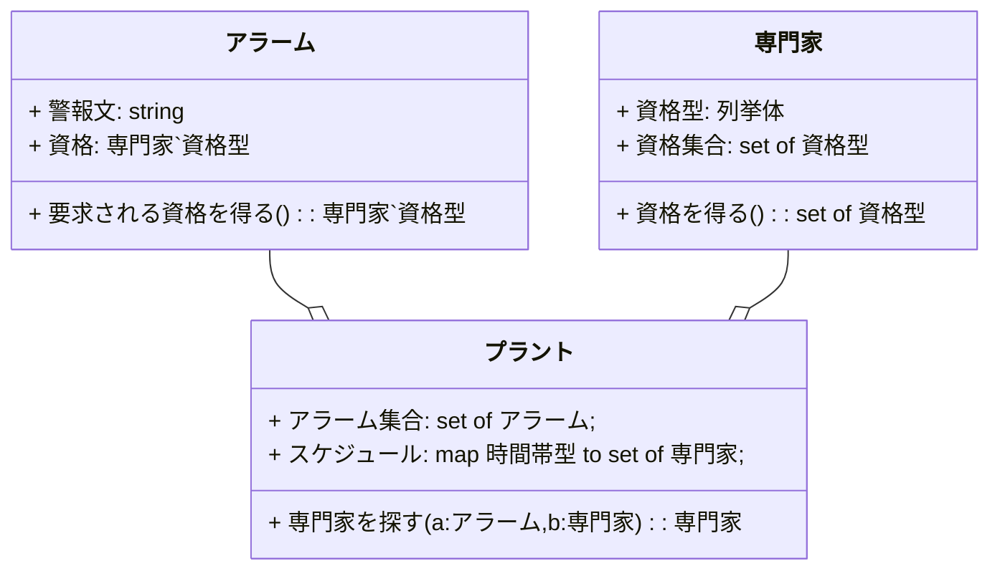

# はじめに
要求仕様記述段階での使用が主に想定されている数学的形式手法VDM(Vienna Development Method)[^1]のオブジェクト指向拡張言語VDM++の検証ツールWindows版[^2]を公式サイト[^3]からダウンロードして、お試し的に使ってみました。

## この記事の概要

九州大学さんが作成されたVDM++開発手法ガイドライン1.0[^4]で解説されているアルゴリズムの陰定義の事前条件、事後条件の数学的形式表現が一般的なプログラミング言語ではどのようなソースコードになるのかに興味があり、この例題の一部を同ツールのJavaコード生成機能で確認してみます。

## この記事内容の作業環境
Windows11 Pro 22H2  ※msvcr100SP1インストール済[^5]
The VDM++ Toolbox v9.0.7

# 化学プラントの例
VDM++開発手法ガイドラインでは化学プラントの簡単なアラームシステムの適用事例が説明されていて、UMLのクラス図として、「プラント」「専門家」「アラーム」の３つのクラスからなる構成が例示されています。

## 化学プラントアラームシステムの3つのクラス
それらのクラスをmermaidで記述しました。３クラスの関係としてはプラントクラスにアラームクラスと専門家クラスのインスタンス変数が含まれるとしています。本来は多重度を考慮したモデリングが必要です。


原文のクラス図ではクラス名に「〇〇クラス」と後装飾がされていますが、これは言語要件ではなく、わかりやすさのためにそのように命名しているものと解釈しています。mermaidで記述した上図のクラス図では、クラス名の「クラス」装飾は割愛しています。またお題の内容をわかりやすくするため、プラントクラスのメソッドは一部割愛しています。データ型の表記はVDM++に準じています。

# 化学プラントアラームシステムの3つのクラス定義
本記事の本題であります、数学的形式言語の事前条件・事後条件をJavaコード出力で確認するため、VDM++による基本的なクラス定義構文を確認します。クラス名の「クラス」装飾はそのままとしています。
## 「専門家」「アラーム」のクラス定義
### VDM++のクラス定義
以下にVDM++のクラス定義としてアラームクラス、専門家クラスの例を引用します。
```mind:VDM++
class アラームクラス
types
    public string = seq of char;
instance variables
    警報文: string;
    資格: 専門家クラス`資格型;
operations
    要求される資格を得る:()==>  専門家クラス`資格型
    要求される資格を得る()==
        is not yet specified;
end アラームクラス

class 専門家クラス
types
    public 資格型= <機械> | <化学> | <生物> | <電気>;
instance variables
operations
    資格を得る:()==>  set of 資格型
    資格を得る()==
        is not yet specified;
end 専門家クラス

```
VDM++のクラス定義構文には下記のセクション定義があります。（すべてではありません。）
**types** VDMデータ型定義セクション
**instance variables** クラスのインスタンス宣言セクション
**operations** 操作の宣言・定義セクション

## 「プラント」のクラス定義
### VDM++のクラス定義
以下にVDM++のクラス定義としてプラントクラスの例を引用します。「専門家を探す」以外のメソッドは割愛しています。

```mind:VDM++
class プラントクラス
types
    public 時間帯型= token;
instance variables
    アラーム集合: set of アラームクラス;
    スケジュール: map 時間帯型 to set of 専門家クラス;
--不変条件
inv
    forall p in set dom スケジュール& スケジュール(p) <> {};
inv forall a in set アラーム集合&
    forall p in set dom スケジュール&
    exists ex in set スケジュール(p) &
    a. 要求される資格を得る() in set ex. 資格を得る();

operations
    専門家を探す: アラームクラス* 時間帯型 ==> 専門家クラス
        専門家を探す(a, p) ==
            is not yet specified;
        --事前条件
        pre a in set アラーム集合and
            p in set dom スケジュール
        --事後条件
        post let ex = RESULT in
            ex in set スケジュール(p) and
            a. 要求される資格を得る() in set ex. 資格を得る();
end プラントクラス
```
**--** VDM++単行コメント　原文にはなく本記事筆者が原文説明文より追加
**pre** 「専門家を探す」操作の事前条件
**post**「専門家を探す」操作の事後条件
**inv**　不変条件

# 化学プラントアラームシステムの3つのクラス定義をVDM++検証ツールに読み込ませる
VDMToolsユーザマニュアルVDM++[^6] によるとソースファイルはWord形式またはRTF形式とあったので、前記クラス定義をWordPadにコピペして読み込ませようとしたのですが、VDM++検証ツール側の文字コード設定を既定のUTF-8からShift-JISに変えても、日本字部分が文字化けしているようで構文エラーが1行目から引っかかっているようでした。

ユーザマニュアルVDM++をよく読むとプレーンテキストでも読み込めるとありましたのでSamplesフォルダに格納されている拡張子.vppのテキストファイルのクラス定義のテンプレートに３つの定義をコピペして読み込ませました。文字コード設定はShift-JISで保存しています。ツール側設定がShift-JISのままのため。

前記のVDM++開発手法ガイドライン1.0記載のクラス定義に加えてメソッド側のアクセス装飾とか必要でした。最終的にJavaコード生成可能な状態となったクラス定義を以下に示します。

## 「専門家」「アラーム」のクラス定義
### VDM++のクラス定義
```mind:plant.vpp
\section{専門家クラス}

\begin{vdm_al}
class 専門家クラス
types
    public 資格型 = <機械> | <化学> | <生物> | <電気>;
instance variables
operations
    public 資格を得る:()==>  set of 資格型
    資格を得る()==
        is not yet specified;

end 専門家クラス

\end{vdm_al}
```
```mind:plant2.vpp
\section{アラームクラス}

\begin{vdm_al}
class アラームクラス
types
    public string = seq of char;
instance variables
    警報文: string;
    資格: 専門家クラス`資格型;
operations
    public 要求される資格を得る:() ==>  専門家クラス`資格型
    要求される資格を得る()==
        is not yet specified;
end アラームクラス

\end{vdm_al}
```
## 「プラント」のクラス定義
### VDM++のクラス定義
```mind:plant3.vpp
\section{プラントクラス}

\begin{vdm_al}
class プラントクラス
types
    public 時間帯型= token;
instance variables
    アラーム集合: set of アラームクラス;
    スケジュール: map 時間帯型 to set of 専門家クラス;
inv
    forall p in set dom スケジュール& スケジュール(p) <> {};
inv forall a in set アラーム集合&
    forall p in set dom スケジュール &
    exists ex in set スケジュール(p) &
    a. 要求される資格を得る() in set ex. 資格を得る();
operations
    専門家を探す: アラームクラス * 時間帯型 ==> 専門家クラス
    専門家を探す(a, p) ==
        is not yet specified
    pre a in set アラーム集合 and
        p in set dom スケジュール
    post let ex = RESULT in
        ex in set スケジュール(p) and
        a. 要求される資格を得る() in set ex. 資格を得る();
end プラントクラス

\end{vdm_al}
```

# VDM++検証ツールに読み込ませたファイルとフォルダの構成
```
examples\test\plant.vpp
examples\test\plant2.vpp
examples\test\plant3.vpp
examples\test\test.opt
examples\test\test.prj
examples\test\test.wgm
```
examplesフォルダ配下のサブフォルダにはツール付属のファイルがたくさん格納されています。クラスを名前空間風にフォルダに分けるのもありなのかもしれません。今回は１つのフォルダtestにtestプロジェクトとして３つのクラス定義ファイル.vppを格納しています。

## Javaコード生成後のファイルとフォルダの構成
上記のソースコードファイルとプロジェクトファイルを除くと下記のようなファイルとサブフォルダが生成されました。
```
examples\test\アラームクラス.java
examples\test\プラントクラス.java
examples\test\専門家クラス.java
examples\test\external_アラームクラス.java
examples\test\external_プラントクラス.java
examples\test\external_専門家クラス.java
examples\test\quotes
examples\test\quotes\化学.java
examples\test\quotes\生物.java
examples\test\quotes\電気.java
```

# 生成されたJavaコード
本記事の本題、数学的形式言語の事前条件・事後条件をJavaコード出力で確認することにありますので、ずばりプラントクラス.javaのコード内容を見てみます。
## プラントクラス.java
```java:プラントクラス.java
//
// THIS FILE IS AUTOMATICALLY GENERATED!!
//
// Generated at 2023-10-21 by the VDM++ to JAVA Code Generator
// (v9.0.7 - Sat 09-Jun-2018 10:11:21 +0900)
//
// ***** VDMTOOLS START Name=HeaderComment KEEP=NO
// ***** VDMTOOLS END Name=HeaderComment

// This file was genereted from "C:\\Documents\\examples\\test/plant3.vpp".

// ***** VDMTOOLS START Name=package KEEP=NO
// ***** VDMTOOLS END Name=package

// ***** VDMTOOLS START Name=imports KEEP=NO
import java.util.Map;
import java.util.Set;
import java.util.HashMap;
import java.util.HashSet;
import java.util.Iterator;
import jp.vdmtools.VDM.UTIL;
import jp.vdmtools.VDM.Token;
import jp.vdmtools.VDM.Sentinel;
import jp.vdmtools.VDM.EvaluatePP;
import jp.vdmtools.VDM.CGException;
// ***** VDMTOOLS END Name=imports


public class プラントクラス implements EvaluatePP {

// ***** VDMTOOLS START Name=アラーム集合 KEEP=NO
  private volatile Set アラーム集合 = new HashSet();
// ***** VDMTOOLS END Name=アラーム集合

// ***** VDMTOOLS START Name=スケジュール KEEP=NO
  private volatile Map スケジュール = new HashMap();
// ***** VDMTOOLS END Name=スケジュール

// ***** VDMTOOLS START Name=sentinel KEEP=NO
  volatile プラントクラスSentinel sentinel;
// ***** VDMTOOLS END Name=sentinel


// ***** VDMTOOLS START Name=プラントクラスSentinel KEEP=NO
  class プラントクラスSentinel extends Sentinel {

    public final int 専門家を探す = 0;

    public final int nr_functions = 1;

    public プラントクラスSentinel () throws CGException {}

    public プラントクラスSentinel (EvaluatePP instance) throws CGException {
      init(nr_functions, instance);
    }

  }
// ***** VDMTOOLS END Name=プラントクラスSentinel

// ***** VDMTOOLS START Name=evaluatePP#1|int KEEP=NO
  public Boolean evaluatePP (int fnr) throws CGException {
    return Boolean.TRUE;
  }
// ***** VDMTOOLS END Name=evaluatePP#1|int

// ***** VDMTOOLS START Name=setSentinel KEEP=NO
  public void setSentinel () {
    try {
      sentinel = new プラントクラスSentinel(this);
    }
    catch (Exception e) {
      System.out.println(e.getMessage());
    }
  }
// ***** VDMTOOLS END Name=setSentinel

// ***** VDMTOOLS START Name=child KEEP=NO
  protected external_プラントクラス child = new external_プラントクラス(this);
// ***** VDMTOOLS END Name=child

// ***** VDMTOOLS START Name=vdm_init_プラントクラス KEEP=NO
  private void vdm_init_プラントクラス () {
    try {
      setSentinel();
    }
    catch (Exception e) {
      e.printStackTrace(System.out);
      System.out.println(e.getMessage());
    }
  }
// ***** VDMTOOLS END Name=vdm_init_プラントクラス

// ***** VDMTOOLS START Name=inv_プラントクラス KEEP=NO
  public Boolean inv_プラントクラス () {
    Boolean rexpr_2 = null;
    boolean tmpQuant_4 = true;
    final Set e1_set_7 = new HashSet(スケジュール.keySet());
    Set tmpSet_14 = new HashSet(e1_set_7);
    for (Iterator enm_13 = tmpSet_14.iterator(); enm_13.hasNext() && tmpQuant_4; ) {
      final Token p = (Token)enm_13.next();
      if (UTIL.equals((Set)スケジュール.get(p), new HashSet())) {
        tmpQuant_4 = false;
      }
    }
    if (tmpQuant_4) {
      boolean tmpQuant_16 = true;
      Set tmpSet_37 = new HashSet(アラーム集合);
      for (Iterator enm_36 = tmpSet_37.iterator(); enm_36.hasNext() && tmpQuant_16; ) {
        final アラームクラス a = (アラームクラス)enm_36.next();
        boolean tmpQuant_19 = true;
        final Set e1_set_22 = new HashSet(スケジュール.keySet());
        Set tmpSet_35 = new HashSet(e1_set_22);
        for (Iterator enm_34 = tmpSet_35.iterator(); enm_34.hasNext() && tmpQuant_19; ) {
          final Token p = (Token)enm_34.next();
          boolean tmpQuant_24 = false;
          final Set e1_set_28 = (Set)スケジュール.get(p);
          Set tmpSet_33 = new HashSet(e1_set_28);
          for (Iterator enm_32 = tmpSet_33.iterator(); enm_32.hasNext() && !tmpQuant_24; ) {
            final 専門家クラス ex = (専門家クラス)enm_32.next();
            if (UTIL.Contains(ex.資格を得る(), a.要求される資格を得る())) {
              tmpQuant_24 = true;
            }
          }
          if (!tmpQuant_24) {
            tmpQuant_19 = false;
          }
        }
        if (!tmpQuant_19) {
          tmpQuant_16 = false;
        }
      }
      rexpr_2 = Boolean.valueOf(tmpQuant_16);
    }
    else {
      rexpr_2 = Boolean.FALSE;
    }
    return rexpr_2;
  }
// ***** VDMTOOLS END Name=inv_プラントクラス

// ***** VDMTOOLS START Name=プラントクラス KEEP=NO
  public プラントクラス () throws CGException {
    this.vdm_init_プラントクラス();
  }
// ***** VDMTOOLS END Name=プラントクラス

// ***** VDMTOOLS START Name=専門家を探す#2|アラームクラス|Token KEEP=NO
  private 専門家クラス 専門家を探す (final アラームクラス a, final Token p) throws CGException {
    sentinel.entering(sentinel.専門家を探す);
    try {
      if (!this.pre_専門家を探す(a, p).booleanValue()) {
        UTIL.RunTime("Precondition failure in 専門家を探す");
      }
      return child.impl_専門家を探す(a, p);
    }
    finally {
      sentinel.leaving(sentinel.専門家を探す);
    }
  }
// ***** VDMTOOLS END Name=専門家を探す#2|アラームクラス|Token

// ***** VDMTOOLS START Name=pre_専門家を探す#2|アラームクラス|Token KEEP=NO
  private Boolean pre_専門家を探す (final アラームクラス a, final Token p) throws CGException {
    return Boolean.valueOf(UTIL.Contains(アラーム集合, a) ? スケジュール.containsKey(p) : false);
  }
// ***** VDMTOOLS END Name=pre_専門家を探す#2|アラームクラス|Token

}


```
**pre** 「専門家を探す」操作の事前条件
```java:
private Boolean pre_専門家を探す (final アラームクラス a, final Token p) throws CGException {
    return Boolean.valueOf(UTIL.Contains(アラーム集合, a) ? スケジュール.containsKey(p) : false);
  }
```
**post**「専門家を探す」操作の事後条件
private Boolean post_専門家を探す　のような関数定義は出力されないようでした。
**inv**　不変条件
```java:
public Boolean inv_プラントクラス () {
    //長大なので割愛
}
```
# おわりに
まったく先入観なくどんなJavaコードが生成されるのかと、わくわくしておりました。ただし、生成されたコードを見てけっこう長いと感じたことから、実際に生成されたコードより短いものを暗黙には想定していたようです。

また、下記のようなツール依存の名前空間のパッケージが使われることは、まったく想像していませんでした。プラントクラス内で定義されるプラントクラスSentinelクラスはVDM.Sentinelを継承するようです。このインスタンス変数も重要な役割を担っている模様。
```java:
import jp.vdmtools.VDM.UTIL;
import jp.vdmtools.VDM.Token;
import jp.vdmtools.VDM.Sentinel;
import jp.vdmtools.VDM.EvaluatePP;
import jp.vdmtools.VDM.CGException;
```
今回の記事では、例題のクラスの概要やクラス定義の説明に大半をついやしていますので、続きの記事を作成してもう少し深堀してみます。（予定は未定）

[^1]: IBMのウィーン研究所で1960年代から70年代にかけて開発された形式手法。その実装には1996年にISO標準（ISO_IEC_13817-1）となったVDM-SLと、そのオブジェクト指向拡張のVDM++がある。
[^2]: FMVDM　[VDMTools VDMTools](http://fmvdm.org/vdmtools/index-ja.html)
[^3]: FMVDM　[VDMTools リリース版 (9.0.7) Windows VDM++](http://fmvdm.org/VDMTools/Windows/setuppp-9.0.7-vs10-x64.exe)
[^4]: FMVDM-> github [[PDF] VDMTools VDM++開発手法ガイドライン1.0 2016](https://github.com/vdmtools/vdmtools/raw/stable/doc-jp/guidelines/guidelines_a4J.pdf)
[^5]: Qiita [「MSVCR100.dllが見つからない」の解決策](https://qiita.com/mylifewithviolin/items/7c9a6f39b73bdd9235af) 参照
[^6]: FMVDM-> github [VDMTools ユーザマニュアル VDM++](https://github.com/vdmtools/vdmtools/raw/stable/doc-jp/user-man/usermanpp_a4J.pdf)
