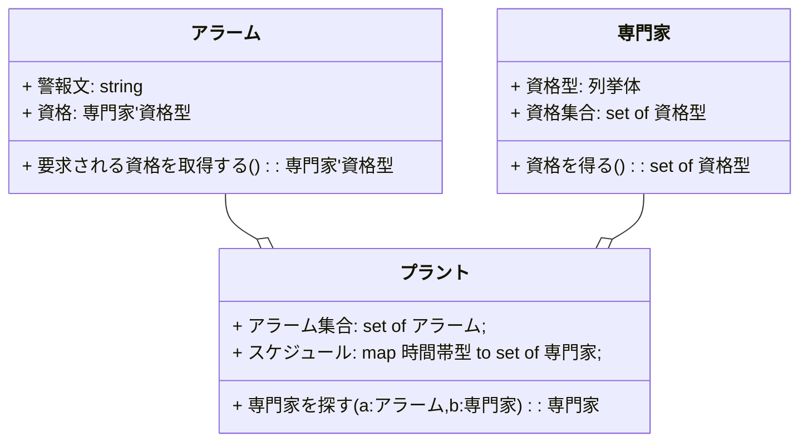

# はじめに
上流工程ではどの程度日本語が使われているのかを調査するため、要求仕様記述段階での使用が主に想定されているVDM(Vienna Development Method)[^1]の具体的な記述例を引き続き調査しました結果[^2][^3] 九州大学さんが日本語のVDM++言語マニュアルとVDM++開発手法ガイドライン1.0を作成していることを発見しました。この記事では、その開発手法ガイドラインを読み解いてみます。文の意味がわかりずらい場合はVDM++言語マニュアルの記述も引用します。

## 対象読者
システムエンジニアさん。

# 関連リンク
FMVDM　[VDMTools 付属文書](http://fmvdm.org/doc/index-ja.html)

FMVDM-> github [[PDF] VDMTools VDM++開発手法ガイドライン1.0 2016](https://github.com/vdmtools/vdmtools/raw/stable/doc-jp/guidelines/guidelines_a4J.pdf)

FMVDM-> github [[PDF] VDMTools VDM 言語マニュアル VDM++](https://github.com/vdmtools/vdmtools/raw/stable/doc-jp/lang-man/langmanpp_a4J.pdf)

# アルゴリズム定義
VDM++開発手法ガイドラインを読み解くにあたり、マスト要件の概念理解として言語マニュアル VDM++の「5 アルゴリズム定義」よりパワーワードをピックアップする。

VDM++ では、アルゴリズムが関数と操作の両方により定義できる。

## アルゴリズムの陽定義と陰定義
手順的に明確な明示的なアルゴリズム定義を「陽に」定義すると呼んでいる。後述する拘束条件により定義されるアルゴリズム定義を「陰に」定義すると呼んでいる。
## 関数
グローバル変数にアクセスすることはできないしローカル変数を定義することもできない。本来の数学的意味での関数に近い概念。
**式**
「関数」に対する明示的なアルゴリズム定義を「式」と呼んでいる。
## 操作
グローバル変数と一定の条件のローカル変数の両方を扱うことができる。構造化プログラミング言語の「関数」はこちらよりの概念。
**文**
「操作」に対する明示的なアルゴリズム定義を「文」と呼んでいる。

# アルゴリズムの陰定義
関数と操作の実行前後の拘束条件である、事前条件または事後条件によってアルゴリズムが陰に定義できるとされている。
## 不変条件
関数や操作が評価される前後に関わらず
定義された型が何を必ず保持していなくてはならないかを指定するtrueの値をとる式
## 事前条件
関数や操作が評価される前に
定義された型が何を保持していなくてはならないかを指定するtrueの値をとる式
## 事後条件
関数や操作が評価された後に
定義された型が何が保持されなければならないかを指定するtrue の値をとる式


# 化学プラントの例
VDM++開発手法ガイドラインでは化学プラントの簡単なアラームシステムの適用事例が説明されている。

## 3つのクラス
UMLのクラス図として、「プラント」「専門家」「アラーム」の３つのクラスが例示されている。原文のクラス図ではクラス名に「〇〇クラス」と後装飾がされているが、これは言語要件ではなく、わかりやすさのためにそのように命名しているものと解釈した。mermaidで記述した下図のクラス図では、クラス名の「クラス」装飾は割愛した。

### UMLのクラス図のプロパティ≒VDM++型のデータ
前節での明示は割愛しているが、VDM++のデータ型には、集合演算用のものもあったり、構造化プログラミング言語の静的な型付け変数とは異なるタイプのものもあるが、総じて変数のようなものとその型の情報が定義される。

### UMLのクラス図のメソッド≒VDM++の操作
VDM++開発手法ガイドラインではUMLのクラス図のメソッドに対応するものとしては、VDM++の「操作」によって例示されている。
「専門家」「アラーム」の２つのクラスには当初メソッドはない。getter/setter的なメソッドがあるのかないのかはここでは問題にしない。事後条件との関係で追加される。
VDM++のクラス定義においては「操作」に限定されない。

## プラントクラス
以下にVDM++のクラス定義としてプラントクラスの例を引用する。「専門家を探す」以外のメソッドは割愛。
```mind:VDM++
class プラントクラス
types
    public 時間帯型= token;
instance variables
    アラーム集合: set of アラームクラス;
    スケジュール: map 時間帯型 to set of 専門家クラス;
operations
    専門家を探す: アラームクラス* 時間帯型==> 専門家クラス
    専門家を探す(a, p) ==
        is not yet specified;
...
end プラントクラス
```
VDM++のクラス定義においてはセクショントークンが存在する。この日英混合文的な雰囲気には好みが分かれるかもしない。
筆者的には、テーブル名や列名が日本語の状態のSQL文が連想される。適度に英字が混じると区切れてわかりやすいと感じるのが筆者の感覚。

# モデルをより厳密にするとは
ここからが本題となる。これまでのところはオブジェクト指向モデリングが少しセクション分けされたというイメージにとどまっている。ここからVDM++的な味付け、アルゴリズムの陰定義が始まる。

## 不変条件の追加
不変条件とは、関数や操作が評価される前後に関わらず定義された型が何を必ず保持していなくてはならないかを指定するtrueの値をとる式のことであったが、ここでは具体的にはスケジュールのインスタンスの条件として付加されている。この表記は直感的にはわかりにくい。
スケジュールとはあくまで専門家のスケジュールなのだから、誰かしら割り当てられている時間帯がスケジュールなのであって、スケジュールには専門家が割り当てられていない時間帯というものはないといったことを示している。
```mind:VDM++
class プラントクラス
...
instance variables
    アラーム集合: set of アラームクラス;
    スケジュール: map 時間帯型to set of 専門家クラス;
inv
    forall p in set dom スケジュール& スケジュール(p) <> {};
...
end プラントクラス
```

## 事前条件の追加
事前条件とは、関数や操作が評価される前に定義された型が何を保持していなくてはならないかを指定するtrueの値をとる式のことであったが、ここでは具体的には「専門家を探す」操作にどんなアラームクラスも時間帯型も扱えるわけではないことを示している。この表記は直感的にはわかりにくい。
引数aのアラームクラスはアラーム集合の一部でなければならず、引数pの時間帯はスケジュールに登録されたものであるといったことを示している。
```mind:VDM++
class プラントクラス
...
operations
    専門家を探す: アラームクラス* 時間帯型==> 専門家クラス
    専門家を探す(a, p) ==
        is not yet specified
    pre a in set アラーム集合and
        p in set dom スケジュール
...
end プラントクラス
```

## 事後条件の追加
事後条件は、関数や操作が評価された後に定義された型が何が保持されなければならないかを指定するtrue の値をとる式のことであったが、ここでは具体的には「専門家を探す」操作に、専門家はアラームを扱うための正しい資格を持つことをチェックすることが追記されている。そのためクラス定義内では記述を割愛したほかの操作「要求される資格を得る」「資格を得る」が呼び出されている。ここで若干手続き的な雰囲気が醸し出された。
```mind:VDM++
class プラントクラス
...
operations
    専門家を探す: アラームクラス* 時間帯型==> 専門家クラス
    専門家を探す(a, p) ==
        is not yet specified
...
    post let ex = RESULT in
        ex in set スケジュール(p) and
        a. 要求される資格を得る() in set ex. 資格を得る();
...
end プラントクラス
```

# おわりに
駆け足ではありましたが、九州大学の「VDM++開発手法ガイドライン」を読み解いてみました。本篇では上記のあとに、更新された不変条件や正当性確認について解説されています。この点については本記事の続編として改めて記述してみたいところです。


[^1]: IBMのウィーン研究所で1960年代から70年代にかけて開発された形式手法。その実装には1996年にISO標準（ISO_IEC_13817-1）となったVDM-SLと、そのオブジェクト指向拡張のVDM++がある。
[^2]: Qiita [IPA (独)情報処理推進機構の「厳密な仕様記述入門」を読み解く - 要求仕様 形式記述言語VDM/VDM++](https://qiita.com/mylifewithviolin/items/57d8acad91f940360739) 参照
[^3]: Qiita [要求仕様 形式記述言語VDM++ 識別子として日本語は使われているのか](https://qiita.com/mylifewithviolin/items/1a7ed468bdd228046ad2) 参照
