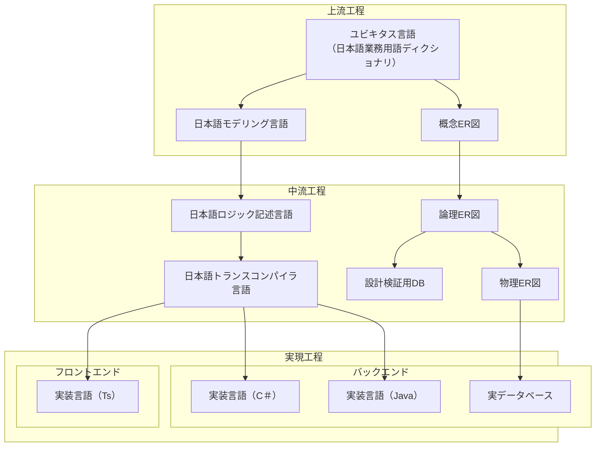

# はじめに

日本語プログラミング言語をモデリング言語としてシステム開発上中流工程に導入した場合、そのメリット・デメリットについて考察する記事の2回目です。

本記事の内容はいくつかに分割されて記載されます。本記事中の「本記事」とは分割された内容の総体を指す場合があります。

https://qiita.com/advent-calendar/2023/remind

この記事は日本語構造化仕様記述言語 Re:Mind（リマインド）アドベントカレンダー2023の11日向けの記事です。

## 対象読者
とりあえずこの記事の想定読者はシステムエンジニアさんです。とくに日本語で要求仕様や内部設計資料を書いている方向けのお話です。

実装ご担当者の方も引き受けた実装の内部設計書がぐだぐだで完成納期だけが迫られるという体験をされたことあるかと思いますので、そのような方にとっても参考になればと考えております。

# 想定しているシステム開発フロー
[前回の初回の記事](https://qiita.com/mylifewithviolin/items/b7cc85911507cf1a2a55)ではオーソドックスなリレーショナルデータベースを使用している業務システムを想定していると書きましたが、もう少しだけ具体的にその業務システムはレイヤードアーキテクチャを想定して設計・開発されるとします。

よくありうるのは最終的な実装言語が各レイヤーによって異なる場合があることです。本記事ではその点を考慮して進めてまいります。

少し図が複雑化しますが、もっともシンプルな原型については、お手数ですが前回記事をご参照ください。

# 各工程のレイヤーの扱い
上図の概念図では、実装工程だけレイヤーにわかれているようにも見えますが、上中流でそのように見えないのは、モデリング設計言語が一貫しているためです。

レイヤーにわけて設計しないという意味ではなく、同じ言語を使ってそれぞれのレイヤー向けのクラスなどをモデリングします。

トランスコンパイラ層では、実際はターゲット言語によるアノテーションの違いや細かい点での差異は許容するとしています。また、実装言語の差異は細かいので、実装専門の人材が各レイヤーの実装言語をすべて対応できる場合は多くありますが、設計者レベルでは実装言語にそこまで詳しくないので、実装言語の些末さを除いたレベルで適切なロジックを考案設計できる必要があります。

前回で上中流工程での「完成」について前ブレ的に触れておりますが、のちの記事で詳しく説明していくとして、今回の図ではデータベース設計のルートに設計検証用DBというものを記述しています。

# この回のまとめ
この記事のテーマは上中流の設計品質と生産性を向上させる可能性について検討することです。
デザインレビューの判定基準が、各工程の成果物の書き味に立ち入らない場合は、往々にして日程消化の都合上不安定な成果物が後工程の「実現工程」に投入されることにより、「実現工程」の担当者に負荷のしわ寄せがおそいかかるという状況を避けられないものかという問題意識を含んでいます。

# 次回
~~各工程の詳細について検討してきます。~~
レイヤードアーキテクチャ について補足します。
