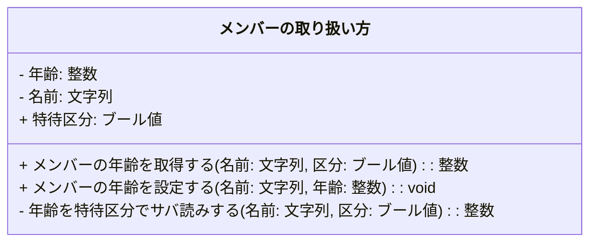
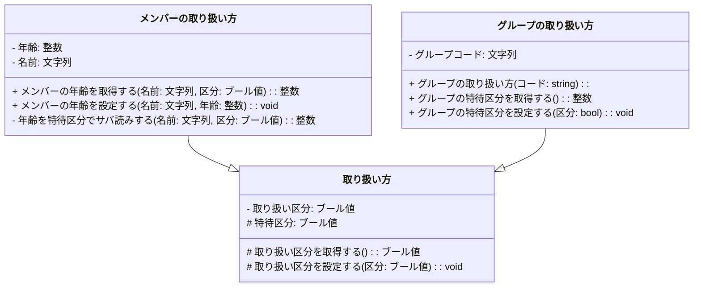
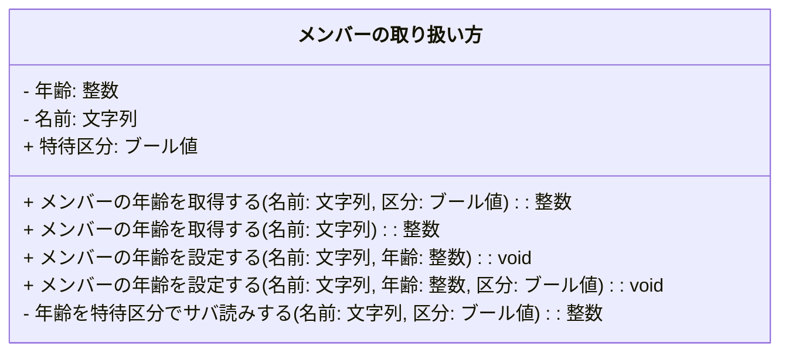
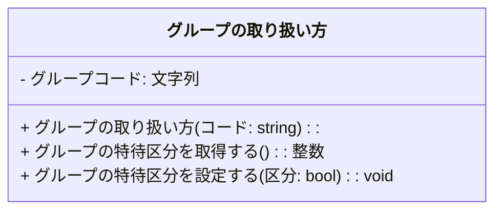
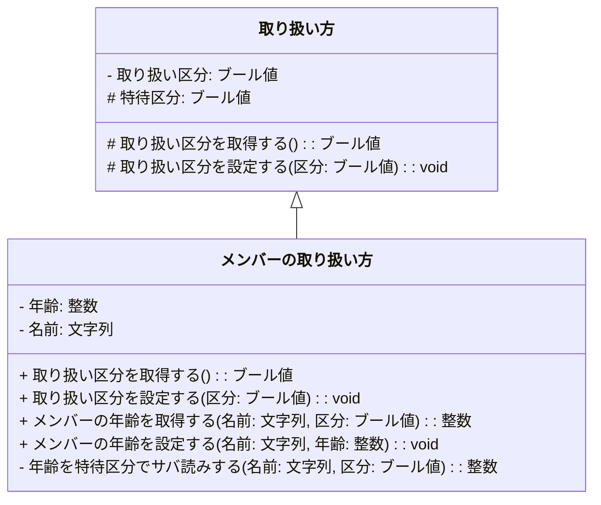

# はじめに
プログラミング初心者が様々なことを大量に覚えようとする前にまず認識すべき重要な点についてまとめてみました。

## 対象読者
プログラミングに関心を持たれた超初心者または業務上やむなくプログラミングをしないといけない方（経験なし）

## 前提
この記事を閲覧くださったあなたが、まさに前記対象読者に該当する場合、もしもまだ
[プログラミング初心者が強く認識すべき３大ロジック構造□[順次]◇[分岐]○[反復]＋[割込み]](https://qiita.com/mylifewithviolin/items/c5613eda58bf552d7bf6)
という記事をご覧になっていないのであれば、ぜひこちらの記事を読んでから本記事にもどってきてほしいのです。

その理由　対象読者となる方は必ず読んでね

なぜなら、本記事のオプジェクト指向プログラミングの考え方よりも、構造化プログラミングの基礎的な考え方をマスターするのが、プログラミング初心者のあなたにとって優先事項とわたしは考えるからです。

プログラミングを職業とすることをめざすあなたの将来のコア・コンピンタンス[^1] は、さまざまなはやりすたりを経ていく個々のプログラミング言語の詳細を把握することではなく、（新しい言語を速やかに習得できることが望ましいこと自体を否定するものではありません。）複雑な現実対象から要求されるロジックを処理するアルゴリズムの発案・具現化・実装する能力にあると確信しています。

**アルゴリズムの発案・具現化・実装の基礎となる思考フォーマットは、どこまでいっても３大ロジック構造□[順次]◇[分岐]○[反復]の組み合わせ**であり、これから説明するオブジェクト指向の考え方はそれらをより安全に保管し、効率よく再利用したり、より生産性をあげるための方法論です。（アルゴリズム発案～の応用能力として、オブジェクト指向の構造を取り入れることを否定するものではありません。）

# オブジェクト指向プログラミングの３大概念とは
本題に入る前に、まずいったんオブジェクト指向プログラミングをめぐる重要ワードについて押さえておきます。
## データとアルゴリズム
### アルゴリズムとは
**アルゴリズム**は、問題を解決するための手順やロジックを指します。とくに、コンピュータを使って問題を解決する際に沿う手順のことで、**その基本的なロジックフォーマットは□[順次]◇[分岐]○[反復]の組み合わせ**です。その手順の呼び出し口をメソッドとこの記事では呼ぶとします。

### データとは
**データ**は、コンピューターの処理対象となるファクト情報のことで、状態・条件などを表す数値（と文字。記号含む、複数からなる場合は文字列という。これらはコード化されて数値で表現されます。）からなります。図形、図形的文字、画像、動画、音声などもこれで表現します。[^2]
ロジックの2大構造◇[分岐]○[反復]では、判定条件として必須となります。□[順次]であってもなんらかの処理対象としてデータが使われます。
プログラミング言語上はさまざまな「変数」に格納されます。

### データ構造とは
**データ構造**は、データを効率的に管理するための整理方法で、データの集合体やその出し入れの方法に依存したデータの管理方法などを指します。
データの出し入れ方法としてスタック、キューは重要で、いまは理解しなくてもよいですが、方法は手順なのでアルゴリズムと密着します。

## オブジェクト指向プログラミングのオブジェクトとは
**オブジェクト**は、データとアルゴリズムがセットになったプログラミング言語上の定義情報、または実行可能な状態でメモリに展開された実体を指します。オブジェクトというと、どちらかという後者よりのイメージで、前者の定義情報はオブジェクトの定義としてクラスとも呼ばれます。
オブジェクト指向プログラミング言語上、後者よりの意味のオブジェクトはおおむねデータ寄りの概念の変数として扱われます。実装定義されているアルゴリズムやロジックは、変数名を装飾してその手順名を呼び出します。
## オブジェクト指向プログラミングの３大概念とは
隠ぺい、継承、多態の３つのオブジェクト制御構造によって処理の流れを記述することをブジェクト指向プログラミングといいます。

**1．隠ぺい（カプセル化）** データやデータ構造、アルゴリズムをブラックボックス化して、オブジェクトの定義情報の詳細がわからなくても、実行・利用できること。
**2．継承（インヘリタンス）** オブジェクトの定義情報を再利用する方法で、ある特徴をもつオブジェクトの共通事項をまとめて、単一の定義情報として、個別のオブジェクトはその差分だけを定義すること。共通事項となりえるのはデータとアルゴリズム双方です。
**3．多態（ポリモーフィズム）** 前記継承により親子関係にあるオブジェクトに対して、親のアルゴリズムをちょい変更して子から呼び出すときは、親のメソッド名と同じ名前で呼び出したり、または、単一のあるオブジェクトの中で同じまたは異なるデータに対して同じような操作をする場合、メソッド名の重複を許容すること。[^3]

# Mermaidによる３大概念のクラス図
オブジェクトの定義情報のクラスをMermaidを使って図示してみます。
### 隠ぺい・カプセル化
下図の３段組みの四角は、１つ目はオブジェクトの定義名称、２つ目はデータの構成情報（データ変数名）、３つ目は定義されているアルゴリズム（ロジック）の呼び出し方法（呼び出し名メソッド名、引き渡す外部のデータのセット位置など）からなる情報です。

オブジェクトが保持するデータ、データ構造は、オブジェクトが保持するアルゴリズムを呼び出すメソッドを介してのみ操作可能といった状態を指します。上図の記述ルールでは先頭に-記号がついているのが隠ぺいされた変数で、+記号のメソッドが公開されたものとなります。メソッドの中身は通常隠ぺいされた状態で使用します。

単純な単一の変数の参照、更新のためget/setなどの名称で始まるメソッドが定義実装される場合がありますが、変数についてはそのまま操作してよいですよとする場合があります。上図では+記号の変数となります。

また、オブジェクトが呼び出すアルゴリズムのメソッドの下請けアリゴリズムのメソッドはオブジェクト内部からしか実行できないとすることができます。上図では-記号のメソッドとなります。

+記号のメソッドはメソッド名からだいたい何をやっているかはわかる場合があり、そのレベルでソースコードの可読性を高めようという意図もあるのですが、実際のアルゴリズムの内容は公開されていないので、ほんとうはなにをやっているかわからないというのがカプセル化です。実際は正規の仕様として、呼び出し方や効能は説明が公開されます。

### 継承・インヘリタンス
下図あ3つのオブジェクトの定義情報の関係を図示しています。[メンバーの取り扱い方]と[グループの取り扱い方]は共通の取り扱い項目があるので、それらは共通の定義[取り扱い方]を起こし、それとの差分だけの定義としています。

上図の記述ルールでは先頭に#記号がついている変数、メソッドがオブジェクトの親子関係内で限定的に公開されたものとなります。親子関係にないオブジェクトからは-記号がついているのに等しい状態です。親の#記号がついている変数、メソッドは、子からみると+記号がついているのに等しい状態です。

[取り扱い方]の変数、取り扱い区分には-記号がついているので、[メンバーの取り扱い方]と[グループの取り扱い方]からは、[取り扱い方]の#記号がついているメソッドを介してしか操作できないことになります。

### 多態・多相・ポリモーフィズム
多態性・多相性・ポリモーフィズムには、前記継承関係の上での考え方と、単一のオブジェクト内での考え方があり、まずは後者を図示して、その後前者を図示します。
#### 単一オブジェクト内での多態性・ポリモーフィズム

公開メソッドの[メンバーの年齢を取得する][メンバーの年齢を設定する]がそれぞれ2つになっています。これはいったいどういうことを指すのでしょう。

これは、同じ[メンバーの年齢を取得する]メソッド名を使って、ほぼ同じことをするのだけれど、ちょこっと違う操作をしたい場合、だいたい同じことをやろうとしているのだけれど、ちょっと違うことをやるよということを、プログラミング言語の人間側の読者が汲み取りやすくするための方便です。

また、同一のオブジェクトの定義情報から、別の状態を保持するコンピュータ上のメモリに展開された実体情報を複数生成した場合、たとえば上図の[グループの取り扱い方]の定義情報をAとBを2つのグループコードで初期化して、別変数としますと、

□グループの取り扱い方 グループAの取扱方法 = グループの取り扱い方("A")
□グループの取り扱い方 グループBの取扱方法 = グループの取り扱い方("B")

それぞれのグループの取扱方変数で、同名のメソッドで異なる内部変数を操作するような場合も、多態性・ポリモーフィズムの考え方を反映しています。

□グループAの取扱方法.**グループの特待区分を設定する**(true)
□グループBの取扱方法.**グループの特待区分を設定する**(false)

・bool グループAの特待区分
・bool グループBの特待区分
□グループAの特待区分 = グループAの取扱方法.**グループの特待区分を取得する**()
□グループBの特待区分 = グループBの取扱方法.**グループの特待区分を取得する**()

#### 親子関係のオブジェクト内での多態性・ポリモーフィズム
下図は説明の都合上、ちょっと親子関係の上下関係を逆転して、親を上に持ってきています。

上図では親のオブジェクトの[取り扱い方]の#記号がついているメソッド[取り扱い区分を取得する][取り扱い区分を設定する]を子のオブジェクトの[メンバーの取り扱い方]でも重複定義しています。引数の型や数も同じです。

この場合も、同じ[取り扱い区分を設定する]メソッド名を使って、ほぼ同じことをするのだけれど、ちょこっと違う操作をしたい場合、だいたい同じことをやろうとしているのだけれど、ちょっと違うことをやるよということを、プログラミング言語の人間側の読者が汲み取りやすくするための方便です。

たとえば、親の[取り扱い区分を設定する]メソッドは、賞味、指定された値で取り扱い区分を設定するだけなのに対して、子の[取り扱い区分を設定する]メソッドは、子の持つ変数、特待区分の値によって、設定値が変化するとかのロジックを組んで、それからその中で親の[取り扱い区分を設定する]メソッドを呼び出して取り扱い区分を設定することが考えらます。

・取り扱い方 取扱方法
・メンバーの取り扱い方 メンバー取扱方法
□取扱方法.**取り扱い区分を設定する**(true)
□メンバー取扱方法.**取り扱い区分を設定する**(true)

上記の場合、□取扱方.取り扱い区分を設定する(true)は素直に取り扱い区分がtrueとなるのに対して、□メンバー取扱方.取り扱い区分を設定する(true)は、特待区分によっては取り扱い区分がfalseとなるとか、若干異なる挙動を示したい場合に有用です。

# おわりに
Javaなどのオブジェクト指向プログラミング言語のソースコードに触れる方が、そのよって立つ考え方を理解いただけるようコンテンツを追加してみました。

[^1]: コア・コンピタンス　ある企業の事業分野において、「競合他社に真似できない核となる能力」の事をさし、個人の能力の場合はその比喩。ひと言で表すとすると「得意分野」。
[^2]: 文字が数値の別表現であることは、プログラミング言語のソースコードの文字列も数値列に帰着し、それが定義しているアルゴリズムやロジックも最終的には0と1の数値からなるコンピュータ実行可能コードとなります。
[^3]: コンパイラ的には一意に識別できないといけないので、引数の数や型で区別します。
