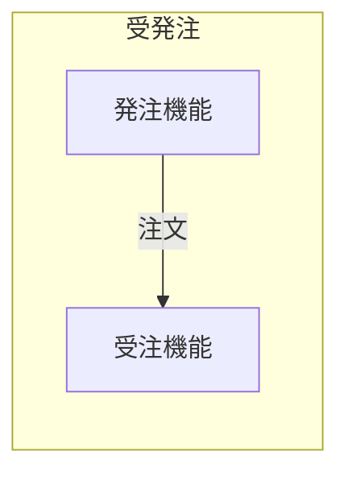
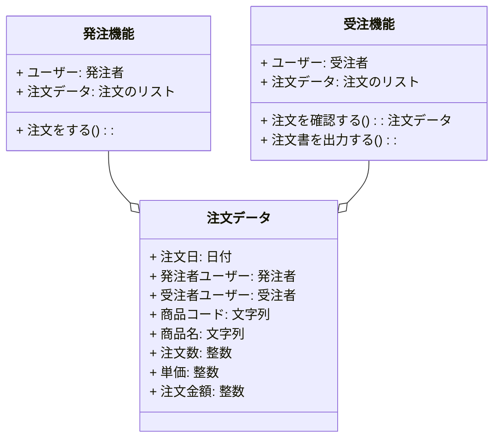
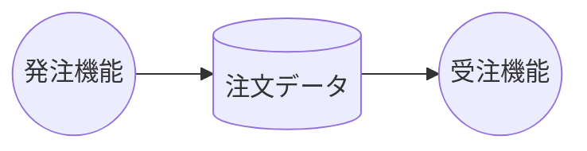

# はじめに

日本語プログラミング言語をモデリング言語としてシステム開発上中流工程に導入した場合、そのメリット・デメリットについて考察する記事の4回目です。

本記事の内容はいくつかに分割されて記載されます。本記事中の「本記事」とは分割された内容の総体を指す場合があります。

https://qiita.com/advent-calendar/2023/remind

この記事は日本語構造化仕様記述言語 Re:Mind（リマインド）アドベントカレンダー2023の13日向けの記事です。

## 対象読者
とりあえずこの記事の想定読者はシステムエンジニアさんです。とくに日本語で要求仕様や内部設計資料を書いている方向けのお話です。

# 想定しているレイヤードアーキテクチャ
[前回](https://qiita.com/mylifewithviolin/items/d10d59e98c4d2d7dca3d)はこの記事が想定している業務アプリケーションシステムが一般的なWebアプリケーションシステムで、帳票ツールの都合でバックエンドの実装言語がC#とJavaの2言語になっていることを説明しました。

# 想定している業務

上流工程のイメージの説明に入る前に、本記事が想定している業務内容について説明しておきます。下図のような簡単な受発注業務をインターネットで支援するシステムとします。

発注者は発注機能で注文を登録し、受注者は受注機能で注文を閲覧し、注文書をPDFなどでダウンロードできるとします。

具体的な業務システムとしては、受注者が登録した注文にどうやって発注者に気づかせるかとか実用上の機能要件はたくさんありますが、ここではとりあえずそれらはすべて割愛し、設計的な段取りが説明できる最小限の機能要件に単純化します。

クラス図で機能とデータを描くとみんなとりあえずクラスとなります。

ゲイン・サーソン式ではデータストアの記述が少々面倒なので、デマルコ式でデータフロー図を書いておきます。

# この回のまとめ
ざっくり上流工程の対象業務について説明しました。

# 次回
各工程の詳細について引き続き検討していきます。
