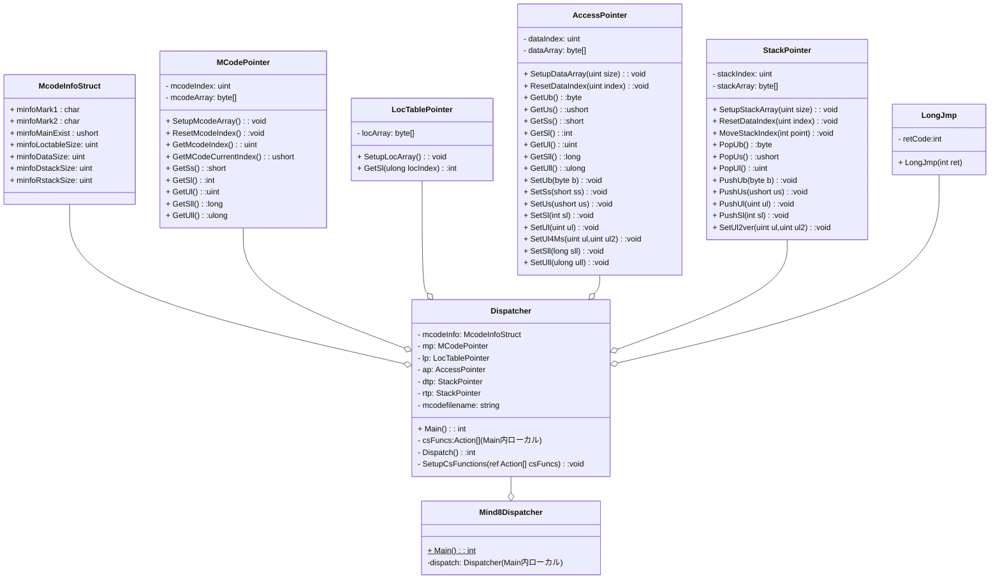

# はじめに
Mind8の中間コードディスパッチャ（の一部）をCからC#に書き換えてみるという野望として、Cのディスパッチャ配下の関数配列をC#で実装していましたのがちょうど２年前でした。

https://qiita.com/mylifewithviolin/items/151517f7a57b5b8b97f5

当時、Mind8のコンソールアプリのスタートアップに実は大量の中間コードの実装が横たわっており、「表示する」の完走到達の前に事実上息絶えていたのでした。しかし、昨今GitHubCopilotPro+の余裕のある推論量に触れて、もしかしてもしかしてこういう機械的なことって得意なのという気がしてきましたが、やらせてみる（やっていただく）ことにしました。

# お題のC#ソースコードのクラス構成
ここでC#ソースコードのクラス構成とファイル構成をおさらいしておきます。
お題のクラスをver.1.0でmermaidで記述しました。構造の概念把握が目的なのであまり細かい点の表記は気にしていません。メソッドの引数は割愛している場合があります。


## クラスの説明と対応ソースファイル構成
ファイル名の由来はオリジナルのCソースファイルです。C#デリゲートによる関数配列の実装を単一のCsFunctions.csから複数のソースファイルに分割しています。CsFunctions.csはprivate void SetupCsFunctionsの定義だけでとなっており、個々の関数の実装は各ファイルに分散しています。

| クラス名 | 概要 | 対応ソースファイル |
|:-|:-|:-|
|Mind8Dispatcher|Windowsコンソールアプリのホストクラス|Mind8Dispatch.cs|
|Dispatcher|ディスパッチャ本体クラス|Dispatcher.cs|
||C#デリゲートによる関数配列(配列定義)|CsFunctions.cs|
||0ker.cのC#実装|CsFunctions0ker.cs|
||1ker.cのC#実装|CsFunctions1ker.cs|
||2ker0.cのC#実装|CsFunctions2ker0.cs|
||2ker2.cのC#実装|CsFunctions2ker2.cs|
||3ker.cのC#実装|CsFunctions3ker.cs|
||bunki.cのC#実装|CsFunctionsBunki.cs|
||compword.cのC#実装|CsFunctionsCompword.cs|
||dispword.cのC#実装|CsFunctionsDispword.cs|
|McodeInfoStruct|Mcode情報構造体|Dispatcher.cs|
|LongJmp|広域ジャンプ用のアプリケーション例外|Dispatcher.cs|
|MCodePointer|Mcode領域アクセスクラス|MCodePointer.cs|
|LocTablePointer|Locテーブルアクセスクラス|LocTablePointer.cs|
|AccessPointer|データ領域アクセスクラス|AccessPointer.cs|
|StackPointer|スタッククラス|StackPointer.cs|

# 使用AI
## Microsoft Copilot
Windows11アプリケーションのMicrosoft Copilot。昨年末から日本語プログラミング言語あおい Aoi（Re:Mind）の原型を作成してもらった生成AI[^2][^3][^4]。モードは「無料プラン」。
## GitHub Copilot
GitHub CopilotのPro+版。あおい実装[^1]と検証の主担当。スーパバイザとしてMicrosoft Copilotを使いGitHub CopilotのCodeAgent推論量を最小化するプロンプトをCopilotで生成しGitHub CopilotのCodeAgentで実行という工法？を採用しています。

## Dispatcherクラス（C#関数配列）
ディスパッチャ本体クラスのC#関数配列部分です。
### SetupCsFunctions C#の関数配列を準備する
この関数配列の中身を実装するのがキモとなります。現在の実装中の関数は下記のとおりです。
<details><summary>CsFunctions.cs</summary>

```cs:CsFunctions.cs

using System.Dynamic;
namespace Mind8Kernel
{

    public partial class Dispatcher
    {
        private readonly int maxCountCsFunctions = 1 + 0x026D;
        /// <summary>C#の関数配列を準備する</summary>
        /// <param name="csFunc">C#関数配列の参照</param>
        private void SetupCsFunctions(ref Action[] csFuncs){
            Encoding.RegisterProvider(CodePagesEncodingProvider.Instance);
            csFuncs=new Action[maxCountCsFunctions];
        /*--------------------- 実行  -----------------------------------*/
            csFuncs[0x0010]=ZzEndExecute;//不完全要注意
            csFuncs[0x0011]=Jikkou;//不完全要注意
            csFuncs[0x0012]=Musyori;//
            csFuncs[0x0013]=EmgcyExit;
            csFuncs[0x0014]=ProcessOwari;
        /*--------------------- スタックポインタのアクセス  --------------*/
            csFuncs[0x0015]=StackKensa0;
            csFuncs[0x0016]=StackReset;//
            csFuncs[0x0017]=FinishDispatcher;
            csFuncs[0x0018]=C_stack_data_no;
        /*--------------------- $$RESERVE[nL]  --------------------------*/
            csFuncs[0x0019]=ZzReserve1L;
            csFuncs[0x001A]=ZzReserve2L;
            csFuncs[0x001B]=ZzReserve3L;
            csFuncs[0x001C]=ZzReserve4L;
            csFuncs[0x001D]=ZzReserve5L;
            csFuncs[0x001E]=ZzReserve6L; 
            csFuncs[0x001F]=ZzReserve; 
        /*--------------------- $$EXIT[nL]  -----------------------------*/
            csFuncs[0x0020]=ZzExit1L;//
            csFuncs[0x0021]=ZzExit2L;
            csFuncs[0x0022]=ZzExit3L;
            csFuncs[0x0023]=ZzExit4L;
            csFuncs[0x0024]=ZzExit5L;
            csFuncs[0x0025]=ZzExit6L;
            csFuncs[0x0026]=ZzExit7L;
            csFuncs[0x0027]=ZzExit;
        /*--------------------- $$IFEXIT系  -----------------------------*/
            csFuncs[0x0028]=ZzIfExit;//
            csFuncs[0x0029]=ZzIf0Exit;//
            csFuncs[0x002A]=ZzIf1Exit;//
            csFuncs[0x002B]=ZzNotIfExit;//
            csFuncs[0x002C]=ZzNotIf0Exit;//
            csFuncs[0x002D]=ZzNotIf1Exit;//
        /*--------------------- $$JMP  ----------------------------------*/
            csFuncs[0x002E]=ZzJmpRelative; 
            csFuncs[0x002F]=ZzJmpIndexed; //

            csFuncs[0x0030]=ZzPointNull;
            csFuncs[0x0031]=ZzPushNull;
            csFuncs[0x0032]=ZzPushNull;//重複
            csFuncs[0x0033]=ZzPushPointer;
            csFuncs[0x0034]=ZzPushPointerPlusSize;
            csFuncs[0x0035]=AddressWoEru;
        /*---------------------  大域変数のセットアップ  ------------------*/
            csFuncs[0x0036]=ZzPointVarAddr;//
            csFuncs[0x0037]=ZzPointCodeAddr;
        /*---------------------  大域集合のセットアップ  ------------------*/
            csFuncs[0x0038]=ZzPushVarAddrPlusSize;
            csFuncs[0x0039]=ZzPushMcodeAddrPlusSize;
        /*---------------------  局所変数のセットアップ  ------------------*/
            csFuncs[0x003A]=ZzPointLocalAddr0W;
            csFuncs[0x003B]=ZzPointLocalAddr1W;
            csFuncs[0x003C]=ZzPointLocalAddr2W;
            csFuncs[0x003D]=ZzPointLocalAddr3W;
            csFuncs[0x003E]=ZzPointLocalAddr4W; 
            csFuncs[0x003F]=ZzPointLocalAddr5W; 
            
            csFuncs[0x0040]=ZzPointLocalAddr6W;
            csFuncs[0x0041]=ZzPointLocalAddr7W;
            csFuncs[0x0042]=ZzPointLocalAddr;
        /*---------------------  局所集合のセットアップ  ------------------*/
            csFuncs[0x0043]=ZzPushLocalAddrPlusSize;
            csFuncs[0x0044]=ZzPushLocalAddrPlusSize;
        /*---------------------  変数の間接読み出し  ----------------------*/
            csFuncs[0x0045]=ZzPushBvar;
            csFuncs[0x0046]=ZzPushWvar;
            csFuncs[0x0047]=ZzPushDvar;
            csFuncs[0x0048]=ZzPushLvar;
            csFuncs[0x0049]=ZzPushQvar;
            csFuncs[0x004A]=ZzPushSvar;
            csFuncs[0x004B]=ZzPushJvar;
        /*---------------------  変数の直接読み出し  ----------------------*/
            csFuncs[0x004C]=ZzReadBvar;
            csFuncs[0x004D]=ZzReadWvar;
            csFuncs[0x004E]=ZzReadDvar;
            csFuncs[0x004F]=ZzReadLvar; 
            csFuncs[0x0050]=ZzReadQvar; 

            csFuncs[0x0051]=ZzReadSvar;
            csFuncs[0x0052]=ZzReadJvar;
        /*---------------------  局所変数の直接読み出し  ---------------*/
            csFuncs[0x0053]=ZzReadBvarLocal;
            csFuncs[0x0054]=ZzReadWvarLocal;
            csFuncs[0x0055]=ZzReadDvarLocal;
            csFuncs[0x0056]=ZzReadLvarLocal;
            csFuncs[0x0057]=ZzReadQvarLocal;
            csFuncs[0x0058]=ZzReadSvarLocal;
            csFuncs[0x0059]=ZzReadJvarLocal;
        /*---------------------  変数の間接書き込み  ------------------*/
            csFuncs[0x005A]=ZzPopBvar;
            csFuncs[0x005B]=ZzPopWvar;
            csFuncs[0x005C]=ZzPopDvar;
            csFuncs[0x005D]=ZzPopLvar;
            csFuncs[0x005E]=ZzPopQvar;
            csFuncs[0x005F]=ZzPopSvar;

            csFuncs[0x0060]=ZzPopMemory;
            csFuncs[0x0061]=ZzPopMemoryWithResult;
            csFuncs[0x0062]=ZzPopMemoryWithResult;
        /*---------------------  変数の直接書き込み  --------------------*/
            csFuncs[0x0063]=ZzWriteBvar;//
            csFuncs[0x0064]=ZzWriteWvar;//
            csFuncs[0x0065]=ZzWriteDvar;//
            csFuncs[0x0066]=ZzWriteLvar;//
            csFuncs[0x0067]=ZzWriteQvar;//
            csFuncs[0x0068]=ZzWriteSvar;//
        /*---------------------  局所変数の直接書き込み  ----------------*/
            csFuncs[0x0069]=ZzWriteBvarLocal;
            csFuncs[0x006A]=ZzWriteWvarLocal;
            csFuncs[0x006B]=ZzWriteDvarLocal;
            csFuncs[0x006C]=ZzWriteLvarLocal;
            csFuncs[0x006D]=ZzWriteQvarLocal;
            csFuncs[0x006E]=ZzWriteSvarLocal;
        /*---------------------  変数のクリア  --------------------------*/
            csFuncs[0x006F]=ZzClearBvar;//
            csFuncs[0x0070]=ZzClearWvar;//
            csFuncs[0x0071]=ZzClearDvar;//
            csFuncs[0x0072]=ZzClearLvar;//
            csFuncs[0x0073]=ZzClearFvar;
            csFuncs[0x0074]=ZzClearSvar;//
            csFuncs[0x0075]=ZzClearMemory;
            csFuncs[0x0076]=ZzClearMemory;
        /*--------------------- 変数を一つ増加  -------------------------*/
            csFuncs[0x0077]=ZzIncBvar;
            csFuncs[0x0078]=ZzIncWvar;
            csFuncs[0x0079]=ZzIncDvar;
            csFuncs[0x007A]=ZzIncLvar;
        /*--------------------- 変数を一つ減少  -------------------------*/
            csFuncs[0x007B]=ZzDecBvar;
            csFuncs[0x007C]=ZzDecWvar;
            csFuncs[0x007D]=ZzDecDvar;
            csFuncs[0x007E]=ZzDecLvar;
        /*--------------------- 変数をセット  ---------------------------*/
            csFuncs[0x007F]=ZzSetBvar;//
            csFuncs[0x0080]=ZzSetWvar;//
            csFuncs[0x0081]=ZzSetDvar;//
            csFuncs[0x0082]=ZzSetLvar;//

            csFuncs[0x0083]=c_test_push_quad;
            csFuncs[0x0084]=c_test_push_float;
        /*--------------------- 変数を増加  -----------------------------*/
            csFuncs[0x0085]=ZzAddBvar;
            csFuncs[0x0086]=ZzAddWvar;
            csFuncs[0x0087]=ZzAddDvar;
            csFuncs[0x0088]=ZzAddLvar;
            csFuncs[0x0089]=ZzAddFvar;
        /*--------------------- 変数を減少  -----------------------------*/
            csFuncs[0x008A]=ZzSubBvar;
            csFuncs[0x008B]=ZzSubWvar;
            csFuncs[0x008C]=ZzSubDvar;
            csFuncs[0x008D]=ZzSubLvar;
            csFuncs[0x008E]=ZzSubFvar;
        /*--------------------- バイトロード～ダブルロード  ----------------*/
            csFuncs[0x008F]=ByteLoad;
            csFuncs[0x0090]=WordLoad;
            csFuncs[0x0091]=DoubleLoad;
        /*--------------------- バイトストア～ダブルストア  ----------------*/
            csFuncs[0x0092]=ByteStore;
            csFuncs[0x0093]=WordStore;
            csFuncs[0x0094]=DoubleStore;  
        /*--------------------- 数値定数  -------------------------------*/
            csFuncs[0x0095]=Zz0;//
            csFuncs[0x0096]=Zz1;//
            csFuncs[0x0097]=Zz2;//
            csFuncs[0x0098]=Zz3;//
            csFuncs[0x0099]=Zz4;//
            csFuncs[0x009A]=Zz5;//
            csFuncs[0x009B]=Zz6;//
            csFuncs[0x009C]=Zz7;//
            csFuncs[0x009D]=Zz8;//
            csFuncs[0x009E]=Zz9;//
            csFuncs[0x009F]=Zz10;//
            csFuncs[0x00A0]=ZzWord;//
            csFuncs[0x00A1]=ZzMword;//
            csFuncs[0x00A2]=ZzDouble;//
            csFuncs[0x00A3]=ZzQuad;//
        /*--------------------- 文字列定数  ----------------------------*/
            csFuncs[0x00A4]=ZzSliteralOdd;//
            csFuncs[0x00A5]=ZzSliteralEven;//
        /*--------------------- 文字列情報分解・合成  -------------------*/
            csFuncs[0x00BE]=MojiretuJyouhouBunkai;//
            csFuncs[0x00BF]=MojiretuJyouhouGousei;//
        /*--------------------- 表示系  --------------------------------*/
            csFuncs[0x00C1]=ZzHyouji;//
            
        /*--------------------- ならば～つぎに  -------------------------*/
            csFuncs[0x00EC]=Zzif;//
            csFuncs[0x00ED]=ZzNotif;//
        /*------------------- 回数指定～繰り返し  ------------------------*/
            csFuncs[0x00EE]=ZzDo;//

        /*--------------------- 数値計算  -------------------------------*/
            csFuncs[0x0101]=HitotuKuwae;//
            csFuncs[0x0102]=FutatuKuwae;//
            csFuncs[0x0103]=HitotuHiki;//
            csFuncs[0x0104]=FutatuHiki;//
            csFuncs[0x0105]=ZzAddWimm;//
            csFuncs[0x0106]=ZzAddDimm;//
            csFuncs[0x0107]=Kuwae;//
            csFuncs[0x0108]=ZzSubWimm;//
            csFuncs[0x0109]=ZzSubDimm;//
            csFuncs[0x010A]=Hiku;//
            // csFuncs[0x010B]=HitotuHiki;//
            // csFuncs[0x010C]=FutatuHiki;//
            csFuncs[0x0122]=Sute;//
            csFuncs[0x0123]=NibannmeWoSute;//
            csFuncs[0x0124]=FutatuSute;//
            // csFuncs[0x0125]=FutatuHiki;//   
        /*--------------------- 文字列実体変数への格納  ------------------*/
            csFuncs[0x0164]=ZzPopJvar;//
            csFuncs[0x0165]=ZzWriteJvar;//
            csFuncs[0x0166]=ZzWriteJvarLocal;//
            csFuncs[0x0167]=MojiretuJittaiWoIre;//        
        /*----------- その他、文字列実体情報によるオペレーション  ---------*/
            csFuncs[0x016E]=ZzClearXvar;//
        /*--------------------- 一バイト検索  ---------------------------*/    
            csFuncs[0x01D7]=ItiBaitoKensaku;
            csFuncs[0x01D8]=GyakuItiBaitoKensaku;
        /*--------------------- 私のプログラム名  -----------------------*/
            csFuncs[0x0261]=CmcodeFullFilename;//
            csFuncs[0x0264]=GetArgC;//
        /*--------------------- 標準入出力  -----------------------------*/
            csFuncs[0x026D]=OutputDevice;//
        }

    }
}
```

</details>

これは宣言しているだけでもほんの一部で、さらにその中身おもにCマクロで書かれた実装をC#に書き換えるという気の遠くなる作業が横たわっていたのでした。

## Microsoft Copilot
GitHub Copilotへのプロンプトは自分でだしていましたのでその点でのMicrosoft Copilotとのやりとりはなかったです。ただし推奨項目４でGitHub Copilotが黙り込んだので、これはどういう状況とか訪ねていました。
## GitHub Copilot
### プロンプト１
>このカレントフォルダのC#プロジェクトは
mind8dispatch.csproj
C言語で実装されたMind8ランタイムの中間コードディスパッチャを
C＃で途中まで実装したものです。
C言語で実装されたMind8ランタイムのソースコードは
下記のフォルダに格納されています。
C:\developments\vscode\mind8kernel
>
>Dispatcher.cs
は
C:\developments\vscode\mind8kernel
kermain.c
がおおむね対応します。
CsFunctions.cs
が中間コードを実際の実行コードに展開している箇所で
Cプロジェクト側も同じようなしくみで
中間コードをCおよびCマクロで展開した実行コードを
ディスパッチしています。
>
>とりあえず
C:\developments\vscode\mind8kernel
のソースから
のMind8ディスパッチャC実装概要をまとめ
C:\developments\vscode\mind8dispatch\docs\Mind8ディスパッチャC実装概要.md
に出力し
C:\developments\vscode\mind8dispatch\
のMind8ディスパッチャC＃実装の実装状況を
C:\developments\vscode\mind8dispatch\docs\Mind8ディスパッチャC＃互換実装の実装状況.md
に出力してください。
#### 生成レスポンス１
**docs\Mind8ディスパッチャC実装概要.md**
**docs\Mind8ディスパッチャC＃互換実装の実装状況.md**
が生成されました。かなりわくわくどきどきでした。


### docs\Mind8ディスパッチャC実装概要.md の一部抜粋

```md
# Mind8ディスパッチャ C実装概要

## 対象と構成

本書は `C:\developments\vscode\mind8kernel` のソースを読み、Mind8ランタイムの
中間コード読込みとディスパッチの構造をまとめたものです。通常カーネルの構成は
`kernel.c` がコンパイル時の設定を定義し、実装本体の `kerbody.c` をインクルードします。
コンパイラ用などの別構成は `compker.c` などから同じ本体を異なる設定で組み立てます。
```

これはごく一部のさわりですが、デバッグ実行しながらひっしこいて内容把握した実装をGitHub Copilotはおよそ30分程度の読解で詳細に認識した模様。これはちょっと言語開発者の@killyさんに全文読ませて差し上げたい感じ:relaxed:

### docs\Mind8ディスパッチャC＃互換実装の実装状況.md の一部抜粋

```md
# Mind8ディスパッチャ C#互換実装の実装状況

## 概要

このプロジェクトはC版Mind8ランタイムの一部を .NET 8 のC#で置き換える試作段階です。
MCOを読み、16ビット中間コードをC関数相当の処理またはMind単語への分岐として扱う基本形は
実装されています。一方、C版の関数テーブル全体、MCO形式検査、エンディアン対応、制御の
再開などは未完了であり、現時点でC版との全面互換を保証する状態ではありません。

### C版関数番号表との照合

通常ユーザーカーネルが選択する `mind8kernel/c_words.tbl` と `SetupCsFunctions()` の照合結果です。Cテーブルは `0x0010`～`0x02F6` の743番号、C#登録は `0x0010`～`0x026D` の179番号でした。C#側だけに存在する番号と重複した番号登録はありません。C番号との対応名は大文字小文字とアンダースコアを正規化して照合しています。

| 分類 | 結果 |
| --- | --- |
| C番号に存在しC#未登録 | 564番号。次の範囲に全件存在する: `0x00A6`～`0x00BD`,
`0x00C0`, `0x00C2`～`0x00EB`, `0x00EF`～`0x0100`, `0x010B`～`0x0121`,
`0x0125`～`0x0163`, `0x0168`～`0x016D`, `0x016F`～`0x01D6`, `0x01D9`～`0x0260`, 
`0x0262`～`0x0263`, `0x0265`～`0x026C`, `0x026E`～`0x02F6` |
| C#番号にのみ存在 | 0番号 |
| 重複した番号登録 | Cテーブル0件、C#登録0件 |
| 同一関数を複数番号に割当て | 下記のCエイリアス11組のうち、C#登録済みは4組 |
| 異なる関数名への割当て | `0x0061`を検出し、C版に合わせて修正済み |

Cテーブル上の複数番号エイリアスは `0x0031`/`0x0032` (`zzPushNull`)、`0x0043`/`0x0044` (`zzPushLocalAddrPlusSize`)、`0x0060`/`0x0061` (`zzPopMemory`)、`0x0075`/`0x0076` (`zzClearMemory`)、`0x00D6`/`0x00D7` (`zzPointQarray`)、`0x00DC`/`0x00DD` (`zzPointQarrayLocal`)、`0x0126`/`0x0127` (`jyogeByteKoukan`)、`0x013F`/`0x0140` (`tenso`)、`0x0168`/`0x0169` (`zzClearJvar`)、`0x0170`/`0x0171` (`chgDefaultStruct`)、`0x01EA`/`0x01EB` (`baitoSuWoEru`) です。C#にはそれらのうち `0x0031`/`0x0032`、`0x0043`/`0x0044`、`0x0060`/`0x0061`、`0x0075`/`0x0076` が同じハンドラーとして登録されています。

`0x0061` はC版の `zzPopMemory` がコピーのみを行い、`0x0062` の `zzPopMemoryWithResult` はコピーに加えて残り情報をスタックに返す実装です。C#登録を `ZzPopMemory` に修正して番号対応を揃えましたが、C#側の両ハンドラー本体は現在 `UnDefined` を投げるスタブであり、機能互換は未実装です。

照合は `node tools/compare-c-function-table.js` で再実行できます。既定では隣接ワークスペースの `mind8kernel/c_words.tbl` を読みます。C#だけの番号、別関数名への割当て、重複番号があれば終了コード1となり、`--strict` を加えるとC側の未登録番号が残っている場合も終了コード1になります。

## 実装済み基盤と明確な未完了箇所

| 領域 | 現状 |
| --- | --- |
| MCOの基本読込み | MCO末尾の情報、Mコード本体、LOCテーブルを完全読込みする。`.mco`拡張子の補完と大文字小文字を区別しない拡張子判定を行う。C版のCGI専用検索先には未対応 |
| MCO情報検査 | `MC`マーク、Version 8、Runtime 10、Serial 42、MAIN、各領域サイズとファイル境界を検査する。バイト順はMCOの`0x20`フラグで判断し、必要時にMCO情報・MコードEDI表・LOCを変換する |
| ディスパッチ | C版と同じ最上位ビットによる二分岐を実装。命令・LOC位置の範囲検査は確認できない |
| 関数テーブル | C版の全番号ではなく、`SetupCsFunctions()` に記述された番号だけを登録 |
| スタック再開 | `StackReset()` は `LongJmp(1)` を投げるが、`Dispatch()` は例外を捕捉した後にディスパッチループへ戻らず終了する。C版の `setjmp` による再開動作とは一致していない |
| ディスパッチ終了 | `FinishDispatcher()` と `C_stack_data_no()` は同じ `LongJmp(2)` を使う。C版との戻り値や終了条件の一致は未確認 |
| 文字列実体格納 | `PopJvar_0()` は長さ制限の一部のみで、変数ヘッダー設定と文字列コピーがコメントアウトされている |
| 標準出力 | `OutputDevice()` はファイルハンドルを読み捨て、文字列を `Console.Write()` するため、任意の出力先ハンドル動作とは異なる |

## 互換化にあたっての技術的注意

- `BitConverter` による数値の読書きはホストのバイト順に依存します。C版のMCOエンディアン判定・スワップ処理はC#側にありません。
- C版はLOCテーブルをMコード領域のアドレスへ調整しますが、C#版は配列インデックスとして扱います。この設計で進める場合も、ワード番号、符号、バイトオフセットの対応をC版マクロと照合する必要があります。
- `CmcodeFullFilename()` は `Marshal.StringToHGlobalAnsi()` のポインターを `uint` に変換してスタックへ積んでいます。64ビットプロセスではポインター幅が切り詰められ、確保したメモリーの解放もありません。
- `StackPointer` やMコードポインターの配列アクセスには、C版と同等の一貫した境界検査・異常系処理がまだ確認できません。
- C#側には自動互換テストが見当たりません。C版と同じMCOを実行し、スタック、メモリー、出力、終了状態を比較するテストが必要です。

```

日本語プログラミング言語あおいの開発では、テストと修正の自動化というのが、プログラミング言語開発マターとしては、とても助かるのを痛感しております。本件は仕様（互換仕様）がより明確なので、かなりいけるかもという感じです。実際は現在総合テストの実行直前まで進行しています。実際のところ気が遠くなって手がとまっていた中間コードテーブルの中身を１時間くらいで実装していたような感じです。

# おわりに
以上です。いかがでしたでしょうか？本件しばらくつづきがあります。

[^1]: AIとつくる日本語プログラミング言語Aoi （あおい） - Qiita
[^2]: Microsoft Copilotで日本語トランスコンパイラ言語 Re:Mindをいじりたおす - Qiita
[^3]: Copilotが生成した日本語トランスコンパイラ言語 Re:MindのASTパーサが動作するまで - Qiita
[^4]:Copilotが生成した日本語トランスコンパイラ言語 Re:MindのC#コード生成が動作するまで - Qiita

