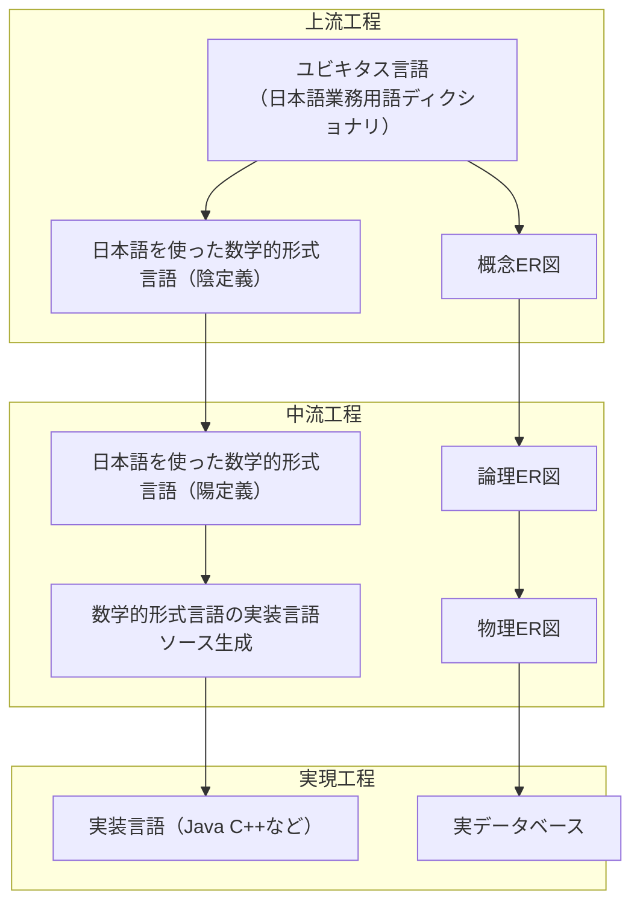

# はじめに

日本語プログラミング言語をモデリング言語としてシステム開発上中流工程に導入した場合、そのメリット・デメリットについて考察する記事の9回目です。

本記事の内容はいくつかに分割されて記載されます。本記事中の「本記事」とは分割された内容の総体を指す場合があります。

https://qiita.com/advent-calendar/2023/remind

この記事は日本語構造化仕様記述言語 Re:Mind（リマインド）アドベントカレンダー2023の21日向けの記事です。

## 対象読者
とりあえずこの記事の想定読者はシステムエンジニアさんです。とくに日本語で要求仕様や内部設計資料を書いている方向けのお話です。

# 想定しているシステム開発フロー
オーソドックスなリレーショナルデータベースを使用している業務システムであることを[1回目](https://qiita.com/mylifewithviolin/items/b7cc85911507cf1a2a55)[2回目](https://qiita.com/mylifewithviolin/items/4ce62e0d5473626347e1)の記事で説明しております。

## 想定しているレイヤードアーキテクチャ・業務
一般的なWebアプリケーションシステムであり、簡単な受発注業務をインターネットで支援するシステムであることを[3回目](https://qiita.com/mylifewithviolin/items/d10d59e98c4d2d7dca3d)[4回目](https://qiita.com/mylifewithviolin/items/68dbf00cebb1bc8f6209)の記事で説明しております。

## 想定しているユビキタス言語
[5回目](https://qiita.com/mylifewithviolin/items/e1a7915efbf369117c97)の記事ではドメイン駆動設計（DDD）の文脈で用いられる意味でのユビキタス言語を例示しました。

## ユビキタス言語化された日本語プログラミング言語
[6回目](https://qiita.com/mylifewithviolin/items/f49c48241d8f72d6839a)[7回目](https://qiita.com/mylifewithviolin/items/8823d08c79bf70464bc0)の記事ではドメインエキスパートからプログラマレベルまで共有可能な言語のことをユビキタス言語化された日本語プログラミング言語とし、その各工程のソースコードの差異を例示・解説しました。

また、[前回](https://qiita.com/mylifewithviolin/items/4db1d402ed273ec784dc)の記事では日本語プログラミング言語をモデリング言語としてシステム開発の上中流工程に導入した場合のメリット・デメリットについて、いったんまとめてみました。

# 数学的形式言語で日本語識別子を使えばよいのでは問題
21世紀の第1四半期のおわりである今日、システム開発の上中流工程において実績のある言語処理系はやはり数学的形式言語でしょう。
中でも構造化プログラミング言語の構文を持ち、オブジェクト指向言語によるモデリングも可能な処理系としてVDM++は最有力の存在です。

コンピュータシステムと一言でいっても多種多様な系が存在し、IoT時代ではハードウェア制御が関係するシステムも多数存在しており、ミッションクリティカルなシステムでは数学的形式言語での要件適合性の検証がマスト要件になっているものもあるようです。

結論から申し上げますと、数学的形式言語で日本語識別子を使えばシステム開発の上中流工程のあいまいさを排し、より合理的な整合性のある仕様や設計が可能であることに疑いはないとわたしは考えております。

1回目の記事で図示しました、ユビキタス言語化された日本語プログラミング言語のシステム開発工程上の位置づけを数学的形式言語で置き換えてみますと、ざっくり以下のようになると思われます。

数学的形式言語の処理系であるVDM++を使用した設計手法の解説情報では、当たり前のように日本語識別子が使われています。これはやはりDDD的な意味でのユビキタス言語が自然言語の母語で書かれていることから、その流れでも日本語でモデリングするのが自然であるという認識が設計現場では一般的であると推察されます。

## ユビキタス言語化された日本語プログラミング言語と日本語識別子を使った数学的形式言語ではなにが違うのか

日本語識別子を使った数学的形式言語といった場合、半角英字トークンをベースに設計された処理系で日本語識別子を使うという意味のほか、まだ登場はしていませんが、日本語プログラミング言語のように日本語がネイティブのシステムトークンとなっている数学的形式言語というものが、将来登場するとしたらそれも含めて何が違うのかという話になっていきます。

ちなみに本記事の主題は、システム開発上中流工程で同じようにユビキタス言語化された、日本語識別子を使った数学的形式言語を新たに検討しようとするものではなく、構造化プログラミング言語で静的型付け、オブジェクト指向パラダイムの特徴をもつ設計言語について検討しております。

なにがどう違うのかについては次回、詳しく説明します。

# この回のまとめ
上中流工程においては、競合でありパートナーでもある日本語識別子を使った数学的形式言語の存在について触れてみました。

# 次回
数学的形式言語との関係について引き続き検討します。
