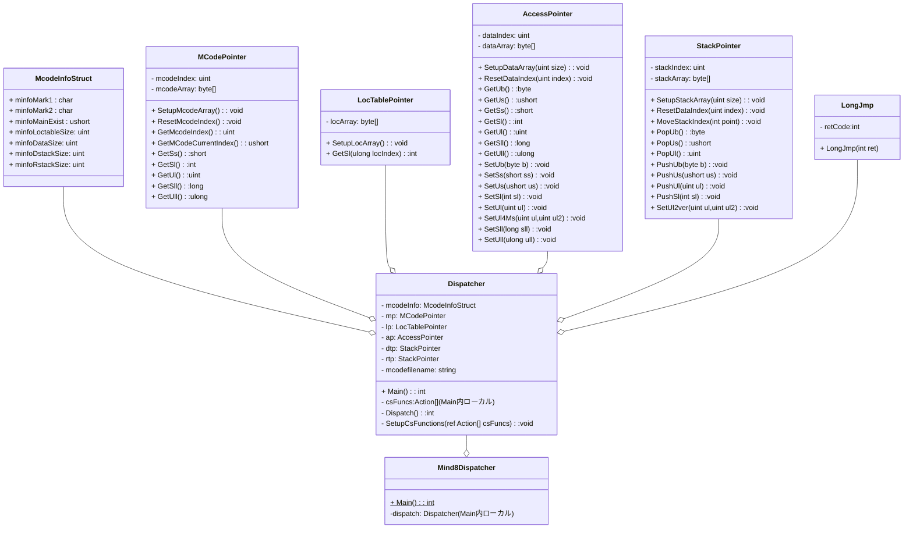

# はじめに
[前回](https://qiita.com/mylifewithviolin/items/c24cac3a0788cc2ad6f5)はMind8の中間コードディスパッチャ（の一部）をCからC#に書き換えてみるという野望の序二段のあたりとして、独自のスタックを実装しスタックアドレスポインタを操作しているCの関数配列のいくつかをC#で実装しています。

この記事へのコメントでMind開発者@killyさんよりMindスタックポインタの実装について重要な情報を共有いただきましたので、独自スタックの実装を少し調整します。また調整前より、リターンスタックだけでなくデータスタックも独自スタックの実装としていましたので、同じ動きとなります。

本記事ではおよそ2週間前にご提示したMind8の中間コードディスパッチャ（の一部）をCからC#に書き換える（[具体的な構想案ドラフト](https://qiita.com/mylifewithviolin/items/2d1e59eb4cdcd03cbed7)）をより一層具体的なものとしてみます。これをもって現状認識を「三段目」に進行したとします。（この番付の判定はてきとうです:joy:）

# 前提条件
Windows11 Pro 22H2
VSCode(Visual Studo Code)　1.86.1
Microsoft Visual C++ 2008 Express Edition
Mind Version 8.0.08 for Windows
C# 12 
dotnet-sdk-8.0.204-win-x64

## VSCodeの拡張機能
C/C++ for Visual Studio Code 1.18.5 Microsoft 
C/C++ Extension Pack 1.3.0 Microsoft 
.NET Install Tool 2.0.2 Microsoft
Base language support for C# 2.18.16 Microsoft

C/C++のデバッガは直接使わないのですが、Cで実装されているMind8kernelの動作をデバッグ実行で探るために使用します。[こちらの記事](https://qiita.com/mylifewithviolin/items/2804356ae2f39b055b8c)の環境となります。

# お題のMind8の中間コードファイル
[こちらの記事](https://qiita.com/mylifewithviolin/items/7f0878469e068baccf90)をご参照ください。
また、[前回記事](https://qiita.com/mylifewithviolin/items/c24cac3a0788cc2ad6f5)に実際のMCode領域内のMCodeをC版オリジナルがディスパッチしたリストを確認しています。お題の「Hello by mind8」のコンソール出力までは649（同一コード含む）のmcodeを処理します。

# お題のC#ソースコードのクラス構成
ここでC#ソースコードのクラス構成とファイル構成をまとめておきます。前回まではコンソールアプリケーションのstatic void Main()をもつ１つのクラス内にすべて実装していましたが（各種Cの共用体アドレスポインタの代替実装クラスもこのクラス内の定義）、今回は最終形態に近い構造のクラス構成に変更し、ソースファイルもクラスごとに分割します。

それらのクラスをmermaidで記述しました。構造の概念把握が目的なのであまり細かい点の表記は気にしていません。メソッドの引数は割愛している場合があります。Qiitaの？mermaidのレンダリング可能文字数ぎりぎりのようです。


## クラスの説明と対応ソースファイル構成
| クラス名 | 概要 | 対応ソースファイル |
|:-|:-|:-|
|Mind8Dispatcher|Windowsコンソールアプリのホストクラス|Mind8Dispatch.cs|
|Dispatcher|ディスパッチャ本体クラス|Dispatcher.cs|
||C#デリゲートによる関数配列|CsFunctions.cs|
|McodeInfoStruct|Mcode情報構造体|Dispatcher.cs|
|LongJmp|広域ジャンプ用のアプリケーション例外|Dispatcher.cs|
|MCodePointer|Mcode領域アクセスクラス|MCodePointer.cs|
|LocTablePointer|Locテーブルアクセスクラス|LocTablePointer.cs|
|AccessPointer|データ領域アクセスクラス|AccessPointer.cs|
|StackPointer|スタッククラス|StackPointer.cs|

# お題のC#ソースコード
それでは各クラスの現時点での実装状況を見ていきます。
## Mind8Dispatcherクラス Main 暫定メイン
コンソールアプリのホストクラスのMainです。まだ引数からのファイル名には非対応です。ディスパッチャクラスのインスタンスを生成してMainを実行するシンプルな状態となりました。
Mind8Kernelの名前空間を導入しました。他のクラスもこの名前空間に属しています。

```cs:Mind8Dispatch.cs
namespace Mind8Kernel
{
    /// <summary>Mind8ディスパッチャ</summary>
    public partial class Mind8Dispatcher
    {
        /// <summary>メイン</summary>
        /// <param name="args">引数</param>
        static int Main(string[] args)
        {
            string mcodefilename="hello.mco";
            Dispatcher dispatcher =new();
            return dispatcher.Main(mcodefilename);
    
        }       
    }
}
```
## Dispatcherクラス
ディスパッチャ本体クラスです。従来コンソールアプリのホストクラスの内容の大半がこちらに移動しました。C#関数配列とソースを分けるためpartial装飾されています。
従来のクラス内変数もこのクラス内のprivate変数となっています。
### LongJmpクラス 広域ジャンプ用のアプリケーション例外
Cの関数配列内でCのLongJmpで実装されている箇所のC#代替実装用の例外クラスです。後述するディスパッチャループを監視してキャッチします。

```cs:Dispatcher.cs
namespace Mind8Kernel
{
    /// <summary>Mind8ディスパッチャ</summary>
    public partial class Dispatcher
    {
        /// <summary>広域ジャンプ用のアプリケーション例外</summary>
        private class LongJmp(int ret) : Exception{
            public int retCode = ret;
        }
        /// <summary>プログラム終了用のアプリケーション例外</summary>
        private class ExitModule(int ret) : Exception{
            public int retCode=ret;
        }

        /// <summary>MCode情報構造体</summary>
        private struct McodeInfoStruct	     /*-- 全体=32バイト --*/
        {
            //～略～     
        }      
        /// <summary>メイン</summary>
        public int Main(string args){
            //後述～       
        }
        /// <summary>ディスパッチャ</summary>
        private int Dispatch(McodeInfoStruct McodeInfo,Action[] csFuncs){
            //後述～
        }
    }

    
}    
```

### Main 暫定メイン
ディスパッチャ本体クラスのMainです。従来コンソールアプリのホストクラスのMainに記述されていた内容がこちらに移設されました。

```cs:Dispatcher.cs
        private  byte[] McodeBase =[];//MCode領域
        private byte[] WordOffsetTable=[];//LOCテーブル
        private MCodePointer mp=new();//MCode領域用ポインタ
        private LocTablePointer lp=new();//LOCテーブル用ポインタ
        private AccessPointer ap =new(); //データ領域用ポインタ
        private StackPointer dtp =new(); //データスタック用ポインタ
        private StackPointer rtp =new(); //リターンスタック用ポインタ
        private string mcodefilename ="";

        /// <summary>メイン</summary>
        /// <param name="args">引数</param>
        public int Main(string args)
        {
            mcodefilename=args;
            McodeInfoStruct mcodeInfo =new();

            /* ディスパッチャを準備する */
            bool ret=SetupForDispatch(ref mcodeInfo,mcodefilename);
            if(!ret){
                return -1;
            }

            MonitorMcode(McodeBase);//MCode領域をモニタする
            mp.SetupMcodeArray(McodeBase);//MCode領域用ポインタを準備する
            lp.SetupLocArray(WordOffsetTable);//LOCテーブル用ポインタを準備する
            ap.SetupDataArray(mcodeInfo.minfoDataSize);//データ領域用ポインタを準備する
            //resetDataStackPointer();//DstackPointer = DataStackBase[RestartEnvCount];
            //resetRetnStackPointer();//RstackPointer = RetnStackBase;
            dtp.SetupStackArray((ushort)mcodeInfo.minfoDstackSize);//データスタック用ポインタを準備する
            rtp.SetupStackArray((ushort)mcodeInfo.minfoRstackSize);//リターンスタック用ポインタを準備する
            //McodePointer.b = (UCHAR *)McodeBase + 0x70;	/* 0x70=実行開始地点 */
            mp.ResetMcodeIndex(0x70);

            /* C#の関数を準備する */
            Action[] csFuncs=[]; //C#の関数を格納する配列
            /* C#の関数配列を準備する */
            SetupCsFunctions(ref csFuncs);
            /* ディスパッチャ開始 */
            return Dispatch(mcodeInfo, csFuncs);

        }
```

### Dispatch ディスパッチャ本体
ディスパッチャ本体です。従来コンソールアプリのホストクラス内に記述されていた内容がこちらに移設されました。
Cの関数配列内でCのLongJmpで実装されている箇所のC#代替実装として、例外クラスがすろーされてくるのを監視してキャッチします。状態復帰のコードはまだ実装していません。とりあえず代替構造を記述してあります。
```cs:Dispatcher.cs
        /// <summary>ディスパッチャ</summary>
        /// <param name="McodeInfo">MCode情報構造体の参照</param>
        /// <param name="csFunc">C#関数配列の参照</param>
        private int Dispatch(McodeInfoStruct McodeInfo, Action[] csFuncs){
            
            ushort   mcode;

            int retcode=0;//setjmp( RESTARTENV );		/* ←ディスパッチャ再 */
            if ( retcode != 2 )			/* 強制脱出の検査 */
            {
                try{
                    int i=0;
                    for(;;)
                    {
                        mcode = mp.GetMCodeCurrentIndex();
                        Console.WriteLine("{0,4:d} {1,4:X4} {2,6:d}",++i,mcode,mcode);
                        if ( (mcode & 0x8000)==0 )
                        {
                            /* C#関数 */
                            csFuncs[mcode]();
                        }
                        else
                        {
                            /* Mind単語 */
                            //PUSH_R( McodePointer.l );
                            //#define  PUSH_R(addr) *(--RstackPointer)=(ULONG)(addr)
                            rtp.PushUl(mp.GetMcodeIndex());//現在のMCodeポインタの値をリターンスタックにプッシュする
                            //SET_MCODE_POINTER_BY_WORDNO( mcode & 0x7fff );
                            //McodePointer.b = (UCHAR *)(WordOffsetTable[wordNo])
                            mp.ResetMcodeIndex((uint)lp.GetSl((uint)(mcode & 0x7fff)));
                        }
                    }
                }catch(LongJmp ljmp){
                    retcode=ljmp.retCode;
                    //状態復帰
                }catch(ExitModule eMd){
                    return eMd.retCode;
                }
            }
            return 0;
        }

```

## MCodePointerクラス
Mcode領域アクセスクラスです。従来コンソールアプリのホストクラス内で宣言していましたが、Mind8Kernel名前空間内で別クラスとして宣言するようにしました。
内容は前回記事から変更ありません。
<details><summary>ソースコード</summary>

```cs:MCodePointer.cs
    
    namespace Mind8Kernel
{
    /// <summary>MCode領域アクセスポインタ</summary>
    public class MCodePointer{
        private uint mcodeIndex;
        private byte[] mcodeArray =[];
        public void SetupMcodeArray(byte[] McodeBase){
            mcodeArray=McodeBase;
        }
        public void ResetMcodeIndex(uint index){
            mcodeIndex=index;;
        }
        public uint GetMcodeIndex(){
            return mcodeIndex;
        }
        public ushort GetMCodeCurrentIndex(){/* for unsigned short access  */
            byte[] int16Byte = new byte[2];
            for (ulong i = 0; i < 2; i++) int16Byte[i] = mcodeArray[mcodeIndex + i];
            mcodeIndex +=2;
            return BitConverter.ToUInt16(int16Byte, 0);
        }
        public short GetSs(){/* for signed short access  */
            byte[] int16Byte = new byte[2];
            for (ulong i = 0; i < 2; i++) int16Byte[i] = mcodeArray[mcodeIndex + i];
            mcodeIndex +=2;
            return BitConverter.ToInt16(int16Byte, 0);
        }
        public int GetSl(){/* for signed long access   */
            byte[] int32Byte = new byte[4];
            for (ulong i = 0; i < 4; i++) int32Byte[i] = mcodeArray[mcodeIndex + i];
            mcodeIndex +=4;
            return BitConverter.ToInt32(int32Byte, 0);
        }
        public uint GetUl(){/* for unsigned long access   */
            byte[] int32Byte = new byte[4];
            for (ulong i = 0; i < 4; i++) int32Byte[i] = mcodeArray[mcodeIndex + i];
            mcodeIndex +=4;
            return BitConverter.ToUInt32(int32Byte, 0);
        }
        public long GetSll(){/* for signed long long access   */
            byte[] int64Byte = new byte[8];
            for (ulong i = 0; i < 8; i++) int64Byte[i] = mcodeArray[mcodeIndex + i];
            mcodeIndex +=8;
            return BitConverter.ToInt64(int64Byte, 0);
        }
        public ulong GetUll(){/* for unsigned long long access   */
            byte[] int64Byte = new byte[8];
            for (ulong i = 0; i < 8; i++) int64Byte[i] = mcodeArray[mcodeIndex + i];
            mcodeIndex +=8;
            return BitConverter.ToUInt64(int64Byte, 0);
        }
    }
}
```

</details>

## LocTablePointerクラス
Locattionテーブルアクセスクラスです。従来コンソールアプリのホストクラス内で宣言していましたが、Mind8Kernel名前空間内で別クラスとして宣言するようにしました。
内容は前回記事から変更ありません。
<details><summary>ソースコード</summary>

```cs:LocTablePointer.cs
using System.Security.Cryptography;
namespace Mind8Kernel
{
/// <summary>Locテーブルアクセスポインタ</summary>
public class LocTablePointer{
        private byte[] locArray =[];
        public void SetupLocArray(byte[] locTable){
            locArray=locTable;
        }
        public int GetSl(ulong locIndex){/* for signed long access   */
            locIndex*=4;
            byte[] int32Byte = new byte[4];
            for (ulong i = 0; i < 4; i++) int32Byte[i] = locArray[locIndex + i];
            return BitConverter.ToInt32(int32Byte, 0);
        }
        
    }
}
```

</details>

## AccessPointerクラス
データ領域アクセスクラスです。従来コンソールアプリのホストクラス内で宣言していましたが、Mind8Kernel名前空間内で別クラスとして宣言するようにしました。
内容は前回記事以前に対して、初期化処理でサイズを渡して内部でByte配列確保するように変更しました。またクラス図と同じようにGet系メソッドを前半に集め、Set系メソッドを後半に集めました。
<details><summary>ソースコード</summary>

```cs:AccessPointer.cs
    namespace Mind8Kernel
{
    /// <summary>データ領域アクセスポインタ</summary>
    public class AccessPointer{
        private uint dataSize;
        private ulong dataIndex;
        private byte[] dataArray =[];
        public void SetupDataArray(uint size){
            dataSize=size;
            dataArray =new byte[dataSize];
            dataIndex=0;
        }
        public void ResetDataIndex(ulong index){
            dataIndex=index;
        }
        public byte GetUb(){    /* for unsigned byte access */
            return dataArray[dataIndex];
        }
        public ushort GetUs(){/* for unsigned short access  */
            byte[] int16Byte = new byte[2];
            for (ulong i = 0; i < 2; i++) int16Byte[i] = dataArray[dataIndex + i];
            return BitConverter.ToUInt16(int16Byte, 0);
        }        
        public short GetSs(){/* for signed short access  */
            byte[] int16Byte = new byte[2];
            for (ulong i = 0; i < 2; i++) int16Byte[i] = dataArray[dataIndex + i];
            return BitConverter.ToInt16(int16Byte, 0);
        }
        public int GetSl(){/* for signed long access   */
            byte[] int32Byte = new byte[4];
            for (ulong i = 0; i < 4; i++) int32Byte[i] = dataArray[dataIndex + i];
            return BitConverter.ToInt32(int32Byte, 0);
        }
        public uint GetUl(){/* for unsigned long access   */
            byte[] int32Byte = new byte[4];
            for (ulong i = 0; i < 4; i++) int32Byte[i] = dataArray[dataIndex + i];

            return BitConverter.ToUInt32(int32Byte, 0);
        } 
        public ulong GetUll(){/* for signed long long access   */
            byte[] int64Byte = new byte[8];
            for (ulong i = 0; i < 8; i++) int64Byte[i] = dataArray[dataIndex + i];
            return BitConverter.ToUInt64(int64Byte, 0);
        }

        
        public void SetUb(byte b){    /* for unsigned byte access */
            dataArray[dataIndex] =b;
        }
        public void SetUb4Msi(byte b,uint length){  /* for unsigned byte access (for mind strings instance)*/
            for (ulong i = 0; i < length; i++) dataArray[dataIndex + i]= b;
        }

         public void SetUs(ushort us){/* for unsigned short access  */
            byte[] int16Byte =BitConverter.GetBytes(us);
            for (ulong i = 0; i < 2; i++) dataArray[dataIndex + i]=int16Byte[i];
         }

        public void SetSs(short ss){/* for signed short access  */
            byte[] int16Byte =BitConverter.GetBytes(ss);
            for (ulong i = 0; i < 2; i++) dataArray[dataIndex + i]=int16Byte[i];
         }

        public void SetSl(int sl){/* for signed long access  */
            byte[] int32Byte =BitConverter.GetBytes(sl);
            for (ulong i = 0; i < 4; i++) dataArray[dataIndex + i]=int32Byte[i];
        }
        public void SetUl(uint ul){/* for unsigned long access  */
            byte[] int32Byte =BitConverter.GetBytes(ul);
            for (ulong i = 0; i < 4; i++) dataArray[dataIndex + i]=int32Byte[i];
        }
        public void SetUl4Ms(uint ul,uint ul2){/* for unsigned long access (for mind string)  */
            byte[] int32Byte =BitConverter.GetBytes(ul);
            for (ulong i = 0; i < 4; i++) dataArray[dataIndex + i]=int32Byte[i];
            int32Byte =BitConverter.GetBytes(ul2);
            for (ulong i = 0; i < 4; i++) dataArray[dataIndex + i + 4]=int32Byte[i];
        }
        public long GetSll(){/* for signed long long access   */
            byte[] int64Byte = new byte[8];
            for (ulong i = 0; i < 8; i++) int64Byte[i] = dataArray[dataIndex + i];
            return BitConverter.ToInt64(int64Byte, 0);
        }
        public void SetSll(long sll){/* for signed long access  */
            byte[] int64Byte =BitConverter.GetBytes(sll);
            for (ulong i = 0; i < 8; i++) dataArray[dataIndex + i]=int64Byte[i];
        }
        public void SetUll(ulong ull){/* for unsigned long access  */
            byte[] int64Byte =BitConverter.GetBytes(ull);
            for (ulong i = 0; i < 8; i++) dataArray[dataIndex + i]=int64Byte[i];
        }
    }
}
```

</details>

## StackPointerクラス
スタックアクセスクラスです。従来コンソールアプリのホストクラス内で宣言していましたが、Mind8Kernel名前空間内で別クラスとして宣言するようにしました。
内容は前回記事以前に対して、インデックスのPOP/PUSHの際の増減方向を変更してMind互換に変更しました。またクラス図と同じようにPOP系メソッドを前半に集め、PUSH系メソッドを後半に集めました。

```cs:StackPointer.cs
namespace Mind8Kernel
{ 
 /// <summary>スタックポインタ</summary>
    public class StackPointer{
        private uint stackSize=4;
        private uint stackMaxSize;
        private uint stackIndex;
        private byte[] dataArray =[];
        public void SetupStackArray(uint size){
            stackMaxSize=size;
            dataArray =new byte[stackMaxSize];
            stackIndex=stackMaxSize-1*stackSize;//
        }        
        public void ResetStackIndex(uint index){
            stackIndex=index*stackSize;//byte配列インデックス=アドレスポインタ変数の値*4
        }
        public void MoveStackIndex(int point){
            stackIndex=(uint)(stackIndex + point*stackSize);//byte配列インデックス=アドレスポインタ変数の値*4
        }
        public uint GetCurrentStackIndex(){
            return stackIndex;
        }
        public byte PopUb(){    /* for unsigned byte access */
            if(stackIndex + stackSize > stackMaxSize-1)throw new Exception("stack under flow");
            byte[] int32Byte = new byte[stackSize];
            for (ulong i = 0; i < stackSize; i++) int32Byte[i] = dataArray[stackIndex + i];
            stackIndex+=stackSize;//POPはインデックス増加
            return (byte)BitConverter.ToUInt32(int32Byte, 0);
        }
        public ushort PopUs(){    /* for unsigned byte access */
            if(stackIndex + stackSize > stackMaxSize-1)throw new Exception("stack under flow");
            byte[] int32Byte = new byte[stackSize];
            for (ulong i = 0; i < stackSize; i++) int32Byte[i] = dataArray[stackIndex + i];
            stackIndex+=stackSize;//POPはインデックス増加
            return BitConverter.ToUInt16(int32Byte, 0);
        }
        public uint PopUl(){/* for unsigned long(int32) access   */
            if(stackIndex + stackSize > stackMaxSize-1)throw new Exception("stack under flow");
            byte[] int32Byte = new byte[stackSize];
            for (ulong i = 0; i < stackSize; i++) int32Byte[i] = dataArray[stackIndex + i];
            stackIndex+=stackSize;//POPはインデックス増加
            return BitConverter.ToUInt32(int32Byte, 0);
        }
        
        public void PushUb(byte b){    /* for unsigned byte access */
            if(stackIndex - stackSize < 0)throw new Exception("stack over flow");
            stackIndex -=stackSize;//PUSHはインデックス減少
            byte[] int32Byte = new byte[stackSize];
            int32Byte[3] =b;
            for (ulong i = 0; i < stackSize; i++) dataArray[stackIndex + i]=int32Byte[i];
        }
        public void PushUs(ushort us){    /* for unsigned byte access */
            if(stackIndex - stackSize < 0)throw new Exception("stack over flow");
            stackIndex -=stackSize;//PUSHはインデックス減少
            byte[] int32Byte =BitConverter.GetBytes(us);
            for (ulong i = 0; i < stackSize; i++) dataArray[stackIndex + i]=int32Byte[i];
        }
        public void PushUl(uint ul){/* for unsigned long(int32) access  */
            if(stackIndex - stackSize < 0)throw new Exception("stack over flow");
            stackIndex -=stackSize;//PUSHはインデックス減少            
            byte[] int32Byte =BitConverter.GetBytes(ul);
            for (ulong i = 0; i < stackSize; i++) dataArray[stackIndex + i]=int32Byte[i];
        }
        public void PushSl(int sl){/* for signed long(int32) access  */
            if(stackIndex - stackSize < 0)throw new Exception("stack over flow");
            stackIndex -=stackSize;//PUSHはインデックス減少
            byte[] int32Byte =BitConverter.GetBytes(sl);
            for (ulong i = 0; i < stackSize; i++) dataArray[stackIndex + i]=int32Byte[i];
        }
        public void SetUl2var(uint ul,uint ul2){/* for unsigned long access (for 1set of 2variable)  */
            //アドレス指定で直接セットしている元コードのためポインタインデックスの自動増加はなし
            byte[] int32Byte =BitConverter.GetBytes(ul);
            for (ulong i = 0; i < stackSize; i++) dataArray[stackIndex + i]=int32Byte[i];
            int32Byte =BitConverter.GetBytes(ul2);
            for (ulong i = 0; i < stackSize; i++) dataArray[stackIndex + i + 4]=int32Byte[i];
        }
    }
}
```

</details>

## Dispatcherクラス（C#関数配列）
ディスパッチャ本体クラスのC#関数配列部分です。ソースファイル名は同じですが、従来はコンソールアプリのホストクラスのpartialクラスでしたが、本記事からはディスパッチャ本体クラスのpartialとなります。
### SetupCsFunctions C#の関数配列を準備する
この関数配列の中身を実装するのがキモとなります。
現在の実装中の関数は下記のとおりです。とりあえずこの範囲の配列では関数枠を実装して中身にはCマクロのコードをコメントで参照できるようにしてあります。
<details><summary>ソースコード</summary>

```cs:CsFunctions.cs

using System.Dynamic;
namespace Mind8Kernel
{
public partial class Dispatcher
{
    private readonly int maxCountCsFunctions = 1 + 0x0261;
    /// <summary>C#の関数配列を準備する</summary>
    /// <param name="csFunc">C#関数配列の参照</param>
    private void SetupCsFunctions(ref Action[] csFuncs){
        csFuncs=new Action[maxCountCsFunctions];
    /*--------------------- 実行  -----------------------------------*/
        csFuncs[0x0010]=ZzEndExecute;//不完全要注意
        csFuncs[0x0011]=Jikkou;//不完全要注意
        csFuncs[0x0012]=Musyori;//
        csFuncs[0x0013]=EmgcyExit;
        csFuncs[0x0014]=ProcessOwari;
    /*--------------------- スタックポインタのアクセス  --------------*/
        csFuncs[0x0015]=StackKensa0;
        csFuncs[0x0016]=StackReset;//
        csFuncs[0x0017]=FinishDispatcher;
        csFuncs[0x0018]=C_stack_data_no;
    /*--------------------- $$RESERVE[nL]  --------------------------*/
        csFuncs[0x0019]=ZzReserve1L;
        csFuncs[0x001A]=ZzReserve2L;
        csFuncs[0x001B]=ZzReserve3L;
        csFuncs[0x001C]=ZzReserve4L;
        csFuncs[0x001D]=ZzReserve5L;
        csFuncs[0x001E]=ZzReserve6L; 
        csFuncs[0x001F]=ZzReserve; 
    /*--------------------- $$EXIT[nL]  -----------------------------*/
        csFuncs[0x0020]=ZzExit1L;//
        csFuncs[0x0021]=ZzExit2L;
        csFuncs[0x0022]=ZzExit3L;
        csFuncs[0x0023]=ZzExit4L;
        csFuncs[0x0024]=ZzExit5L;
        csFuncs[0x0025]=ZzExit6L;
        csFuncs[0x0026]=ZzExit7L;
        csFuncs[0x0027]=ZzExit;
    /*--------------------- $$IFEXIT系  -----------------------------*/
        csFuncs[0x0028]=ZzIfExit;
        csFuncs[0x0029]=ZzIf0Exit;
        csFuncs[0x002A]=ZzIf1Exit;
        csFuncs[0x002B]=ZzNotIfExit;
        csFuncs[0x002C]=ZzNotIf0Exit;
        csFuncs[0x002D]=ZzNotIf1Exit;
    /*--------------------- $$JMP  ----------------------------------*/
        csFuncs[0x002E]=ZzJmpRelative; 
        csFuncs[0x002F]=ZzJmpIndexed; //

        csFuncs[0x0030]=ZzPointNull;
        csFuncs[0x0031]=ZzPushNull;
        csFuncs[0x0032]=ZzPushNull;//重複
        csFuncs[0x0033]=ZzPushPointer;
        csFuncs[0x0034]=ZzPushPointerPlusSize;
        csFuncs[0x0035]=AddressWoEru;
    /*---------------------  大域変数のセットアップ  ------------------*/
        csFuncs[0x0036]=ZzPointVarAddr;//
        csFuncs[0x0037]=ZzPointCodeAddr;
    /*---------------------  大域集合のセットアップ  ------------------*/
        csFuncs[0x0038]=ZzPushVarAddrPlusSize;
        csFuncs[0x0039]=ZzPushMcodeAddrPlusSize;
    /*---------------------  局所変数のセットアップ  ------------------*/
        csFuncs[0x003A]=ZzPointLocalAddr0W;
        csFuncs[0x003B]=ZzPointLocalAddr1W;
        csFuncs[0x003C]=ZzPointLocalAddr2W;
        csFuncs[0x003D]=ZzPointLocalAddr3W;
        csFuncs[0x003E]=ZzPointLocalAddr4W; 
        csFuncs[0x003F]=ZzPointLocalAddr5W; 
        
        csFuncs[0x0040]=ZzPointLocalAddr6W;
        csFuncs[0x0041]=ZzPointLocalAddr7W;
        csFuncs[0x0042]=ZzPointLocalAddr;
    /*---------------------  局所集合のセットアップ  ------------------*/
        csFuncs[0x0043]=ZzPushLocalAddrPlusSize;
        csFuncs[0x0044]=ZzPushLocalAddrPlusSize;
    /*---------------------  変数の間接読み出し  ----------------------*/
        csFuncs[0x0045]=ZzPushBvar;
        csFuncs[0x0046]=ZzPushWvar;
        csFuncs[0x0047]=ZzPushDvar;
        csFuncs[0x0048]=ZzPushLvar;
        csFuncs[0x0049]=ZzPushQvar;
        csFuncs[0x004A]=ZzPushSvar;
        csFuncs[0x004B]=ZzPushJvar;
    /*---------------------  変数の直接読み出し  ----------------------*/
        csFuncs[0x004C]=ZzReadBvar;
        csFuncs[0x004D]=ZzReadWvar;
        csFuncs[0x004E]=ZzReadDvar;
        csFuncs[0x004F]=ZzReadLvar; 
        csFuncs[0x0050]=ZzReadQvar; 

        csFuncs[0x0051]=ZzReadSvar;
        csFuncs[0x0052]=ZzReadJvar;
    /*---------------------  局所変数の直接読み出し  ---------------*/
        csFuncs[0x0053]=ZzReadBvarLocal;
        csFuncs[0x0054]=ZzReadWvarLocal;
        csFuncs[0x0055]=ZzReadDvarLocal;
        csFuncs[0x0056]=ZzReadLvarLocal;
        csFuncs[0x0057]=ZzReadQvarLocal;
        csFuncs[0x0058]=ZzReadSvarLocal;
        csFuncs[0x0059]=ZzReadJvarLocal;
    /*---------------------  変数の間接書き込み  ------------------*/
        csFuncs[0x005A]=ZzPopBvar;
        csFuncs[0x005B]=ZzPopWvar;
        csFuncs[0x005C]=ZzPopDvar;
        csFuncs[0x005D]=ZzPopLvar;
        csFuncs[0x005E]=ZzPopQvar;
        csFuncs[0x005F]=ZzPopSvar;

        csFuncs[0x0060]=ZzPopMemory;
        csFuncs[0x0061]=ZzPopMemoryWithResult;
        csFuncs[0x0062]=ZzPopMemoryWithResult;
    /*---------------------  変数の直接書き込み  --------------------*/
        csFuncs[0x0063]=ZzWriteBvar;//
        csFuncs[0x0064]=ZzWriteWvar;//
        csFuncs[0x0065]=ZzWriteDvar;//
        csFuncs[0x0066]=ZzWriteLvar;//
        csFuncs[0x0067]=ZzWriteQvar;//
        csFuncs[0x0068]=ZzWriteSvar;//
    /*---------------------  局所変数の直接書き込み  ----------------*/
        csFuncs[0x0069]=ZzWriteBvarLocal;
        csFuncs[0x006A]=ZzWriteWvarLocal;
        csFuncs[0x006B]=ZzWriteDvarLocal;
        csFuncs[0x006C]=ZzWriteLvarLocal;
        csFuncs[0x006D]=ZzWriteQvarLocal;
        csFuncs[0x006E]=ZzWriteSvarLocal;
    /*---------------------  変数のクリア  --------------------------*/
        csFuncs[0x006F]=ZzClearBvar;//
        csFuncs[0x0070]=ZzClearWvar;//
        csFuncs[0x0071]=ZzClearDvar;//
        csFuncs[0x0072]=ZzClearLvar;//
        csFuncs[0x0073]=ZzClearFvar;
        csFuncs[0x0074]=ZzClearSvar;//
        csFuncs[0x0075]=ZzClearMemory;
        csFuncs[0x0076]=ZzClearMemory;
    /*--------------------- 変数を一つ増加  -------------------------*/
        csFuncs[0x0077]=ZzIncBvar;
        csFuncs[0x0078]=ZzIncWvar;
        csFuncs[0x0079]=ZzIncDvar;
        csFuncs[0x007A]=ZzIncLvar;
    /*--------------------- 変数を一つ減少  -------------------------*/
        csFuncs[0x007B]=ZzDecBvar;
        csFuncs[0x007C]=ZzDecWvar;
        csFuncs[0x007D]=ZzDecDvar;
        csFuncs[0x007E]=ZzDecLvar;
    /*--------------------- 変数をセット  ---------------------------*/
        csFuncs[0x007F]=ZzSetBvar;//
        csFuncs[0x0080]=ZzSetWvar;//
        csFuncs[0x0081]=ZzSetDvar;//
        csFuncs[0x0082]=ZzSetLvar;//

        csFuncs[0x0083]=c_test_push_quad;
        csFuncs[0x0084]=c_test_push_float;
    /*--------------------- 変数を増加  -----------------------------*/
        csFuncs[0x0085]=ZzAddBvar;
        csFuncs[0x0086]=ZzAddWvar;
        csFuncs[0x0087]=ZzAddDvar;
        csFuncs[0x0088]=ZzAddLvar;
        csFuncs[0x0089]=ZzAddFvar;
    /*--------------------- 変数を減少  -----------------------------*/
        csFuncs[0x008A]=ZzSubBvar;
        csFuncs[0x008B]=ZzSubWvar;
        csFuncs[0x008C]=ZzSubDvar;
        csFuncs[0x008D]=ZzSubLvar;
        csFuncs[0x008E]=ZzSubFvar;
    /*--------------------- バイトロード～ダブルロード  ----------------*/
        csFuncs[0x008F]=ByteLoad;
        csFuncs[0x0090]=WordLoad;
        csFuncs[0x0091]=DoubleLoad;
    /*--------------------- バイトストア～ダブルストア  ----------------*/
        csFuncs[0x0092]=ByteStore;
        csFuncs[0x0093]=WordStore;
        csFuncs[0x0094]=DoubleStore;  
    /*--------------------- 数値定数  -------------------------------*/
        csFuncs[0x0095]=Zz0;//
        csFuncs[0x0096]=Zz1;//
        csFuncs[0x0097]=Zz2;//
        csFuncs[0x0098]=Zz3;//
        csFuncs[0x0099]=Zz4;//
        csFuncs[0x009A]=Zz5;//
        csFuncs[0x009B]=Zz6;//
        csFuncs[0x009C]=Zz7;//
        csFuncs[0x009D]=Zz8;//
        csFuncs[0x009E]=Zz9;//
        csFuncs[0x009F]=Zz10;//

        csFuncs[0x016E]=ZzClearXvar;//

        csFuncs[0x0261]=CmcodeFullFilename;//
    }
 }
}
```

</details>

### C#の関数配列
exit_programで実行終了している箇所はアプリケーション例外で代替実装しています。下記コードはmcodeの実行がまだこの範囲まで到達していないため未検証です。構想段階のコンセプトコードです。
```cs:CsFunctions.cs
    /*--------------------- 実行  -----------------------------------*/
    private void ZzEndExecute(){  /* ;WORD $$END_EXECUTE */
            /* Mコード=0x0010 */
        // DROP_R;				    /* 臨時のMコード域予約を解消 */
        // McodePointer.w = (USHORT *)POP_R;   /* '実行'直前のMポインタ復帰 */

        //#define  DROP_R             RstackPointer++
        rtp.PopUl();
        mp.ResetMcodeIndex((ushort)rtp.PopUl());
    }
    private void Jikkou(){       /* ;WORD 実行 */
            /* Mコード=0x0011 */
        // USHORT  *rp;
        // PUSH_R( McodePointer.u );	/* 現Ｍコードポインタを退避 */
        // rp = (USHORT *)--RstackPointer; /* リターンスタックに2wordを確保 */
        // McodePointer.w = rp;            /* その先頭から実行する仕掛け    */
        // *rp = POP_W_OF_Q;       	/* 指定されたMcodeを1ワード生成 */
        // *(rp+1) = 0x0010;               /* 後片付け処理のＭコードを記入 */
        //           /*↑'zzEndExecute'のMコード */
        rtp.PushUl(mp.GetMcodeIndex());
        ushort rp=(ushort)rtp.GetCurrentStackIndex();
        mp.ResetMcodeIndex(rp);
        dtp.PopUl();
        rtp.PushUl(dtp.PopUl());
        rtp.PushUl(0x0010);
    }
    private void Musyori(){      /* ;WORD 無処理 */
            /* Mコード=0x0012 */
            //無処理
    }
    private void EmgcyExit(){    /* ;WORD ＄＄実行終り・0001 */
            /* Mコード=0x0013 */
        //exit_program( 1 );
        throw new ExitModule(1);
    }
    private void ProcessOwari(){ /* ;WORD プロセス終り０ */
            /* Mコード=0x0014 */
    	// LONG retCode;
    	// retCode = POP_L_OF_Q;
	    // exit_program( retCode );

        // #define  POP_L_OF_Q           (DROP_F,POP_L)
        dtp.PopUl();
        int retCode =(int)dtp.PopUl();
        throw new ExitModule(retCode);
    }
```
CのlongJmpで実装されていた箇所はアプリケーション例外で代替実装しています。状態の保存や復元は未実装です。下記コードはmcodeの実行がまだこの範囲まで到達していないため未検証です。構想段階のコンセプトコードです。
```cs:CsFunctions.cs
    /*--------------------- スタックポインタのアクセス  --------------*/
    private void StackKensa0(){/* ;WORD スタック検査０ */
            /* Mコード=0x0015 */
        // if ( DstackPointer == DataStackBase[RestartEnvCount] )
        // {
        //         /* OK */
        //         PUSH_Q( 1, 0 );
        // }
        // else
        // {
        //         /* NG */
        //         resetDataStackPointer();        /* in dispatch.c */
        //         PUSH_Q( 0, 0 );
        // }
        if(dtp.GetCurrentStackIndex()==0){
            dtp.PushUl(1);
            dtp.PushUl(0);
        }else{
            dtp.ResetStackIndex(0);
            dtp.PushUl(0);
            dtp.PushUl(0);
        }

    }
    private void StackReset(){      /* ;WORD スタックリセット */
            /* Mコード=0x0016 */
        // resetDataStackPointer();                /* in dispatch.c */
        // resetRetnStackPointer();                /* in dispatch.c */
        // longjmp( RESTARTENV, 1 );       	/* ディスパッチャ強制再開始 */
        dtp.ResetStackIndex(0);//DstackPointer = DataStackBase[RestartEnvCount];
        rtp.ResetStackIndex(0);//RstackPointer = RetnStackBase;
        throw new LongJmp(1);
    }
    private void FinishDispatcher(){	/* ;WORD ディスパッチャ終了 */
            /* Mコード=0x0017 */
        //longjmp( RESTARTENV, 2 );       	/* ディスパッチャ強制再開始 */
        throw new LongJmp(2);
    }
    private void C_stack_data_no(){  /* ;WORD スタックデータ数2 */
            /* Mコード=0x0018 */
        //longjmp( RESTARTENV, 2 );	       /* ディスパッチャ強制再開始 */
        throw new LongJmp(2);
    }

```
前回記事より実際のC#版ディスパッチャが処理するmcodeで通過させたのは下記の0x0055です。同じカテゴリの関数はまだ該当mcodeに到来していないため未検証です。スタックの取り出し順や置く順とかはMind互換を狙って書いていますが、まだなにか勘違いしているかもしれません。このあたりの精度をあげていくことが完成に近づく一歩となりますね。
```cs:CsFunctions.cs
  /*---------------------  局所変数の直接読み出し  ---------------*/
    private void ZzReadBvarLocal(){
            /* Mコード=0x0053 */
        // UCHAR  *varAddr;
        // varAddr = (UCHAR *)RstackPointer + FETCH_MCODE;
        // PUSH_L( *varAddr );
        // PUSH_F( 0 );
        rtp.MoveStackIndex(mp.GetMCodeCurrentIndex());//returnスタックのインデックスをMCode領域の値で移動
        dtp.PushUl(rtp.PopUb());
        dtp.PushUl(0);
    }
    private void ZzReadWvarLocal(){
            /* Mコード=0x0054 */
        // USHORT *varAddr;
        // varAddr = (USHORT *)((UCHAR *)RstackPointer + FETCH_MCODE);
        // PUSH_L( *varAddr );
        // PUSH_F( 0 );
        rtp.MoveStackIndex(mp.GetMCodeCurrentIndex());//returnスタックのインデックスをMCode領域の値で移動
        dtp.PushUl(rtp.PopUs());
        dtp.PushUl(0);
    
    }
    private void ZzReadDvarLocal(){
            /* Mコード=0x0055 */
        // ULONG 	*varAddr;
        // varAddr = (ULONG *)((UCHAR *)RstackPointer + FETCH_MCODE);
        // PUSH_L( *varAddr );
        // PUSH_F( 0 );            
        rtp.MoveStackIndex(mp.GetMCodeCurrentIndex());//returnスタックのインデックスをMCode領域の値で移動
        dtp.PushUl(rtp.PopUl());
        dtp.PushUl(0);

    }
    private void ZzReadLvarLocal(){
            /* Mコード=0x0056 */
        // ULONG 	*varAddr;
        // varAddr = (ULONG *)((UCHAR *)RstackPointer + FETCH_MCODE);
        // PUSH_L( varAddr[0] );                   /* push low  double */
        // PUSH_L( varAddr[1] );                   /* push high double */
        rtp.MoveStackIndex(mp.GetMCodeCurrentIndex());//returnスタックのインデックスをMCode領域の値で移動
        dtp.PushUl(rtp.PopUl());
        dtp.PushUl(rtp.PopUl());
    }
    private void ZzReadQvarLocal(){
            /* Mコード=0x0057 */
        // ULONG 	*varAddr;
        // varAddr = (ULONG *)((UCHAR *)RstackPointer + FETCH_MCODE);
        // PUSH_L( varAddr[1] );                   /* push high double */
        // PUSH_L( varAddr[0] );                   /* push low  double *
        rtp.MoveStackIndex(mp.GetMCodeCurrentIndex());//returnスタックのインデックスをMCode領域の値で移動
        uint ul=rtp.PopUl();
        dtp.PushUl(rtp.PopUl());
        dtp.PushUl(ul);
    }
    private void ZzReadSvarLocal(){
            /* Mコード=0x0058 */
        // ULONG  	*varAddr;
        // varAddr = (ULONG *)((UCHAR *)RstackPointer + FETCH_MCODE);
        // PUSH_A( varAddr[1] );                   /* push address */
        // PUSH_C( varAddr[0] );                   /* push length  */
        rtp.MoveStackIndex(mp.GetMCodeCurrentIndex());//returnスタックのインデックスをMCode領域の値で移動
        uint ul=rtp.PopUl();
        dtp.PushUl(rtp.PopUl());
        dtp.PushUl(ul);
    }
```

# デバッグ実行の結果
現状のディスパッチャのmcode到達状況です。右端に到達した日付を付記しました。
```
SqNo mcode mcode(dec)
   1 8019  32793  //2024/04/23
   2 002F     47  //2024/04/25
   3 0036     54
   4 0080    128  //2024/04/27
   5 0036     54
   6 0070    112
   7 803A  32826
   8 002F     47
   9 813E  33086
  10 0012     18
  11 0036     54
  12 0071    113
  13 8046  32838
  14 8045  32837
  15 0012     18
  16 0036     54
  17 0074    116
  18 0020     32
  19 0020     32
  20 80BA  32954
  21 0036     54
  22 0012     18
  23 016E    366
  24 0020     32
  25 80A6  32934
  26 0097    151
  27 0065    101
  28 0020     32
  29 80D7  32983
  30 0261    609
  31 8053  32851
  32 8052  32850
  33 001A     26
  34 006B    107  //2024/04/29
  35 0055     85
  36 008F    143
  37 00ED    237  //2024/05/03
```
00EDとか、009Fを超える大きめの値でまだ枠すら実装していないコードが出るとそこでとまります:relaxed:

# つづく
生成されたhello.mcoを解釈して、C#側で「Hello by mind8」が出力されるようにするまでの長い道のりですが、とりあえず構想段階のソースコードの確度をざくっと引き上げて「三段目」とかかなという感じです。（この番付の判定はてきとうです:joy:）まだまだ課題山積ですが、次回以降でもこのソースコードを肉付けして実際に動く範囲をステップバイステップで広げてまいります。

# 追記
* ことの発端

https://qiita.com/mylifewithviolin/items/00544a65ae3c51f1b238
