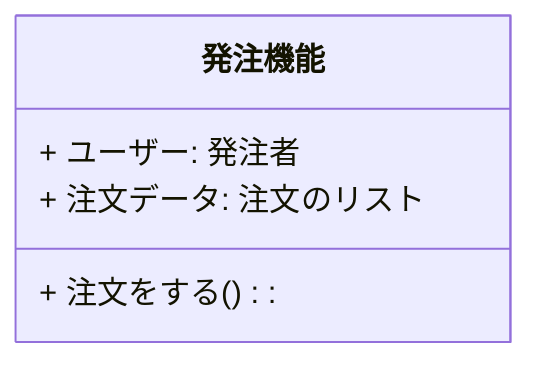

# はじめに

日本語プログラミング言語をモデリング言語としてシステム開発上中流工程に導入した場合、そのメリット・デメリットについて考察する記事の7回目です。

本記事の内容はいくつかに分割されて記載されます。本記事中の「本記事」とは分割された内容の総体を指す場合があります。

https://qiita.com/advent-calendar/2023/remind

この記事は日本語構造化仕様記述言語 Re:Mind（リマインド）アドベントカレンダー2023の17日向けの記事です。

## 対象読者
とりあえずこの記事の想定読者はシステムエンジニアさんです。とくに日本語で要求仕様や内部設計資料を書いている方向けのお話です。

また、参考にプログラマさん。ぐだぐだの内部設計書から実装してひどいめにあったことのあるひと（力量のあるデベロッパはそれを乗り越えて設計者になる？）

# 想定しているシステム開発フロー
オーソドックスなリレーショナルデータベースを使用している業務システムであることを[1回目](https://qiita.com/mylifewithviolin/items/b7cc85911507cf1a2a55)[2回目](https://qiita.com/mylifewithviolin/items/4ce62e0d5473626347e1)の記事で説明しております。

## 想定しているレイヤードアーキテクチャ・業務
一般的なWebアプリケーションシステムであり、簡単な受発注業務をインターネットで支援するシステムであることを[3回目](https://qiita.com/mylifewithviolin/items/d10d59e98c4d2d7dca3d)[4回目](https://qiita.com/mylifewithviolin/items/68dbf00cebb1bc8f6209)の記事で説明しております。

## 想定しているユビキタス言語
[5回目](https://qiita.com/mylifewithviolin/items/e1a7915efbf369117c97)のの記事ではドメイン駆動設計（DDD）の文脈で用いられる意味でのユビキタス言語を例示しました。

## ユビキタス言語化された日本語プログラミング言語
[前回の記事](https://qiita.com/mylifewithviolin/items/f49c48241d8f72d6839a)ではドメインエキスパートから、実際のプロダクトの実装担当者・プログラマレベルまでを、一貫した、構造化された言語で（工程により詳細度は異なるものの）共有可能な言語のことをユビキタス言語化された日本語プログラミング言語と呼ぶこと、その各工程のソースコードの差異を例示しました。

# ユビキタス言語化された日本語プログラミング言語の工程別イメージ
前回と重複しますが、今回はそのイメージの説明となりますので再掲いたします。


このUMLで表現されたクラスを日本語プログラミング言語で各工程別に記述したのが下記のイメージです。すべてをコンパイルできるように記述するとみ渡しにくくなるので下請け関数の定義内容は端折っています。このあたりは各工程別に詳説する際に補足していきます。また上記のクラスが下流工程までそのまま定義されていくことはありませんのでご留意ください。これはあくまで説明用のイメージです。

#### 上流工程　モデリング言語
この記事で例示する日本語プログラミング言語はJava C#などの経験者向けに設計されていますので、語順まで含めて日本語らしさを強調する言語とは設計思想が異なっています。
```mind:Re:Mind
▽クラス 発注機能
    ・発注者　ユーザー
    ・注文のリスト 注文データ

    ▽注文をする()
        //未定義
    △
△
```


これらのプログラミング言語経験者が設計資料を技術文書として箇条書きする際に使われる言い回しを想定しており、自然言語らしさはあまりないです。

VDM++で日本語識別子を使った状態に酷似していますが、C言語系のブロック文の中かっこ区切り {　} はさすがに箇条書きの日本語の技術文書でもそぐわないので、ブロック範囲指定トークンとして▽（開始）△（終端）を使っています。

制御構文のトークンは箇条書きの先頭記号ともなっています。分岐の◇ループの〇、順次実行の□

コンパイラが構文解析する際に、中身の定義があるのかないのかを▽（開始）△（終端）の間をチェックしますので、モデリング言語レベルの場合、実装の定義がなくインターフェースだけ宣言しておくことが想定されますので
```mind:Re:Mind
▽△注文をする()
```
のような短縮系を導入しようか考えています。▽に連続して△が出現したらその文はインターフェースのみの宣言とコンパイラに認識させることが容易そうです。

#### 中流工程　ロジック記述言語
モデリング言語の場合はロジックの中身の定義がなくても可としていますが、ロジック記述言語レベルでは、中身の定義を書いていきます。

```mind:Re:Mind
▽クラス 発注機能 : 共通機能
    ・発注者　ユーザー
    ・注文のリスト 注文データ

    ▽注文をする()
        □注文データを 新規作成し
        ・注文を 新規作成し
        ◇在庫がある 
           □注文データに追加する(注文)
        ◇ここまで
    △
    ▽boolean 在庫がある()
        //定義がある
    △
    ▽注文データに追加する(c注文 注文)
        //定義がある
    △
    
△
```
ここで注目してほしいのは「注文データに追加する」関数の引数の型名です。英字系のオブジェクト指向言語の場合、クラス名は先頭大文字、インスタンス変数名は先頭小文字で後は同じとかいう記述が可能です。日本語には一部のかなカナ文字にしか大文字小文字がありませんので、型名クラス名と変数名インスタンス名は異なる文字であれば可としています。

VDM++で日本語識別子の型名やクラス名を定義した場合、〇〇型、〇〇クラス、変数名が〇〇と運用で決めているケースが散見されますが、この記事の例ではそのようにしてもよいし、上記の例のように一文字付加して区別するとしてもよいというスタンスです。言語仕様として、型名クラス名に「型」「クラス」の後装飾必須とかはしていないです。

#### 中流工程　トランスコンパイラ言語
中流工程の下方ではトランスコンバイラ言語となります。日本語識別子を半角英字ベースの実装言語の識別子として使用可とするプロジェクトの場合は不要ですが、通常実装言語側のJavaDocなどで、英字名の関数名、引数名の日本語名のコメント追記というのはよく行われていますので、実装言語に引き渡される直前のソースコードにはその逆バージョンのJavaDocを付記するとしています。
```mind:Re:Mind
/**
* OrderLogic : AbstractLogic
*/
▽class public 発注機能 : 共通機能
    /** 
    * doOrder 
    */
    ▽public 注文をする()
        □注文データを 新規作成し
        ・注文を 新規作成し
        ◇在庫がある 
           □注文データに追加する(注文)
        ◇ここまで
    △
    /** 
    * inStock 
    */
    ▽private boolean 在庫がある()
        //定義がある
    △
    /** 
    * addOrderData
    * @param 注文 order 
    */
    ▽private void 注文データに追加する(c注文 注文)
        //定義がある
    △
△
```
トランスコンパイラはこの注釈を見て英字の関数名変数名を生成し、それに対応する日本語の関数名変数名を付記したJavaDocなどをいっしょに生成します。ターゲット言語がJavaDocを使用していない場合は、ターゲットの実装言語対応の注釈システムを出力するようにします。


# この回のまとめ
前回で例示した各工程をまたがるユビキタス言語としての日本語プログラミング言語のソースコード上のイメージを、今回は少し詳しく補足説明しました。

# 次回
各工程の詳細について引き続き検討していきます。この段階の説明で言える各工程のメリットデメリットについてざっくり触れてみます。
