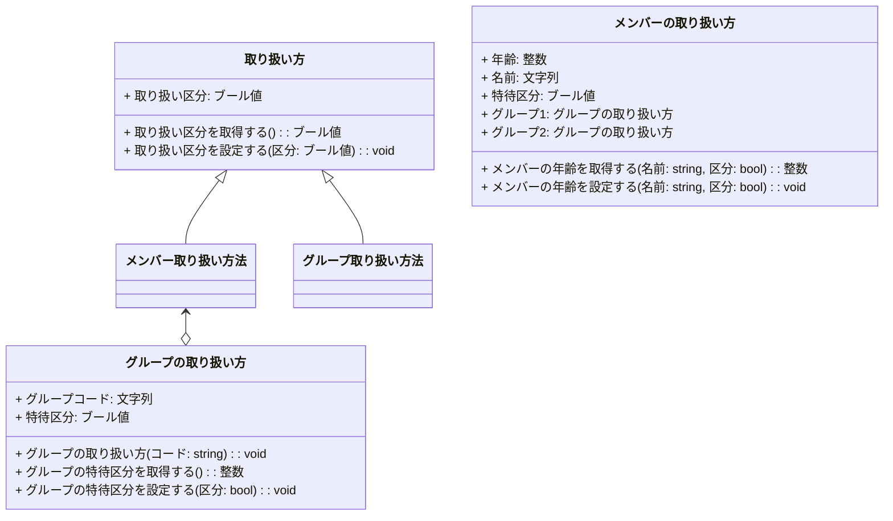
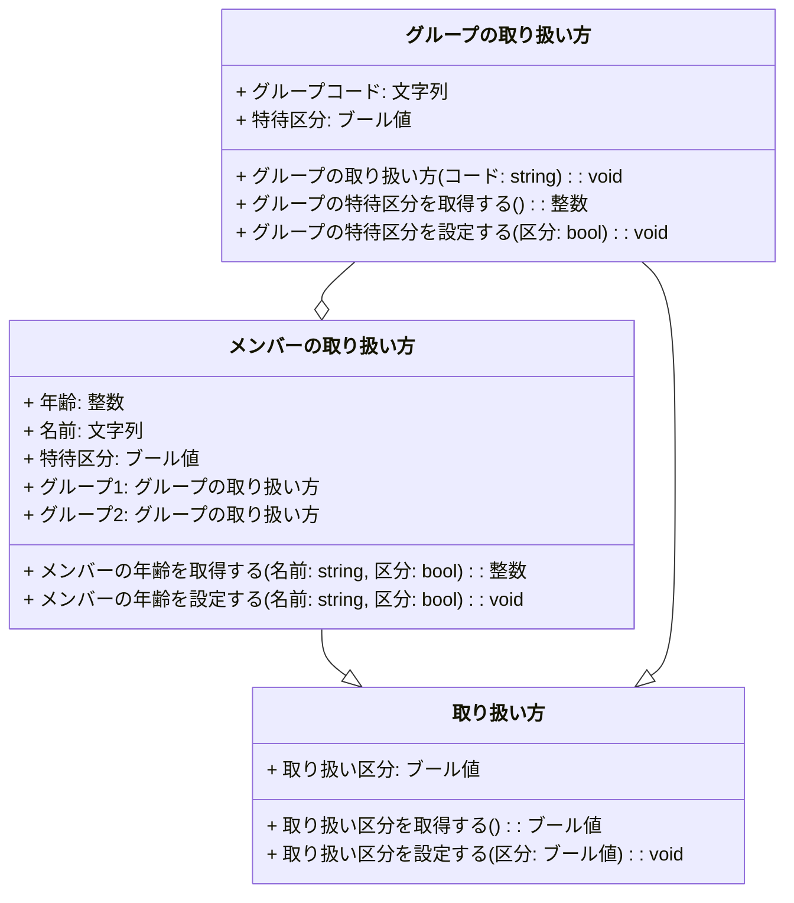

# はじめに
Mermaidのソースコードの代わりに日本語記述のロジック仕様記述言語が間接的なソースコードになるとうれしいなというお話の続きです。前回の記事 [Ph2 派生のほか、集約とか](https://qiita.com/mylifewithviolin/items/9748e9ff277764dfcc8d)では、若干もたつきがありました。

## この記事内容の作業目的
自作ロジック仕様記述言語Re:Mindの構文仕様をAIに学習してもらい、UMLクラス図を作図してもらうことから、日本語ロジック仕様記述言語がUMLクラス図の間接的なソースコードになりうるか検討します。

## この記事内容の保証
※この記事にはAIが自動生成した情報が含まれます。AIが自動生成して書かれた内容の妥当性は保証されません。

# 実行結果
ChatGPTにご提示いただいたMermaidのソースコードでエラーのない状態は、都度Qiita上でイメージ描画するようにしています。
前回の続きからスタートしています。どこがどう違うと自然言語で説明するのがめんどうになり、修正したソースコードを提示しています。

## ChatGPT3.5

私：
ありがとうございます。このようにすると、エラーはなくなりますよ。
```:mermaid
classDiagram

class 取り扱い方 {
  + 取り扱い区分: ブール値
  + 取り扱い区分を取得する(): ブール値
  + 取り扱い区分を設定する(区分: ブール値): void
}

class メンバーの取り扱い方 {
  + 年齢: 整数
  + 名前: 文字列
  + 特待区分: ブール値
  + グループ1: グループの取り扱い方
  + グループ2: グループの取り扱い方
  + メンバーの年齢を取得する(名前: string, 区分: bool): 整数
  + メンバーの年齢を設定する(名前: string, 区分: bool): void
}

class グループの取り扱い方 {
  + グループコード: 文字列
  + 特待区分: ブール値
  + グループの取り扱い方(コード: string): void
  + グループの特待区分を取得する(): 整数
  + グループの特待区分を設定する(区分: bool): void
}

取り扱い方 <|-- メンバー取り扱い方法
取り扱い方 <|-- グループ取り扱い方法
メンバー取り扱い方法 --o グループの取り扱い方
```


ChatGPT:
>素晴らしいです！修正されたMermaidのクラス図のソースコードは正しく集約関係を示し、エラーがなくなりました。これでクラス図が正確に表現されています。


私：
ありがとうございます。描画エラーはなくなりましたが、まだクラス図としての完成度が低いですね。
例えばここは
```
取り扱い方 <|-- メンバー取り扱い方法
取り扱い方 <|-- グループ取り扱い方法
メンバー取り扱い方法 <--o グループの取り扱い方
```
下記のようにした方がRe:Mindのソースコードの意図に近いようです。
```
メンバーの取り扱い方 --|> 取り扱い方
グループの取り扱い方 --|> 取り扱い方
グループの取り扱い方 --o メンバーの取り扱い方
```
ChatGPT:
>了解しました。Re:Mindのソースコードの意図に近い表現に変更します。以下が修正されたMermaidのクラス図のソースコードです。

```:mermaid
classDiagram

class 取り扱い方 {
  + 取り扱い区分: ブール値
  + 取り扱い区分を取得する(): ブール値
  + 取り扱い区分を設定する(区分: ブール値): void
}

class メンバーの取り扱い方 {
  + 年齢: 整数
  + 名前: 文字列
  + 特待区分: ブール値
  + グループ1: グループの取り扱い方
  + グループ2: グループの取り扱い方
  + メンバーの年齢を取得する(名前: string, 区分: bool): 整数
  + メンバーの年齢を設定する(名前: string, 区分: bool): void
}

class グループの取り扱い方 {
  + グループコード: 文字列
  + 特待区分: ブール値
  + グループの取り扱い方(コード: string): void
  + グループの特待区分を取得する(): 整数
  + グループの特待区分を設定する(区分: bool): void
}

メンバーの取り扱い方 --|> 取り扱い方
グループの取り扱い方 --|> 取り扱い方
グループの取り扱い方 --o メンバーの取り扱い方
```
>これで、Re:Mindのソースコードの意図に近い表現が反映されたクラス図となりました。もしご質問や修正があれば、どうぞお知らせください。お手伝いできることがありましたら、いつでもお手伝いさせていただきます。


# おわりに
生成AIにいろいろやってもらうのは自然言語で対話しつつ形式言語のソースコードを調整していく形になりますが、今回はどこがどう違うと自然言語で説明するのがめんどうになり、修正したソースコードを提示しています。ロジック仕様記述言語からMermaidへのトランスコンパイラという処理系はクラス図の実装としても成り立つ気がします。

今回の最終状態

# 参考リンク

https://qiita.com/mylifewithviolin/items/52f806777e6ea031de94

https://qiita.com/mylifewithviolin/items/127a963be816f91b4c84
