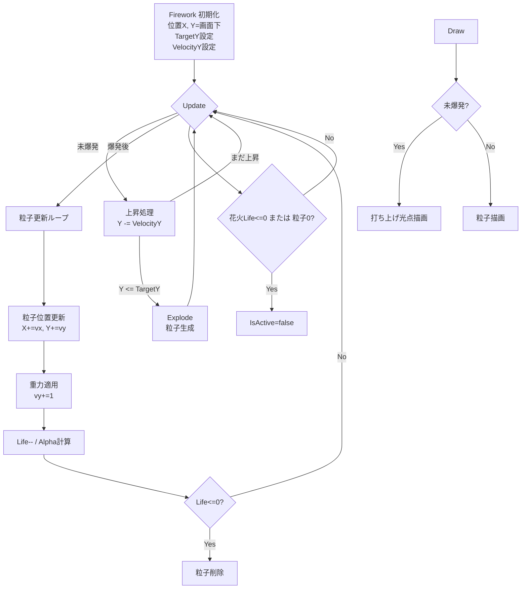

# はじめに
日本語プログラミング言語Mindのバージョン９でAI仕様駆動開発（っぽいこと）を行ってみます。本記事はその第３ステップで、きもちAI仕様駆動開発っぽい感じになってきています。

# 生成AI
## Microsoft Copilot
Windows11アプリケーションのMicrosoft Copilot。昨年末から日本語プログラミング言語あおい（Re:Mind）の原型を作成してもらった生成AI[^1][^2][^3]。モードは「無料プラン」。GitHub Copilotの使い方アドバイザーとして利用。
## GitHub Copilot
GitHub CopilotのPro版を導入。あおいの最小セット（MVP）実装後[^4]の検証で検証改修再検証フローを数回廻したところフリー版のクレジット足らなくなったのでPro版へアップグレード。スーパバイザとしてMicrosoft Copilotを使いGitHub CopilotのCodeAgent推論量を最小化するプロンプトをCopilotで生成しGitHub CopilotのCodeAgentで実行という工法？を採用しています。

# 本記事のステップ
[ステップ２](https://qiita.com/mylifewithviolin/items/34b835716331a64345aa)にてGitHub CopilotがMindの言語仕様に準じて修正・ビルド・再修正ワークフローを廻して、コンパイルエラーがなくせるところまで自律的に動かせましたので、本ステップでは少しアプリ仕様について着目して、実現プランを生成してみます。

## csフォルダの処理概要.md
[ステップ１](https://qiita.com/mylifewithviolin/items/5736ac540c052b409e7a)にて解説しましたが、本記事のお題のソースコードはC#のソースコードからAIに変換してもらったものでした。VSCodeプロジェクトフォルダ内のcsフォルダに変換元のC#のソースコードと仕様のmdを格納してあります。

```cmd
C:\developments\vscode\mind9-ai>dir cs\

2026/09/21  21:30    <DIR>          bin
2026/08/09  12:05            11,451 FireWork.cs
2026/08/09  12:21             3,560 FireWorkForm.cs
2026/09/21  21:31    <DIR>          obj
2026/08/08  21:25             1,067 Program.cs
2025/01/12  01:24               425 WinFormsApp.csproj
2026/08/09  11:53             4,255 処理概要.md
 ```
 こちらのC#アプリはどちらかというVibe Coding（バイブコーディング）的にああしてこうしてといって生成したソースコードに対して、仕様をリバース生成したのが処理概要.mdです。これを今回は読み込んでもらいます。

### 処理概要.md
<details><summary>処理概要.md</summary>

要点だけ先にまとめると **「打ち上げ → 爆発 → 粒子の拡散と減衰 → 描画」という花火アニメーションの完全なライフサイクルを C# で実装している」** という内容です。  
以下、処理内容を構造的に整理します。

---

## ? Firework クラス（通常の花火）

### 1. **打ち上げフェーズ**
- 初期位置は画面下（`Y = height`）。
- 目標高度 `TargetY` に向けて上昇（`Y -= VelocityY`）。
- 目標高度に達すると **爆発処理 `Explode()`** を実行。

---

### 2. **爆発フェーズ（粒子生成）**
`Explode()` 内で以下を行う：

#### ● メインの火花粒子（120?180個）
- 360度に均等配置（角度 = 2π * i / sparkCount）
- ランダム速度（4?12）
- ランダムサイズ（3?7）
- ランダム色（6色のパレット）
- ライフ（18?28）
- α値（透明度）255

#### ● 外周の強調粒子（24個）
- 半径方向に強めの速度を付与
- サイズは小さめ（2?5）
- ライフ（16?26）

---

### 3. **拡散フェーズ（Update）**
各粒子に対して：

- 位置更新  
  `p.X += p.VelocityX`  
  `p.Y += p.VelocityY`
- 重力効果  
  `p.VelocityY += 1`
- ライフ減少  
  `p.Life--`
- α値計算（ライフに応じてフェードアウト）
- ライフが尽きた粒子は削除

花火全体のライフも減少し、粒子がなくなると `IsActive = false`。

---

### 4. **描画フェーズ（Draw）**
- 打ち上げ中は白い光点（本体）＋薄い尾を描画。
- 爆発後は粒子をそれぞれ円として描画（透明度付き）。

---

## ? FireworkTextEffect クラス（文字を花火として散らす効果）

### 1. **Trigger() で文字を粒子化**
- 1600×220 のビットマップに文字を描画。
- 2px 間隔で走査し、文字のピクセル（α > 20）だけ粒子化。
- 粒子の初期位置は文字の描画位置に対応。
- 粒子の初期速度はランダム（左右 ±4、下方向 2?8）。
- 色は Gold / Crimson / Orange / DeepSkyBlue のいずれか。

---

### 2. **Update()**
- 粒子の位置更新
- 横方向速度は徐々に減衰（摩擦）
- 縦方向は重力で加速
- ライフ減少と α値フェードアウト
- ライフが尽きた粒子は削除
- 全粒子が消えると `IsActive = false`

---

### 3. **Draw()**
- 粒子を円として描画（透明度付き）
- αが高い粒子には白い薄い残光（トレイル）を追加

---

## ? 全体のまとめ

この C# コードは **花火の打ち上げから爆発、粒子の拡散、フェードアウトまでのアニメーションを粒子システムで実装**しています。

- **Firework** は通常の丸い花火
- **FireworkTextEffect** は文字を粒子化して散らす特殊演出
- 粒子は位置・速度・色・サイズ・ライフを持ち、毎フレーム更新される
- 描画は `Graphics.FillEllipse()` を使ったシンプルな円描画

つまり **「花火アニメーションの物理挙動＋文字演出を粒子ベースで表現するシステム」** です。

---

**Firework（通常花火）と FireworkTextEffect（文字花火）の処理フローをマーメイドで図式化**しました。  
粒子生成 → 更新 → 描画 → 終了までのライフサイクルが一目で追える構成にしています。

---

## ? **Firework（通常の花火）処理フロー図**



---

## ? **FireworkTextEffect（文字花火）処理フロー図**
Qiitaではシンタックスエラーとなったので割愛


---

</details>

## Microsoft Copilotとの事前準備
やりとりが多かったのはステップ１のときで、ステップ２、３ではだいたいこれでいけるだろうと考えていたのでとくにありません。
## GitHub Copilot
### プロンプト１
>firework.srcは
result\firework修正ビルド完了レポート.md
の状態から開始前の状態に戻しました。
cs\FireWork.cs
cs\FireWorkForm.cs
cs\Program.cs
cs\WinFormsApp.csproj
cs\処理概要.md
に変換元のC#のソースと処理概要を格納しています。UTF-8です。
firework.srcはこれをMindソースへの変換を試みた結果です。
C#のソースは動作しています。
これと同等のMindソースを生成するための修正方針を
docs\firework修正方針.md
に出力してください。
Mindの現状ライブラリで実装できない要件は課題として
まとめてください。代替ライブラリを指示できる場合があります。

#### 生成レスポンス１
>修正方針を firework修正方針.md に出力しました。
>
>内容には以下を含めています。
>
>C#の通常花火、粒子更新、描画、タイマー処理のMind変換方針
文字花火エフェクトの変換可否
現行Mind GUIで実装可能な範囲
Bitmapピクセル取得、ARGB透明度、大量図形更新などの課題
Mind GUIでの近似、外部描画ヘルパー、GUIライブラリ拡張の代替案
段階的な実装手順と完了条件
manual-md 内の全49個のMarkdownを参照対象として確認し、方針書はUTF-8で保存済みです。

生成されたfirework修正方針.mdを読んで、乱数どうするかとか、図形の大量移動とかMindでできるのかとかが詳細にコメントされていたので、生成精度をあげるため、既存実装のサンプルを読み込ませることとしました。

## snowdropsフォルダの乱数サンプルとキャンバス図形移動遅延実行サンプル
snowdropsフォルダに下記のTCL乱数サンプルとキャンバス図形移動遅延実行サンプルのMind9ソースコードファイルを格納しました。

https://qiita.com/mylifewithviolin/items/ef9216f470a40d033405

https://qiita.com/mylifewithviolin/items/cc7cfc4b536f66096684
```cmd
C:\developments\vscode\mind9-ai>dir snowdrops\
2025/01/20  23:40             2,051 randomtcl.src
2025/01/20  23:58             2,970 snowfall4.src
               2 個のファイル               5,021 バイト
 ```
 
## GitHub Copilot
### プロンプト２
>snowdrops\snowfall4.src
snowdrops\randomtcl.src
は実際に動作するMind9のソースサンプルです。
randomtcl.srcは乱数ライブラリです。
これらを読解して
docs\firework修正方針.md
を更新してください。

#### 生成レスポンス２
>firework修正方針.md の現内容を確認したうえで、snowfall4.src と randomtcl.src の実装パターンを読み解きます。特に、乱数・タイマー・canvas描画・粒子更新が既存Mindで実現可能かという方針書の課題部分を、実動サンプルの根拠で更新します。
>
>実動サンプルから、前方針の重要な前提を修正できます。randomtcl.src はTclのexpr { rand() }をMindから評価する正式な乱数実装で、snowfall4.src は固定長の構造体配列、図形IDの再利用、図形を移動、100msの遅延再予約を実際に使っています。これらを根拠として、乱数・周期更新・粒子描画の実装方針を具体化します。

### firework修正方針.md
参考に生成されたfirework修正方針.mdを下記に掲載しておきます。元がmdなのでファイルのリンクを除いてこれもそのまま記載しています。

<details><summary>firework修正方針.md</summary>

# firework.src 修正方針

## 1. 方針の前提

この文書は、次のC#実装を基準に、`firework.src`をMindソースへ変換するための方針を定める。

- cs/FireWork.cs: 通常花火、粒子、文字花火エフェクト
- cs/FireWorkForm.cs: 画面、タイマー、花火群、描画イベント
- cs/Program.cs: WinForms起動
- cs/WinFormsApp.csproj: .NET 8 WinForms構成
- cs/処理概要.md: 処理概要

Mindコードの生成時は、必ずこの文書と docs/Mind言語のコード生成ルール.mdを参照する。また、`manual-md` 配下の全 `.md` を仕様根拠として確認する。

MindマニュアルにないAPI、構文、構造体フィールド、GUI処理を推測で追加してはならない。

## 2. C#実装の機能範囲

### 2.1 通常花火

`Firework` は次の状態を持つ。

- 中心位置: `X`, `Y`
- 爆発目標: `TargetY`
- 上昇速度: `VelocityY`
- 状態: `IsActive`, `HasExploded`
- 花火全体の寿命: `Life`, `MaxLife`
- 粒子のリスト: `FireworkParticle`

粒子は次の状態を持つ。

- 位置: `X`, `Y`
- 速度: `VelocityX`, `VelocityY`
- サイズ: `Size`
- 色: `Color`
- 透明度: `Alpha`
- 寿命: `Life`, `MaxLife`

処理の順序は次のとおり。

1. 画面下から目標高度まで上昇する。
2. 目標高度に達したら爆発する。
3. 円周上にメイン粒子を生成する。
4. 外周強調粒子を追加する。
5. 毎フレーム、粒子の位置、重力、横方向摩擦、寿命、透明度を更新する。
6. 寿命が尽きた粒子を除去する。
7. 粒子がなくなった花火を非アクティブにする。
8. 非アクティブな花火を周期的に再生成する。

### 2.2 通常花火の描画

- 上昇中は白色の中心光と薄い尾を描画する。
- 爆発後は各粒子を円として描画する。
- 粒子の透明度が高い場合は、白色の残光を追加する。

Mindのcanvasでは、マニュアルに記載された「円のIDを取得」「満たす色を設定」「描画」などの図形APIへ変換する。C#の`Graphics.FillEllipse`をそのまま処理単語に置き換えてはならない。

### 2.3 文字花火

`FireworkTextEffect` は、次の処理を行う。

1. 1600 x 220 のBitmapを作成する。
2. Bitmapへフォントで文字列を描画する。
3. 2ピクセル間隔で全画素を走査する。
4. アルファ値が20より大きい画素を粒子へ変換する。
5. 粒子を更新し、横速度の摩擦、重力、寿命、透明度を適用する。
6. 粒子を円として描画し、透明度が高ければ残光を描画する。

これは通常花火とは別の機能であり、通常花火の粒子生成処理だけでは代替できない。

### 2.4 フォームとアニメーション

`FireWorkForm` は次を行う。

- クライアント領域を1200 x 600に設定する。
- 背景色を黒にする。
- 花火を4個管理する。
- 30ms周期のタイマーで更新する。
- フレーム番号と花火ごとのオフセットから再生成周期を計算する。
- 花火が消えたとき、文字エフェクトが非アクティブなら文字花火を開始する。
- 花火と文字エフェクトを再描画する。

MindではWinFormsの`Form`、`Timer.Tick`、`OnPaint`、`Graphics`を使用できない。GUIライブラリのウィンドウ、canvas、イベント処理、遅延実行の仕様へ分解して移植する。

## 3. Mindへの変換単位

### 3.1 データ定義

最初に、マニュアルの構造体定義記法に従って、次のデータを定義する。

- 粒子データ
- 通常花火データ
- 花火配列
- 粒子配列
- canvas IDと図形ID
- フレーム番号、花火数、粒子数

C#の`List<FireworkParticle>`をそのまま表す処理単語はないため、まずは固定長配列と使用中フラグで構成する。固定長はC#の最大値に合わせて事前に決める。

- メイン粒子: 最大180個
- 外周強調粒子: 24個
- 合計: 最大204個
- 花火数: 4個

配列要素のアクセス、構造体メンバーのアクセス、代入は、`manual-md`に記載された構造体・配列の正式記法だけを使用する。現在の`firework.src`にある「取得」「設定」「ランダム(...)」などの未定義表現は使用しない。

### 3.2 初期化

C#の`Firework`コンストラクター相当の処理単語をMind側に定義する。

- Xを指定値にする。
- Yを画面高さにする。
- TargetYを80以上に補正する。
- 上昇速度を乱数で決める。
- IsActiveを真にする。
- HasExplodedを偽にする。
- LifeとMaxLifeを0にする。
- 粒子配列を未使用状態にする。

乱数処理は、`manual-md`に記載された正式な乱数処理単語が確認できる場合だけ使用する。確認できない場合は、乱数を新しい単語として定義せず、固定値または外部入力を使う代替案として課題化する。

### 3.3 更新処理

通常花火の更新は、次の順序を維持する。

1. 非アクティブなら処理を終了する。
2. 未爆発ならYを上昇速度だけ減らす。
3. Yが目標以下ならYを目標値にし、爆発処理へ進む。
4. 爆発後だけ粒子更新を行う。
5. 粒子の位置を速度で更新する。
6. 縦速度へ重力を加える。
7. 横速度を0へ近づける。
8. 粒子寿命を減らし、透明度を計算する。
9. 寿命切れ粒子を未使用状態にする。
10. 花火寿命を減らし、花火または粒子が終了したら非アクティブにする。

C#では`return`、`List.RemoveAt`、`Math.Max`、`Math.Min`を使用しているが、Mindではそれぞれ対応する正式な制御、配列管理、比較処理へ変換する。相当する処理単語がマニュアルにない場合は推測しない。

### 3.4 爆発処理

メイン粒子は、マニュアルにある三角関数の正式記法を使って次の式で生成する。

- 角度: $2\pi i / 粒子数$
- X方向速度: $cos(角度) \times 速度$
- Y方向速度: $sin(角度) \times 速度$

C#では小数計算結果を整数へ変換しているため、Mind側での小数型、整数型、変換方法をマニュアルで確認する。型変換の記載がない場合は、整数近似を独自に推測しない。

外周強調粒子も同様に、24個の固定ループとして移植する。ただし、乱数範囲、除算、整数化の正式記法が確認できない場合は、外周粒子を固定速度へ簡略化する案を別案として示す。

### 3.5 花火群の周期処理

花火群は4要素の固定配列で管理する。

- フレーム番号を1増加する。
- 各花火を確認する。
- 非アクティブなら`(フレーム番号 + i * 110) mod 360`を計算する。
- 結果が0のときだけ新しい花火を作る。
- アクティブなら更新する。

`mod`、比較、配列要素代入は、マニュアルの処理単語を確認して組み立てる。

### 3.6 Canvas描画

Mindのcanvas APIへ次のように対応させる。

- 背景: canvasの背景色設定、またはcanvasクリア
- 打ち上げ中の光点: 白色の円を描画
- 粒子: 粒子色を設定して円を描画
- 残光: 白色の大きめの円を追加描画
- 画面更新: 図形の描画、変更反映、またはcanvasクリア後の再描画

図形IDは、描画後に再利用する必要があるかを確認する。毎フレームに図形を生成し続けると、GUIエンジンの図形数・CPU負荷制限に達する可能性があるため、マニュアルの制限事項を確認し、次のいずれかを選ぶ。

- 毎フレームcanvasをクリアして図形を作り直す。
- 粒子ごとの図形IDを保持し、座標・色・表示状態を更新する。
- Mind canvasではなく、描画専用の外部ライブラリを使う。

実装時は図形数、フレーム時間、GUIエンジンのコマンドキュー詰まりを測定する。

### 3.7 タイマーとイベント

C#の30msタイマーは、MindのGUIマニュアルにあるイベント処理と遅延実行の機能で代替できる可能性がある。ただし、`Timer.Tick`という名称や「タイマーIDを取得」のようなC#風のAPIは使用しない。

実装候補は次の優先順位とする。

1. マニュアルに記載された周期イベントまたは遅延実行予約。
2. 周期イベント処理から短い更新処理を呼び、次回処理を再予約する方式。
3. それでも周期イベントを実現できない場合は、GUIイベント処理を使った簡略アニメーション。

長時間のループで30ms周期を模倣してはならない。GUIエンジンへ制御を返さない処理は、画面描画とイベント処理を停止させるおそれがある。

## 4. 現行Mindライブラリで実装できる可能性が高い部分

以下は、`manual-md`のGUIキャンバスおよび数学処理の範囲で移植候補になる。

- ウィンドウとcanvasの作成
- canvasサイズと背景色の設定
- 円図形の生成と描画
- 図形の色設定
- 画像ファイルのロードと表示
- `sin`、`cos`などの数学関数
- 固定長配列と構造体による状態管理
- 条件分岐、繰り返し、整数演算
- イベント処理と遅延実行による更新の呼び出し
- 花火の上昇、爆発、粒子の位置更新、重力、寿命管理
- 固定文字列をcanvas上のテキスト図形として表示する演出

ただし、各項目の正式な処理単語、引数順、型、構造体アクセス記法は、実装時に該当マニュアルと同梱サンプルで確認する。

## 5. 現行Mindライブラリで同等実装できない、または未確認の要件

### 5.1 Bitmapへの文字描画とピクセル取得

C#はBitmapをメモリ上に作成し、フォントで文字を描画し、`GetPixel`でアルファ値を読み取っている。現在確認できるMindの画像仕様は、画像ファイルのロード、画像の表示、画像を図形として描画する機能であり、次の機能は確認できない。

- オフスクリーンBitmapの生成
- Mindのフォント描画結果を画像へ保存する処理
- 画像の全ピクセルを読み取る処理
- ピクセルのARGB値を取得する処理
- 文字形状から粒子座標を生成する処理

したがって、C#と同じ文字粒子化は現行Mindライブラリだけでは実装不可、または少なくともマニュアル根拠が不足している。推測で実装しない。

### 5.2 粒子ごとのARGBアルファ合成

C#では`Color.FromArgb(alpha, color)`で粒子ごとに透明度を変え、残光も別の透明度で描画している。現在のcanvas仕様で、図形ごとのARGBアルファを設定できることが明確に確認できない場合、同等のフェードアウトは保証できない。

代替案は次のとおり。

- 透明度を使わず、寿命に応じて色を数段階変える。
- 粒子を小さくする、または描画しないことでフェードを近似する。
- Tcl/Tkのcanvas項目へ透明度を設定する拡張を、既存GUIライブラリの正式な拡張として追加する。
- Mindから外部描画ヘルパーへ粒子状態を渡し、外部側でARGB描画する。

このうち、最後の2案は現行ライブラリに存在する機能と断定せず、別途ライブラリ開発が必要な課題として扱う。

### 5.3 高頻度の大量図形更新

C#は1フレームごとに多数の粒子を更新し、Graphicsへ直接描画する。Mind GUIはMind側処理とTcl/Tk側描画エンジンの間にコマンドキューがあるため、短時間に数百個の図形を生成・更新すると、描画遅延やコマンドキュー詰まりが起きる可能性がある。マニュアルのGUIエンジン負荷の制限に従い、次を検証する。

- 204個前後の粒子を30ms周期で処理できるか。
- 毎フレームの図形生成で図形IDや図形数の制限に達しないか。
- GUIエンジンへ処理を返す頻度が十分か。
- canvasクリアと再描画でちらつきが発生しないか。

性能が不足する場合は、粒子数を減らす、更新周期を長くする、描画を数フレームごとに行う、または外部描画ライブラリへ切り替える。

### 5.4 WinForms固有の処理

次のC#処理は、Mindへ同じ形では移植しない。

- `Application.Run`
- `Form.OnPaint`
- `Graphics`
- `DoubleBuffered`
- `System.Windows.Forms.Timer`
- `Invalidate`
- .NETの`Color`、`Bitmap`、`Font`、`SolidBrush`

Mindでは、GUIライブラリのメイン処理、canvas、イベント、図形ID、遅延実行へ変換する。対応するMind仕様がないものは、未実装課題として残す。

## 6. 推奨する実装段階

### 第1段階: canvas動作確認

- 1200 x 600相当のcanvasを作る。
- 黒背景を設定する。
- 円を1個生成して描画する。
- 色変更とcanvasクリアを確認する。

### 第2段階: 固定粒子の静的描画

- 粒子構造体と花火構造体をマニュアル準拠で定義する。
- 乱数を使わず、固定値の粒子を数個描画する。
- 構造体メンバーと配列要素の読み書きを確認する。

### 第3段階: 更新処理

- 1個の花火を上昇させる。
- 目標高度で爆発させる。
- 粒子へ重力、速度、寿命を適用する。
- 1回の更新がGUIへ制御を返すことを確認する。

### 第4段階: 周期処理と4個の花火

- 正式な遅延実行または周期イベントを使う。
- 30ms相当の周期を設定する。
- 花火を4個管理する。
- 非アクティブ時の再生成を実装する。
- 図形数とCPU負荷を測定する。

### 第5段階: 色、残光、性能調整

- 色の種類をC#のパレット相当にする。
- 透明度が未対応なら段階色または非描画で近似する。
- 粒子数、描画周期、canvasクリア方式を調整する。

### 第6段階: 文字花火の判断

文字粒子化は、まず次のAPIの有無を確認する。

- オフスクリーン画像生成
- テキスト描画
- ピクセル読み取り
- アルファ値読み取り
- ピクセル粒子への変換

すべてが確認できない限り、文字花火を通常花火のコードへ混ぜない。固定文字をcanvasのテキスト図形として表示する近似案と、外部ヘルパー方式を別実装として比較する。

## 7. 代替実装の選択肢

### A. Mind GUIだけで近似する

通常花火だけをMindで実装する。文字花火は固定文字テキストの表示、または文字に対応する粒子座標を事前に生成した固定データで代替する。

- 長所: 現行Mind GUIの範囲に収まりやすい。
- 短所: 任意文字列のBitmap粒子化とARGBフェードは失われる。

### B. Mind + 外部描画ヘルパー

Mindは状態更新とイベント制御を担当し、外部プログラムへ粒子データを渡す。外部側はC#、C++、または別途承認された描画ライブラリでBitmap、ARGB、ピクセル粒子化を担当する。

- 長所: C#と同等のピクセル処理を維持しやすい。
- 短所: Mindのファイル操作・プロセス実行・IPC仕様の確認と、外部プログラムの配布が必要。

外部プログラム連携は、`manual-md`にあるファイル操作・プログラム実行仕様だけを使う。未確認のIPC方式を推測しない。

### C. GUIライブラリを拡張する

既存のTcl/TkベースGUIライブラリへ、次の処理を追加する。

- オフスクリーン画像の生成
- テキストの画像化
- ピクセルまたはアルファ値の読み取り
- canvas図形のアルファ設定
- 多数粒子の一括更新

これは既存Mind単語の追加とGUIライブラリ実装の変更を伴うため、単なる`firework.src`の修正では完了しない。API仕様、構造体、処理単語、エラー処理、性能評価を別途設計する。

## 8. 完了条件

Mind版の通常花火について、次を確認できた時点を第一段階の完了とする。

- `firework.src`がSJIS/CP932で保存されている。
- Mindコンパイラがエラーなしで終了する。
- canvasが表示される。
- 花火が上昇し、目標高度で爆発する。
- 粒子が移動し、重力と寿命が反映される。
- 花火が消滅し、周期的に再生成される。
- GUI処理が停止せず、図形数とCPU負荷が許容範囲に収まる。

文字花火を「C#と同等」と判定するには、Bitmap文字描画、ピクセル取得、粒子化、透明度描画の全工程を実際に確認できる必要がある。これらを実装できない場合は、近似版または外部ヘルパー版として明確に区別する。

## 9. 現在のfirework.srcに対する直接的な修正方針

現在の`firework.src`は、構造体やGUI処理単語の意図は含むが、次の点でMindの正式記法になっていない。

- `ランダム(...)`は正式な処理単語として確認してから使用する。
- `取得し`、`設定し`、`円を描く`、`描画開始`、`描画終了`など、マニュアルにない表現は使用しない。
- C#のリスト操作を、Mindの固定長配列と使用中フラグへ変換する。
- `花火の 粒子群の i番目`のような構造体配列アクセスは、マニュアルの正式な配列表記へ変換する。
- `Timer`、`Timer.Tick`、`Invalidate`、`Graphics`を想定せず、Mind GUIの周期イベントまたは遅延実行へ変換する。
- まず文字花火を除外した通常花火だけを、canvasサンプルの正式記法で実装する。
- 通常花火のbuildと動作確認が終わるまで、文字ピクセル化の推測実装を追加しない。

## 10. 実動サンプルによる方針の更新

`snowdrops/snowfall4.src` と `snowdrops/randomtcl.src` は、Mind9で実際に動作するソースサンプルである。以降のMind実装では、これらの記法と処理構成を優先的な実装根拠とする。

### 10.1 乱数は現行Mindで実装可能

`snowdrops/randomtcl.src` は、MindからTclの`expr`を評価して疑似乱数を返すライブラリである。確認できた処理は次のとおり。

- `疑似乱数`: `expr { rand() }`による0.0以上1.0未満の小数乱数
- `種子指定の疑似乱数`: `expr { srand(種子) }`によるシード指定乱数
- `範囲指定の疑似乱数`: 最小値以上、最大値未満の範囲を返す小数乱数
- `範囲指定の疑似乱数２`: 最小値以上、最大値以下の範囲を返す小数乱数

したがって、現在の`firework.src`にある未定義の`ランダム(...)`を新規に推測するのではなく、`randomtcl.src`をライブラリとしてコンパイルし、正式な次の処理単語を使用する。

- 整数範囲が必要な場合は、`範囲指定の疑似乱数２`の戻り値を、サンプルとマニュアルにある小数化・整数化の記法で整数へ変換する。
- 小数範囲が必要な場合は、`範囲指定の疑似乱数`を使用する。
- `疑似乱数()`の呼び出し構文、引数の有無、戻り値の型は`randomtcl.src`の定義に従う。
- `randomtcl.src`の内部実装を`firework.src`へ重複記述しない。ライブラリのコンパイル・読み込み方法を既存のMindサンプルに合わせる。

### 10.2 構造体配列はsnowfall4の方式を使う

`snowfall4.src`では、粒子に図形IDと状態値を持たせ、構造体の全体を固定数の配列として宣言している。

```text
雪片は　構造体
		円ＩＤは　図形ＩＤ
		Y座標は　変数
		速度は　変数
	雪片本体は　円ＩＤと　Y座標と　速度
	全体は　雪の数の　雪片本体。
```

fireworkでは、この方式を次のように適用する。

- 粒子構造体に、円の図形ID、X/Y座標、X/Y速度、サイズ、色、アルファ、寿命、最大寿命を持たせる。
- 花火構造体に、花火の状態、位置、目標高度、上昇速度、寿命、粒子群を持たせる。
- `花火数の 花火`、`粒子数の 粒子`のような固定長構造体配列を使う。
- `List<T>`の追加・削除ではなく、配列要素を再初期化し、使用中状態または寿命で管理する。
- 配列要素の図形IDは保持し、毎フレーム新しい図形を無制限に生成しない。

### 10.3 canvas図形はIDを保持して移動する

`snowfall4.src`は初期化時に円の図形IDを取得し、更新時には次の形式で既存図形を移動する。

```text
円ＩＤ（回数）を　xと　速度（回数）で　図形を移動し
```

この方式により、花火でも次の設計を採用する。

1. 粒子生成時に円の図形IDを取得する。
2. 粒子構造体へ図形IDを保存する。
3. 毎フレーム、計算した移動量または座標で`図形を移動`する。
4. 粒子が寿命切れになったら、図形を削除するか非表示にする正式APIを確認して処理する。
5. 新しい花火を作るときは、寿命切れ要素の図形IDを再利用できるか確認する。

現在の方針にあった「毎フレームcanvasをクリアして図形を作り直す」は、第一候補ではなくなった。まずは`snowfall4.src`と同様に図形IDを保持して移動する方式を採用し、図形数とGUI負荷を抑える。

### 10.4 遅延実行による周期更新

`snowfall4.src`は、30msタイマーを直接想定せず、100msの遅延実行を自分自身へ再予約してアニメーションを継続している。

```text
次の遅延実行を予約とは
	１００ミリと
	遅延後の雪描画の　実行情報と　空列で　遅延実行を予約。
```

イベント処理は、イベント引数を破棄し、状態更新後に次回予約を行う。

```text
遅延後の雪描画とは　本定義　（引数１、引数２、・・、引数個数　→　・）
	イベント引数を捨て
	雪の描く位置を更新し
	次の遅延実行を予約すること。
```

fireworkでは、この形式を使って次を行う。

- 花火群の更新と描画を1回の遅延イベントで行う。
- 処理の最後に次の遅延実行を予約する。
- 30msがMind9のGUIエンジンで安定しない場合は、まず100msなど実動サンプルで確認済みの周期で動作確認する。
- 30ms相当が必要な場合は、遅延値を短くして実測し、GUIエンジン負荷と描画の停止を確認する。
- 長時間ループで周期を模倣せず、必ずGUIへ制御を返してから再予約する。

これにより、以前の「周期イベントまたは遅延実行のどちらか不明」という記述を更新し、現行Mindで実証済みの遅延再予約を第一候補とする。

### 10.5 図形色とアルファの扱い

`snowfall4.src`では、円を作成したあとに`白色で 円IDに 満たす色を設定し`、図形IDを保存して描画している。したがって、通常の粒子色を粒子ごとに設定する処理は、現行canvas APIで実装候補になる。

一方、`snowfall4.src`と確認済みのcanvasサンプルからは、C#の`Color.FromArgb`と同じ粒子単位のアルファ合成までは確認できない。よって、次の優先順位で実装する。

1. 粒子色を通常のcanvas色として設定する。
2. アルファ設定の正式なGUI処理単語がマニュアルまたは実動サンプルで確認できた場合だけ使用する。
3. 確認できない場合は、寿命に応じた色変更、サイズ変更、描画停止でフェードを近似する。
4. C#と同等のアルファが必要なら、GUIライブラリ拡張または外部描画ヘルパーを課題として扱う。

### 10.6 snowfall4方式で実装できる範囲

`snowfall4.src`と`randomtcl.src`を根拠に、次の通常花火処理は現行Mindで実装可能性が高い。

- 乱数による花火位置、上昇速度、粒子速度、粒子サイズ、粒子寿命の初期化
- 固定長の構造体配列による4個の花火と各粒子の管理
- `sin`、`cos`、小数演算による円周上の粒子生成
- 粒子の位置、速度、重力、摩擦、寿命の更新
- 粒子ごとの図形ID保持
- `図形を移動`による既存円の更新
- 遅延実行の再予約によるアニメーションループ
- 粒子色の変更と円の描画

したがって、通常花火については「乱数ライブラリがない」「周期更新を実現できるか不明」「粒子図形を再利用できない」という課題を残さず、上記サンプル方式で実装を開始する。

### 10.7 なお残る課題

実動サンプルを確認しても、次のC#機能は同等性が未確認である。

- Bitmapへ任意文字列を描画して画素を読み取る処理
- 文字画素から任意個数の粒子を生成する処理
- 粒子ごとのARGBアルファ合成
- `Graphics`相当の高速な大量円描画
- 30ms周期が100ms周期と同じ安定性で動作すること

文字花火は、まず固定文字をcanvasのテキストまたは画像として表示する近似案を通常花火と分離して検討する。C#と同じ文字粒子化を要求する場合は、画像・ピクセルAPIを追加したGUIライブラリ、または外部描画ヘルパーが必要である。

## 11. 実装時の参照優先順位

fireworkのMindコードを修正するときは、次の順で根拠を確認する。

1. `snowdrops/snowfall4.src`の構造体配列、図形ID、図形移動、遅延再予約の実動記法
2. `snowdrops/randomtcl.src`の乱数処理単語とTcl評価の実装
3. `manual-md`全体に記載された構造体、算術、GUI、イベント、制限事項
4. `cs`配下のC#ソースと処理概要にある動作要件

上位資料にない処理を下位資料から推測して追加しない。実動サンプルとマニュアルで仕様が確認できない要件は、課題または代替案として明示する。

## 12. 実動サンプルの参照箇所マップ

この方針書で `snowdrops/snowfall4.src` と `snowdrops/randomtcl.src` を参照した箇所は次のとおりである。実装時は、対応する方針節とサンプルの処理ブロックを併読する。

### 12.1 `snowdrops/randomtcl.src` の参照箇所

| 方針書の節 | 参照した定義・記述 | fireworkへの適用 |
| --- | --- | --- |
| 3.2 初期化 | `疑似乱数とは`、`範囲指定の疑似乱数`、`範囲指定の疑似乱数２` | 花火のX座標、目標Y、上昇速度、粒子速度、サイズ、寿命を初期化する。 |
| 3.4 爆発処理 | `疑似乱数`の戻り値型とTcl `expr` 評価 | 乱数を新しい`ランダム(...)`構文として推測せず、既存関数の戻り値を小数化・整数化して使用する。 |
| 10.1 乱数は現行Mindで実装可能 | 3種類の疑似乱数関数の定義全体 | 乱数ライブラリを重複実装せず、`randomtcl.src`をライブラリとして利用する。 |
| 10.6 snowfall4方式で実装できる範囲 | `範囲指定の疑似乱数`、`範囲指定の疑似乱数２` | 通常花火のランダム初期化を現行Mindの実証済み機能として扱う。 |
| 11 実装時の参照優先順位 | 参照順位の2番目 | `snowfall4.src`の処理を実装するとき、乱数部分はこのファイルの処理単語・引数・戻り値を優先する。 |

### 12.2 `snowdrops/snowfall4.src` の参照箇所

| 方針書の節 | 参照した定義・記述 | fireworkへの適用 |
| --- | --- | --- |
| 3.1 データ定義 | `雪片は 構造体`、`雪片本体`、`全体は 雪の数の 雪片本体` | 粒子に図形IDと状態を持たせ、固定長の粒子配列として定義する。 |
| 3.1 データ定義 | `円ＩＤは 図形ＩＤ`、`Y座標は 変数`、`速度は 変数` | 粒子データに図形IDを含め、描画対象と状態値を同じ配列要素で管理する。 |
| 3.6 Canvas描画 | `全ての雪片を初期化して雪片を描くとは` | 初期化時に円のIDを取得し、色を設定し、描画する処理の基準にする。 |
| 3.6 Canvas描画 | `キャンバスと Xと Y座標と Rで 円のＩＤを取得し` | 花火の各粒子を円として生成する際の正式な引数順の根拠にする。 |
| 3.6 Canvas描画 | `白色で 円ＩＤに 満たす色を設定し`、`円ＩＤを 描画する` | 粒子色設定と図形描画の正式な処理単語の根拠にする。 |
| 3.3 更新処理 | `雪の描く位置を更新するとは` | 固定長配列を回数指定で走査し、各要素の座標・速度を更新する処理構造の根拠にする。 |
| 10.2 構造体配列はsnowfall4の方式を使う | 雪片構造体と固定長配列の記法 | `List<T>`の追加・削除を使わず、寿命や使用中状態で粒子を再利用する設計にする。 |
| 10.3 canvas図形はIDを保持して移動する | `円ＩＤ（回数）を xと 速度（回数）で 図形を移動し` | 毎フレーム図形を新規生成せず、保持した図形IDを移動させる。 |
| 10.4 遅延実行による周期更新 | `次の遅延実行を予約とは` | 更新処理の最後に次の遅延イベントを予約するアニメーションループの根拠にする。 |
| 10.4 遅延実行による周期更新 | `遅延後の雪描画とは 本定義`、`イベント引数を捨て` | イベント引数を破棄して更新し、次回予約するイベント処理の正式な構造にする。 |
| 10.5 図形色とアルファの扱い | 円の色設定と図形ID保持 | 通常色の設定は実装候補とし、C#同等のARGBアルファは別課題として分離する。 |
| 10.6 snowfall4方式で実装できる範囲 | 雪片の初期化、更新、再描画の一連の処理 | 通常花火の初期化、粒子更新、図形移動、周期更新を実装する際の全体テンプレートにする。 |
| 11 実装時の参照優先順位 | 参照順位の1番目 | Mindコードの具体的な処理単語と制御構造を決める際に最優先で確認する。 |

### 12.3 参照していないもの、または追加確認が必要なもの

上記2サンプルからは、次のC#機能の正式な実装記法までは確認できない。

- Bitmapへ文字列を描画して画素を読み取る処理
- 画素のアルファ値を粒子の透明度へ変換する処理
- C#の`Color.FromArgb`と同等の図形単位ARGB合成
- 30ms周期が100ms遅延と同じ安定性で動作すること

これらは、`snowfall4.src`や`randomtcl.src`の記法から推測して追加せず、マニュアルまたは別の実動サンプルで正式仕様を確認できた場合だけ方針を更新する。

</details>


次回では調整したこの修正実行プランを実行していきます。修正方針の構造化ドキュメントとしてはなかなかりっぱな内容のができてきた感がありますが、最初の実行結果はけっこう苦戦していきます。（つづく）

# おわりに
同じことをしようとしている方々の参考になれば幸いです。まだたいした参考になりませんが、徐々にそうなっていくことを願っております:joy:

[^1]: Microsoft Copilotで日本語トランスコンパイラ言語 Re:Mindをいじりたおす - Qiita
[^2]: Copilotが生成した日本語トランスコンパイラ言語 Re:MindのASTパーサが動作するまで - Qiita
[^3]:Copilotが生成した日本語トランスコンパイラ言語 Re:MindのC#コード生成が動作するまで - Qiita
[^4]: AIとつくる日本語プログラミング言語Aoi （あおい） - Qiita
