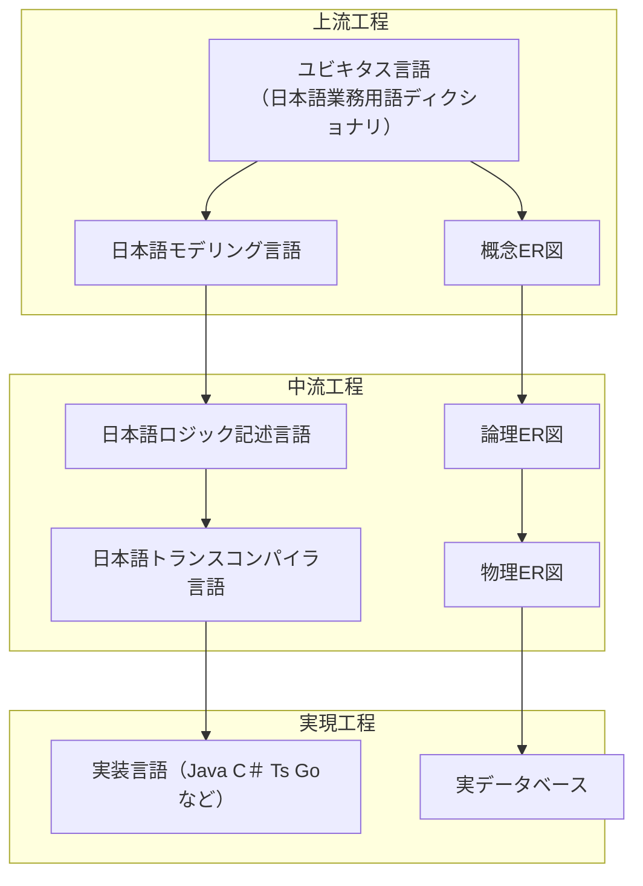

# はじめに

日本語プログラミング言語をモデリング言語としてシステム開発上中流工程に導入した場合、そのメリット・デメリットについて考察します。本記事の内容はいくつかに分割されて記載されます。本記事中の「本記事」とは分割された内容の総体を指す場合があります。

https://qiita.com/advent-calendar/2023/remind

この記事は日本語構造化仕様記述言語 Re:Mind（リマインド）アドベントカレンダー2023の10日向けの記事です。

## 対象読者
とりあえずこの記事の想定読者はシステムエンジニアさんです。とくに日本語で要求仕様や内部設計資料を書いている方向けのお話です。

# 想定しているシステム開発フロー
オーソドックスなリレーショナルデータベースを使用している業務システムを想定しています。とりあえず国内案件として既定自然言語は日本語を想定していますが、自然言語記述の代わりに構造化されたモデリング言語を使用するという意味では日本語に限定されることはない要件です。

右側のルートにリレーショナルデータベースの一般的な設計フェーズを併記しています。こちらのルートは各種ツールがデータベースベンダーやモデリングツールベンダーもしくはそれらを提供するOSSなどから豊富に出そろっています。

本記事の主題は左側のルートで、実装言語に至る設計フェーズでは、現状これといった有力なツールとしては、図系言語のUMLまたは数学的形式言語のVDM++などが想定されます。本記事ではそれらのツールとの対比で、日本語プログラミング言語を使用した場合のメリット・デメリットを考察します。

# 各工程の「完成」とは
前記のざっくりとしたシステム開発フロー図では、「実現工程」としてはテスト工程を含み、「実現工程」の「完成」とはシステムがソフトウェアとして正常に動作する状態を言います。（ここでは隠れたる瑕疵の存在はとりあえず考慮しません。）

しかし、「上流工程」「中流工程」の「完成」とはどういう状態として定義されていますでしょうか？

数学的形式言語のVDM++を導入している場合はでは、各工程の成果物に対して言語の検証ツールによるコンパイルが通過したことを持って「完成」とすることができますが、それ以外の場合はおおむね人間系のデザインレビューによる判定となるかと想定しています。

# この回のまとめ
本記事ではデザインレビューの判定基準が、各工程の成果物の書き味に立ち入らない場合は、往々にして日程消化の都合上不安定な成果物が後工程の「実現工程」に投入されることにより、「実現工程」の担当者に負荷のしわ寄せがおそいかかるという状況を避けられないものかという問題意識を含んでいます。

# 次回
~~各工程の詳細について検討してきます。~~
レイヤードアーキテクチャにふれます。
