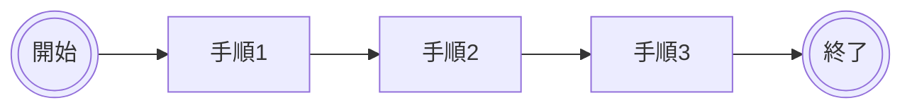
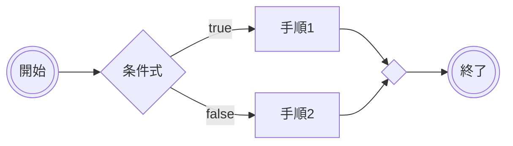
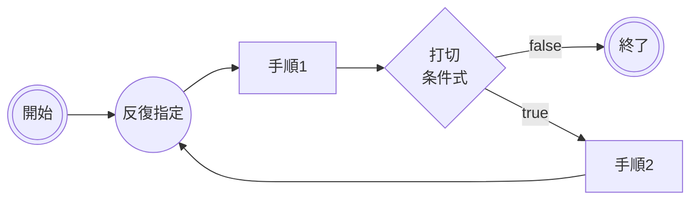
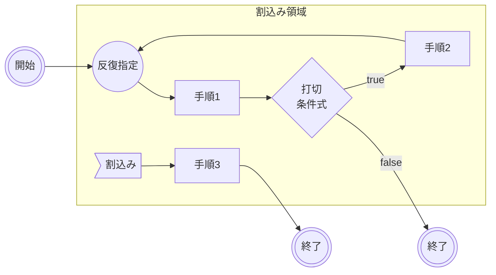

# はじめに
プログラミング初心者が様々なことを大量に覚えようとする前にまず認識すべき重要な点についてまとめてみました。

## 対象読者
プログラミングに関心を持たれた超初心者または業務上やむなくプログラミングをしないといけない方（経験なし）

# プログラミングの３大ロジック構造とは
順次、分岐、反復の３つの制御構造（control structures）によって処理の流れを記述することを構造化プログラミングといいます。

**1．順次（sequence）** 部分プログラムを順々に実行する。
**2．分岐（bifurcation）** 条件式が導出した状態に従い、次に実行する部分プログラムを選択して分岐する。
**3．反復（repetition）** 条件式が導出した特定の状態の間、部分プログラムを繰り返し実行する。ループ処理。

今日のプログラミング言語は非常に煩雑な記述をコード記述者に要求します。そこには、同種のプログラミング言語であっても、構成されるライブラリ群一式フレームワークの違いによっても様々な「動かす」ための記述規約が異なった状態であります。プログラミング初心者の方はこの煩雑さに目を奪われてしまって、習得を断念してしまう場合があるかもしれません。

しかし、今日の手順的なコンピュータ言語によるソフトウェアの記述は、**どんなに複雑そうに見えても、これらの制御構造の組み合わせからなる**という点を強く認識しておくことは、複雑なアプリケーションを書くようになるためにも重要です。

# 初心者は要概念獲得　4つ目の制御構造[割込み]とは
そして、筆者は今日のウィンドウシステム上のアプリケーション、Webブラウザ上でHTMLと協調して動作することを想定しているWebアプリケーション（主にフロントエンド処理）が、イベント駆動型プログラミングとなっていることを鑑みて、４つ目の制御構造として[割込み]という概念も確実に消化理解することを推奨します。

**4．割込み（interrupt）** ある連続的な処理の流れの中で、ハードウェアやソフトウェアが発する信号・メッセージに応じて割り込んで処理する流れ

# Mermaidによる4大制御構造のフロー図
Mermaidで上記4大制御構造のフロー図を記述しました。これは基本形で、この基本構造の上に様々なバリエーションが存在しますが、まずはこの４つの構造を確実に理解しておくことが重要です。

## 順次

各手順の中には、分岐や反復が入れ子になっている場合があります。これらの入れ子構造により、複雑なアプリケーションが書かれていきます。
## 分岐

分岐の数は3以上の場合があります。また、手順の中に分岐や反復が入れ子になっている場合があります。
## 反復
ループの表記は独自です。台形より〇が出現した方が直感的に認識しやすいかな派です。

打切条件式による終了への分岐がない場合は無限ループです。打切条件式の位置により、バリエーションがあります。台形表記のループ記述では、反復回数が記述される場合があります。
## 割込み
いちおう割込領域とかはUMLの表現に従ってみました。要素の位置を細かく指定しきれず、開始の位置がちょっとヘンなのはご容赦ください。

この図の意味するところは、反復処理がぐるぐるやっているところに　＞割込み］というノードを起点に手順３が動作するということです。処理の流れ上、どこに割り込まれるのかが描きづらいので、UML上は「割込み領域」という範囲指定で表現しています。手順3に続く終了は本体処理の終了を意味せず、　＞割込み］を起点に開始された処理の終了を意味して書いています。

# おわりに
Qiitaユーザーでプログラミング講師の@codek2さんの記事[^1]　を拝読して、きっちり3大制御構造のチュートリアルのコンテンツを公開されていらっしゃったので、割込みとかどうですかね？的なコメントについて、いいかもですが、私の方になにか説明記事ありますかね？というリクエストをいただいたので、投稿してみました。

# 参考リンク
https://algo.jeita.or.jp/index.html

>アルゴロジックとは何ですか?
ゲーム感覚でプログラミングを体験するための「課題解決型ゲームソフト」です。プログラムに触れたことのない未経験者から上級者まで、プログラミングの基礎であるアルゴリズムの学習に楽しみながら取り組むことができ、プログラミング的思考力の育成に役立ちます。プログラムの3つの制御構造のうち、アルゴロジック1は、「順次処理」と「繰り返し処理」を、アルゴロジック2は、「順次処理」「繰り返し処理」「分岐処理」を実現しています。

[^1]: Qiita [誰でも役に立つ！はじめてのプログラミング（アルゴリズムとJava）](
https://qiita.com/codek2/items/98a54afd5485d0d9bc6e)　参照
