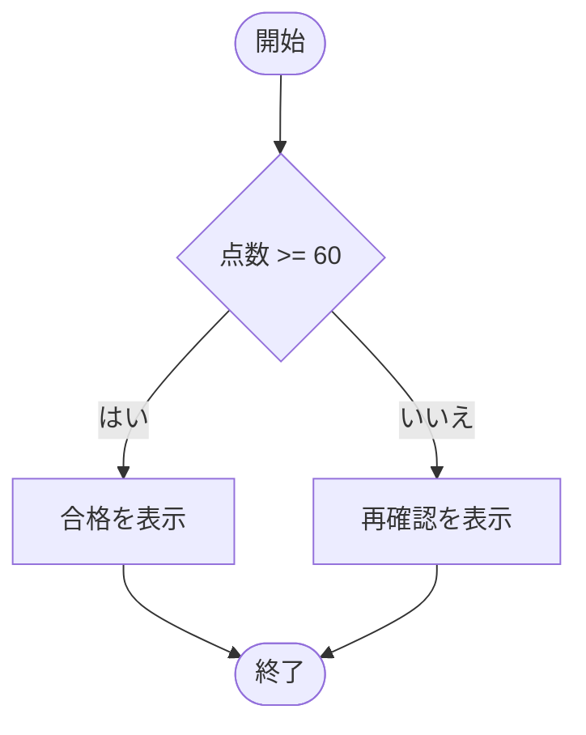

# はじめに
日本語プログラミング言語あおい（Aoi）の実装言語仕様2025 Lv1.2を生成AIに読み込ませて仕様駆動開発を展開し、2026 Lv1.3（で確定した範囲の一部）で最小MVPの開発を完了しました。これに伴いモデリング言語なごみ（Nagomi）の開発を加速させるべく、なごみ仕様2026 Lv1.0 ドラフトのAIレビューを実施し内部仕様を再構成しました。

# 概要
日本語プログラミング言語なごみ（Nagomi）（開発コード名 日本語要求仕様記述言語Re:Mind）はオープンなモデリング言語仕様で[^1]、どなたでもこの記法を使いモデリングしロジックを記述することができます。

## この記事内容の保証
※本記事に開示された仕様は次バージョンの仕様においては予告なく変更される場合があります。また、このバージョンの仕様内で補足や追加がなされる場合があります。

# 日本語モデリング言語なごみ（Nagomi）とは

なごみ（Nogomi）は、システムエンジニアなどソースコードを直接生産しない職種の方々が、具体的にはデータベースをつかったシステムをモデリングするためのモデリング言語です。

構文チェックを経た後の生成物はmermaidクラス図のソースコードが生成されます。また、コンパイラ言語のいずみにソースコードをトランスコンパイルすることもできるとしています。


# 日本語プログラミング言語 なごみ（Nagomi）言語仕様 2026 Lv1.0 ドラフト v2

> 本書は、Lv1.0ドラフトを、あおい（Aoi）Lv1.4ドラフト v3およびいずみ（Izumi）Lv1.1ドラフトの方針と整合するよう改訂したものです。Mermaid出力といずみへの変換で意味・表現の異なる部分を区別し、処理系が黙って構文を省略したり別の意味へ置き換えたりしないことを基本とします。
>
> あおいLv1.4およびいずみLv1.1もドラフトであるため、本書で参照するターゲット仕様の未確定事項は「要確認」とします。本書自体も確定仕様ではありません。

## 1. 目的と位置付け

日本語プログラミング言語なごみ（Nagomi）は、データベースを用いるシステム等のモデルと、そのモデルに関係する処理ロジックを日本語で記述する言語です。処理系は入力を解析・型検査し、次のいずれかを生成します。

1. Markdown形式のMermaidクラス図。モデル要素に加え、実装ロジックを記述した関数・メソッドには関数ごとのMermaidフロー図も生成します。
2. いずみ（Izumi）ソースコード。いずみの構文検査を通過することを目標とします。いずみ実行系のライブラリや任意のターゲット言語APIは対象にしません。

なごみは実行コードのコンパイラではありません。モデルの関数は処理本体を持たない仮宣言にできます。仮宣言をいずみに変換するときは、本書で定める「要処理記述」コメントと、必要に応じてダミー戻り値を含むスタブ関数を生成します。したがって、仮宣言を含む変換結果は構文検査を通過しても、設計ロジックの実装や実行結果を保証しません。

Re:Mindは言語ファミリーの旧称・開発上の呼称であり、なごみの別名として構文規則には使用しません。

### 1.1 本書の表示

| 表示 | 意味 |
|---|---|
| **本ドラフトの規則案** | なごみLv1.0ドラフトv2で採用する規則案です。確定仕様ではありません |
| **ターゲット同期案** | あおい・いずみのドラフトに合わせる規則案です |
| **要確認** | 参照先仕様または処理系契約が未確定で、確定前に確認が必要です |
| **対象外** | 本ドラフトの受理範囲に含めない機能です |

### 1.2 出力先ごとの適合範囲

構文解析と型検査は出力先にかかわらず行います。出力先が意味を保持できない構文を検出した場合、診断してその出力を失敗させます。未対応要素を無視したり、ターゲット言語固有の意味へ暗黙に読み替えたりしてはいけません。

| 要素 | Mermaid Markdown | いずみ |
|---|---|---|
| クラス、継承、フィールド、関数シグネチャ | クラス図に出力 | いずみが対応する構文へ変換。非対応の層・機能は診断 |
| 関数・メソッドの処理本体 | 処理ロジックがある関数ごとにフロー図を出力 | 対応する実行文を変換 |
| 関数・メソッドの仮宣言 | シグネチャをクラス図に出力。処理本体がないためフロー図は出力しない | 構文検査を通るスタブへ変換。戻り値のダミー値は実装結果ではない |
| コンソール出力 | クラス図の要素にはしない。処理本体に含まれる場合はフロー図の処理ノードにする | いずみの予約機能へ変換 |
| Import、Alias、任意のターゲットAPI | 対象外 | 対象外 |

## 2. 字句規則

### 2.1 文字、改行、空白

- 入力は厳密なUTF-8として読みます。不正なUTF-8はエラーとし、置換文字に置き換えて続行しません。UTF-8 BOMはファイル先頭にある場合だけ除去できます。
- 改行にはLFまたはCRLFを使用できます。行番号は1始まりです。
- 半角空白、全角空白、タブはトークン区切りとして扱います。インデントはブロック境界を定めません。
- 物理改行は単純文の終端です。括弧内および文字列リテラル中に改行を含めることはできません。
- 空行とコメントだけの行は、構文上無視します。
- キーワードと隣接識別子はトークン境界で区別します。空白を省略できる位置は本書の構文例に示したものに限ります。

### 2.2 構文記号

| 記号 | Unicodeコードポイント | 用途 |
|---|---|---|
| `▽` | U+25BD | クラス・関数の開始 |
| `△` | U+25B3 | クラス・関数の終端 |
| `□` | U+25A1 | 実行文の開始 |
| `◇` | U+25C7 | 分岐の開始・節 |
| `〇` | U+3007 | 繰り返しの開始・終端 |
| `・` | U+30FB | 変数・定数の宣言 |

類似文字（例：`○` U+25CB、半角中点 `･`）は代替記号ではありません。`▽△` の並びは仮宣言を表す専用の開始記号列です。

### 2.3 識別子と予約名

- 識別子の先頭にはUnicode文字または `_` を使用できます。2文字目以降にはUnicode文字、Unicode数字、`_` を使用できます。
- 識別子の比較は、Unicode正規化や大文字・小文字変換を行わず、入力されたコードポイント列で行います。
- 同一スコープ内の重複宣言はエラーです。関数名は同一プログラム内で一意とし、オーバーロードを認めません。
- 型名、制御キーワード、`コンソール.一行表示する` は予約名です。利用者定義名と衝突する場合はエラーです。
- Mermaid出力では、利用者の識別子を図の内部IDとして直接使用しません。処理系が決定的な安全IDを割り当て、元の名前は適切にエスケープして表示します。

Unicodeの版、文字カテゴリの厳密な判定方法、および予約語の完全な一覧は要確認です。

### 2.4 コメント

- `//` は行末までのコメントです。
- `/* ... */` は複数行コメントです。入れ子にはできません。閉じていないブロックコメントは位置付きエラーです。
- 文字列リテラル内のコメント記号はコメントとして扱いません。
- コメントは構文・意味解析で無視します。ただし、仮宣言からいずみへの変換時に生成する `//要処理記述` は変換契約上の出力コメントです。
- JavaDoc形式コメントによる英字名指定には対応しません。名前変換は11章の規則に従います。

## 3. 型・変数・定数

### 3.1 基本型

なごみの型名は、次の日本語名または対応するあおい論理型名に限定します。大文字小文字を含む別表記やターゲットの物理型名は受理しません。

| なごみ型名 | 同義のあおい論理型名 | 意味 |
|---|---|---|
| `整数` | `int` | 符号付き32ビット整数 |
| `文字列` | `string` | null非許容文字列 |
| `ブール値` | `bool` | 真偽値 |

利用者定義クラス名は、クラスが利用可能な型位置でクラス型として使用できます。`Integer`、`String`、`boolean`、`long` 等の物理型名・未登録型名はエラーです。`null`、nullable型、暗黙の数値変換、暗黙の文字列化は対象外です。

### 3.2 変数・定数の宣言

変数宣言の基本形は `・型名 名前 = 式`、定数宣言の基本形は `・定数 型名 名前 = 式` です。型名には3.1節の型名を使用します。

```nagomi
・整数 年齢 = 34
・文字列 名前 = "花子"
・ブール値 特待区分 = true
・定数 整数 上限 = 10
```

`・変数 型名 名前 = 式` の形も同じ変数宣言として受理できます。初期値は必須です。変数の初期値は宣言型と一致しなければなりません。定数は初期化後に再代入できません。宣言された名前は宣言位置以降の同一ブロック内で有効です。

クラス内のフィールドについても型検査を行います。未初期化フィールドを許可するか、ターゲット側の既定初期化に委ねるかは要確認です。いずみへ変換する場合、変換先が要求する初期化条件を満たせないフィールドは診断します。

## 4. 式と演算子

### 4.1 リテラルと演算子

| 分類 | 記法 | 規則 |
|---|---|---|
| 整数 | 十進整数 | 32ビット符号付き整数 |
| 文字列 | `"..."` | `\\`、`\"`、`\n`、`\r`、`\t` のみエスケープとして受理 |
| 真偽値 | `true`、`false` | ブール値 |
| 整数算術 | `+ - * / %` | 整数同士。除算は整数除算で、小数部をゼロ方向へ切り捨て |
| 整数比較 | `< > <= >=` | 整数同士。結果はブール値 |
| 等価比較 | `== !=` | 同じ基本型の値同士。文字列は序数による値比較 |
| 論理演算 | `! && ||` | ブール値同士。`&&` と `||` は短絡評価 |

文字列の大小比較、型の異なる比較、暗黙変換、未定義エスケープはエラーです。ゼロ除算は実行時エラーです。整数オーバーフロー時の実行結果はターゲット間で保証しません。

### 4.2 優先順位と結合性

上から順に優先順位が高くなります。括弧で評価順を明示できます。

| 優先順位 | 演算子 | 結合性 |
|---:|---|---|
| 1 | 単項 `!`, 単項 `-` | 右から左 |
| 2 | `*`, `/`, `%` | 左から右 |
| 3 | `+`, `-` | 左から右 |
| 4 | `<`, `>`, `<=`, `>=` | 連鎖不可 |
| 5 | `==`, `!=` | 連鎖不可 |
| 6 | `&&` | 左から右 |
| 7 | `||` | 左から右 |

比較演算子を連鎖して記述することはできません。演算子・リテラルの範囲外の式は診断し、ターゲット言語の優先順位に判断を委ねません。

### 4.3 関数呼び出しとコンソール出力

呼び出しは `関数名(式, ...)` の位置引数形式です。引数の数・型は関数シグネチャと照合します。再帰は許可します。関数シグネチャは本体解析前に登録し、宣言順に依存させません。

```nagomi
・整数 合計 = 合計する(3, 5)
□コンソール.一行表示する(合計)
```

`コンソール.一行表示する(式)` は予約機能です。引数は `文字列` または `整数` の1つに限ります。ブール値、null、未対応型は拒否し、利用者定義による同名機能の上書きも認めません。

旧仕様の `□(式, ...)で 関数名` 形式および助詞だけで関数名を解決する形式は、本ドラフトでは対象外です。

## 5. 関数と仮宣言

### 5.1 通常の関数宣言

戻り値あり関数は `▽戻り値型 関数名(型 引数, ...)` で開始し、`△` で終了します。戻り値なし関数は戻り値型を省略して `▽関数名(型 引数, ...)` とします。引数なしは `()` とします。いずみへ変換する際は、戻り値なし関数にいずみの戻り値型 `void` を付けます。

```nagomi
▽整数 合計する(整数 左, 整数 右)
    □左 + 右 を 返す
△

▽年齢を表示する(整数 年齢)
    □コンソール.一行表示する(年齢)
△
```

関数名の重複・オーバーロードは認めません。値を返す関数は、すべての実行経路で戻り値型と一致する値を返す必要があります。戻り値のない関数から値を返すことはできません。returnの正規形は `□式を 返す` とし、`□式 を 返す` と `□return 式` は同じ意味の互換形として受理します。

### 5.2 仮宣言の構文

仮宣言は関数本体を持たず、`▽△` の直後にシグネチャを記述します。通常の関数定義のように、シグネチャの後ろに本体や終端の `△` は置きません。

```nagomi
▽△整数 年齢を取得する(文字列 名前, ブール値 区分)
▽△年齢を設定する(文字列 名前, ブール値 区分)
```

仮宣言は関数シグネチャ、引数型、戻り値型、名前解決の検査対象です。仮宣言には処理本体が存在しないため、実装ロジックがあるとはみなしません。クラス内のメソッドにも同じ記法を使用できます。

関数本体がコメントのみで実行文を含まない場合は、仮宣言と同等に扱います。開始・終端記号の対応が一意でない宣言はエラーです。

### 5.3 仮宣言のいずみ向け変換

仮宣言は、いずみへ変換するときに必ずスタブ関数へ変換します。生成関数の開始行と `△` の間に、単独行の `//要処理記述` を追加します。コメントの直後には、戻り値の有無に応じて次の規則を適用します。

**戻り値なし：** コメント以外の実行文を追加しません。

なごみ:

```nagomi
▽△年齢を設定する(文字列 名前)
```

いずみ出力例:

```izumi
▽void 年齢を設定する(string 名前)
    //要処理記述
△
```

**戻り値あり：** コメントの後に、戻り値型と一致するダミー戻り値変数を初期値付きで宣言し、その値を返します。初期値は `int` / `整数` に `0`、`string` / `文字列` に `""`、`bool` / `ブール値` に `false` とします。

なごみ:

```nagomi
▽△整数 年齢を取得する(文字列 名前)
```

いずみ出力例:

```izumi
▽int 年齢を取得する(string 名前)
    //要処理記述
    ・int 仮戻り値 = 0
    □仮戻り値 を 返す
△
```

いずみへの変換では、関数名・引数名・変数名をなごみの日本語名のまま出力します。型名は日本語型名または対応するあおい論理型名を使用します。ダミー戻り値変数も日本語名（例：`仮戻り値`）とし、関数内の他の名前と衝突する場合は、日本語名のまま連番等を付けて一意にします。

ダミー値は構文・型検査を通過させるためだけの値であり、業務上の値や実装結果ではありません。処理系は仮宣言をスタブ化したことが分かる診断または生成物上のコメントを出すことを推奨します。仮宣言を含む出力を、ロジック実装済みとして扱ってはいけません。

## 6. クラスとインスタンス

### 6.1 クラス宣言

クラス宣言は `▽クラス クラス名` で開始し、`△` で終了します。継承を行う場合は半角コロンを用います。

```nagomi
▽クラス 会員
    ・整数 会員番号 = 0

    ▽整数 番号を取得する()
        □会員番号 を 返す
    △

    ▽△会員情報を更新する(文字列 名前)
△

▽クラス 有料会員 : 会員
    ・文字列 会員種別 = "有料"
△
```

`▽class` は旧記法として受理できるものとしますが、出力・例では `▽クラス` を正規形とします。アクセス修飾子および `static` / `instance` はあおいLv1.4の規則に従います。修飾子省略時はインスタンスメンバーとします。アクセス範囲の省略時の既定値、コンストラクタ、override、循環継承の扱いは要確認です。

クラスのインスタンス生成とメンバーアクセスの基本形は次のとおりです。

```nagomi
・会員 一人目 = new()
・整数 番号 = 一人目.番号を取得する()
□一人目.会員番号 = 番号
```

メンバー解決、アクセス制御、型適合性を検査します。クラス機能をサポートしない変換先プロファイルでは、クラス構文を含む入力を拒否します。

### 6.2 なごみのクラス仮宣言

クラス自体の仮宣言は `▽△クラス クラス名` と記述できます。クラスがメンバーを持つ場合は通常のクラス宣言の中に、5.2節の仮メソッド宣言を記述します。

```nagomi
▽△クラス 会員
```

クラス仮宣言をいずみに変換する場合は、いずみが受理するクラス宣言として出力します。メソッドの仮宣言は5.3節のスタブ変換を適用します。変換先のいずみプロファイルがクラス宣言を受理しない場合は診断します。

## 7. 分岐・繰り返し・ブロック

### 7.1 ブロック境界

インデントは表示上のものであり、ブロック境界を決めません。終端は明示し、終端の省略を認めません。

| ブロック | 開始 | 中間節 | 明示終端 |
|---|---|---|---|
| 関数・クラス | `▽` | なし | `△` |
| 条件分岐 | `◇条件 の場合` | 任意の `◇他に`、または `◇他に 条件 の場合` | `◇ここまで` |
| 前判定ループ | `〇(条件) の間は繰り返す` | なし | `〇ここまで` |
| カウンタループ | `〇初期化, 条件, 更新 繰り返す` | なし | `〇ここまで` |

ブロック開始・節・終端の対応はスタックで検査します。終端の不足、重複、異なる種類の終端、到達不能な節はエラーです。

### 7.2 条件分岐

条件はブール値でなければなりません。1行条件文は受理しません。`◇他に 条件 の場合` は任意回の中間節として記述でき、無条件の `◇他に` は最後の節に限ります。

```nagomi
◇点数 >= 80 の場合
    □コンソール.一行表示する("優")
◇他に 点数 >= 60 の場合
    □コンソール.一行表示する("良")
◇他に
    □コンソール.一行表示する("再確認")
◇ここまで
```

条件分岐の入れ子を許可します。`◇他に` は直近の未終端分岐に属し、曖昧な対応付けは構文エラーです。

### 7.3 繰り返し

前判定ループは条件を各反復の前に評価します。条件が偽なら本体を実行しません。

```nagomi
〇(回数 < 上限) の間は繰り返す
    □回数 = 回数 + 1
〇ここまで
```

カウンタループは初期化、条件、更新の順に評価します。初期化は一度だけ、条件は各反復の前、更新は本体を通常終了した後に実行します。`□ループ先頭へ` は更新の後に次の条件判定へ進み、`□脱出する` は最も内側のループを1つだけ終了します。

```nagomi
〇整数 インデックス = 0, インデックス < 10, インデックス = インデックス + 1 繰り返す
    □コンソール.一行表示する(インデックス)
〇ここまで
```

ループカウンターは整数型で、ループ内をスコープとします。無限ループの省略形、後判定ループは対象外です。初期化・条件・更新の省略は認めません。`□脱出する` と `□ループ先頭へ` はループ外ではエラーです。

カウンタループの構文を受理するいずみLv1.1の最終文法・スコープは要確認です。出力先プロファイルが同じ評価順と制御移動を保証できない場合、変換を拒否します。

## 8. Mermaid Markdown生成

### 8.1 出力構成

Mermaidターゲットでは、1つのMarkdownファイルに次の図を出力します。

1. クラスが1つ以上ある場合はMermaid `classDiagram` を1つ出力します。
2. 実行文または制御構文を含む関数・メソッドごとに、独立したMermaid `flowchart TD` を1つ出力します。
3. 仮宣言、またはコメントのみの関数には処理本体がないため、フロー図を出力しません。
4. クラス宣言がなくても関数ロジックがあれば、フロー図を出力します。
5. 空の図や空のコードフェンスは出力しません。

関数のロジックとは、関数本体に含まれる実行文、分岐、繰り返し、returnを指します。通常のコメント・空行はロジックに含めません。

### 8.2 クラス図への対応

| なごみ要素 | Mermaid表現 |
|---|---|
| クラス | `classDiagram` のクラス |
| フィールド | 属性 |
| 関数・メソッド宣言 | 操作 |
| 継承 | Mermaidのクラス継承関係 |
| 可視性 | `+` / `#` / `-` に対応する場合のみ出力。未確定の可視性は推測しない |
| 関数本体 | クラス図には含めず、8.3節のフロー図へ出力 |
| 仮宣言 | シグネチャだけをクラス図に出力 |

クラス・メンバーの出力順はソース上の宣言順とします。型名はなごみ論理型名で表示します。型・識別子・説明文にMermaid構文やMarkdownの制御記号が含まれる場合、図の構文として解釈されないようエスケープします。Mermaidで安全に表せない名前・型は診断します。

関連、多重度、主キー、外部キー、データベース固有制約を表す構文は本ドラフトの対象外です。単にフィールド型がクラス型であることから関連の向きや多重度を推測してはいけません。

### 8.3 関数フロー図への対応

関数・メソッドごとに、ソース上で一意な名前を図の見出しに表示し、制御フローを独立した `flowchart TD` として出力します。

- 関数の開始と終了を開始・終了ノードとして表します。
- 代入、呼び出し、出力等の実行文は処理ノードとして表します。
- 条件分岐は条件ノードと真偽の分岐辺として表し、各節の合流点を維持します。
- ループは条件ノード、反復辺、終了辺を持つ循環として表します。
- `□脱出する` は対象ループの終了辺、`□ループ先頭へ` は次の反復へ戻る辺として表します。
- returnは戻り値を含む終了辺として表します。return後に到達不能な文は通常の経路として描画せず、意味解析で診断します。
- 関数呼び出しは処理ノードとして表示し、呼び出し先のフロー図をインライン展開しません。
- 処理系は図ノードIDを決定的に割り当てます。表示ラベル内の引用符、角括弧、改行等はMermaidで安全な形にエスケープします。

例:



複数の関数にロジックがある場合は、それぞれ独立したコードフェンスを出力します。クラス図・フロー図の順序は、クラス図を先にし、その後フロー図を関数宣言順にします。

## 9. いずみへのトランスコンパイル

### 9.1 基本方針

いずみ出力は、いずみの指定プロファイルで再解析・型検査できるソースでなければなりません。なごみはImportを持たず、ターゲット言語の物理型名や任意APIをソースに記述しません。`コンソール.一行表示する` はいずみの予約機能へ変換します。

変換はなごみの論理型・式・ブロックの意味を保ちます。いずみプロファイルが対応しないクラス層、継承、式、制御構文、スコープ、関数シグネチャは、生成前に診断します。未対応部分をコメント化したり削除したりしてはなりません。

### 9.2 型・名前・式の対応

| なごみ | いずみ向け出力 |
|---|---|
| `整数` / `int` | `整数` または `int` |
| `文字列` / `string` | `文字列` または `string` |
| `ブール値` / `bool` | `ブール値` または `bool` |
| `コンソール.一行表示する(式)` | いずみの同名予約機能 |
| return | いずみの正規形 `□式を 返す` |
| 明示終端 | いずみ側にも明示終端を出力 |

型名は1つの変換単位内で日本語型名またはあおい論理型名に統一します。どちらを選ぶかは処理系設定で固定し、同じ入力からの出力を決定的にします。

いずみへの変換では、関数名・クラス名・引数名・変数名を日本語のまま保持し、英字への翻字・翻訳・仮英字名の生成は行いません。宣言と参照には同一の名前を使用します。生成するダミー変数名も日本語とし、変換先の予約語・名前衝突を検査します。型名は1つの変換単位内で日本語型名またはあおい論理型名に統一し、同じ入力からの出力を決定的にします。

### 9.3 仮宣言スタブ

仮宣言の変換結果は、5.3節に従い必ず `//要処理記述` コメントを含めます。戻り値なし関数ではコメントのみを挿入し、戻り値あり関数では型に対応した初期値付きのダミー変数を宣言してからその値を返します。これはいずみの構文・型検査を通過させるためのスタブ変換であり、関数の意味を実装するものではありません。

仮宣言を通常の未実装関数のまま出力して、いずみ側で構文エラーにさせる方法は採りません。コメントやダミー戻り値を生成できない型、または変換先プロファイルでは、成功形の出力を作らず診断します。

## 10. CLI・生成物・診断契約案

CLIの詳細は処理系契約です。本ドラフトでは、曖昧なオプション形式を避けるため次の形を提案します。

```text
nagomi sourceFile targetBase -gm
nagomi sourceFile targetBase -ti
```

- 入力拡張子は `.ngm`、入力文字コードは厳密なUTF-8です。
- `-gm` はMermaid Markdown生成、`-ti` はいずみソース生成を選択します。
- `-g m` および `-t i` の分離形式を受理する場合は、結合形式と同じ意味とし、CLI仕様で明記します。
- 出力先は `targetBase.md` または `targetBase.izm` とします。ディレクトリは必要に応じて作成します。
- 生成先の種類を複数指定した場合、未知のオプション、引数不足・過剰、入力と出力の同一パスはエラーです。
- 構文・意味・変換に失敗した場合、標準エラーに診断を出し、非0で終了します。失敗時に新しい不完全成果物を作成せず、既存出力も変更しません。
- 成功時はUTF-8 BOMなしで出力します。同一入力・同一オプションからの出力は決定的でなければなりません。

CLIの正式な大文字小文字、結合形・分離形の両方を受理するか、診断コード、列番号の数え方は要確認です。

## 11. 適合性とエラー処理

- 構文解析・型検査は、選択した出力先にかかわらず実行します。
- 未定義名、型不一致、重複宣言、戻り値漏れ、不正なブロック終端、ループ外のループ制御文はエラーです。
- 出力先で意味を保てない構文は、出力を一部省略して成功扱いにせず、対象要素を示して失敗させます。
- Mermaid出力では、すべての処理ロジックを持つ関数のフロー図があることを適合条件に含めます。宣言だけの関数にはフロー図を生成しないことも検査します。
- いずみ出力では、仮宣言の戻り値なし・あり両ケースで `//要処理記述` が生成され、戻り値ありの場合は正しい型・初期値・returnが生成されることを検査します。生成物を対象のいずみプロファイルで再解析・型検査します。
- 診断には可能な場合にソース位置を含めます。診断の標準出力形式、警告とエラーの区別、複数診断の継続条件は要確認です。

## 12. 対象外および要確認事項

本ドラフトでは、Import/Alias、任意のターゲットAPI、null/nullable型、暗黙変換、配列、例外処理、switch、多重度・主キー等のデータベース専用制約、JavaDoc形式の名前指定を対象外とします。

次の事項は、Lv1.0確定前に決定または参照先と整合させる必要があります。

1. なごみ独自の規範文法（EBNF等）、識別子Unicode版、予約語一覧。
2. あおい・いずみドラフトで未確定の演算子細則、列番号、型・クラス制約との適合関係。
3. いずみのクラス層・継承・カウンタループ・名前生成規則と、仮宣言スタブを受理するプロファイル。
4. フィールド初期化、アクセス修飾子の既定値、コンストラクタ、継承の詳細。
5. Mermaidラベルの完全なエスケープ規則と、Mermaid構文として安全に出力できない入力の診断形式。
6. CLIの正式なオプション形式、拡張子、警告・エラーの出力契約。
7. いずみ向け出力で日本語の識別子を保持すること、予約語・名前衝突の検査、およびダミー変数名の適合試験。

## 13. 改訂履歴

- Lv1.0ドラフト：Mermaidクラス図生成といずみ変換を掲げ、クラス・関数・分岐・繰り返し等の記法を例示しました。
- Lv1.0ドラフト v2：あおいLv1.4・いずみLv1.1のドラフト方針に合わせ、型・終端・関数・変換の扱いを整理しました。いずみ向け仮宣言を構文検査可能なスタブへ変換する規則を追加し、ロジックを記述した各関数にMermaidフロー図を生成する規則を追加しました。

## 参照資料

- [日本語プログラミング言語 あおい言語仕様2026 Lv1.4ドラフトv3](https://qiita.com/mylifewithviolin/items/390006a14125bd53f46a)
- 日本語プログラミング言語 あおい言語仕様2026 Lv1.4ドラフトv3レビュー結果
- 日本語プログラミング言語 いずみ言語仕様2026 Lv1.1ドラフト
- あおいトランスコンパイラといずみコンパイラ開発実装前の確認事項
- 日本語プログラミング言語 なごみ言語仕様2026 Lv1.0ドラフト
- 日本語プログラミング言語 なごみ言語仕様2026 Lv1.0ドラフトレビュー結果


# おわりに
日本語プログラミング言語あおい（Aoi）のMVP実装完了を受けてあおい（Aoi）仕様2026 Lv1.4 ドラフトv3による内部仕様の大幅更新に同期してモデリング言語なごみ（Nagomi）の構文仕様を同期更新しました。まだドラフトとして調整事項を残しています。

[^1]: あおい言語ファミリー（あおい・いずみ・なごみ・あいな）の対象仕様の本文・図は[CC BY 4.0](https://creativecommons.org/licenses/by/4.0/)、指定自作例示コードは[CC0 1.0](https://creativecommons.org/publicdomain/zero/1.0/)。転載・改変等は各ライセンスに従い、第三者素材・既存コードは各条件に従います。
 独立実装は商用・非商用、公開・非公開を問わず自由で、実装のライセンスも自由。仕様のライセンスは実装・利用者プログラムへ自動適用されません。名称・ロゴ・公式認定・特許・第三者の権利は別扱いとなります。仕様・例示は各ライセンスに従い無保証です。
 付記：対象「日本語プログラミング言語 いずみ（Izumi）2026 Lv1.0」｜権利者・表示名 mylifewithviolin｜原文 [URL](https://qiita.com/mylifewithviolin/items/872f9b17cd3a830f9f8d)　｜CC0対象「言語仕様」内の全自作いずみソースコード例｜除外 なし

