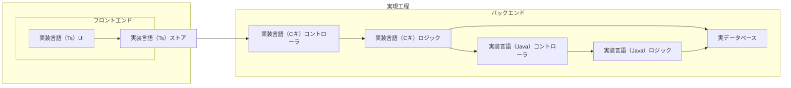

# はじめに

日本語プログラミング言語をモデリング言語としてシステム開発上中流工程に導入した場合、そのメリット・デメリットについて考察する記事の3回目です。

本記事の内容はいくつかに分割されて記載されます。本記事中の「本記事」とは分割された内容の総体を指す場合があります。

https://qiita.com/advent-calendar/2023/remind

この記事は日本語構造化仕様記述言語 Re:Mind（リマインド）アドベントカレンダー2023の12日向けの記事です。

## 対象読者
とりあえずこの記事の想定読者はシステムエンジニアさんです。とくに日本語で要求仕様や内部設計資料を書いている方向けのお話です。

また、本記事が解説する日本語プログラミング言語はまだ実装がなく、設計仕様はオープンですので、ソリューションアイデアに有用性を感じたソリューションプロバイダー事業者の方が独自に製品化することを妨げるものはありません。

# 想定しているレイヤードアーキテクチャ
[前回の記事](https://qiita.com/mylifewithviolin/items/4ce62e0d5473626347e1)ではオーソドックスなリレーショナルデータベースを使用している業務システムを想定しており、少しだけ具体的にその業務システムはレイヤードアーキテクチャを想定して設計・開発されると述べました。

本記事はレイヤードアーキテクチャやその他のアーキテクチャについて詳しく論じるのは主題ではなく、アーキテクチャ間の優劣についても評価するものではありません。あくまで一般的にありえる例として想定します。

では、前回の記事で図解したレイヤードアーキテクチャの本記事での想定事項を補足します。

さらに図が複雑化しますが、もっともシンプルな原型については、お手数ですが前々回記事を、レイヤードアーキテクチャを想定した開発フロー図は前回記事をご参照ください。

# 各工程のレイヤーの扱いとレイヤードアーキテクチャ例の解説
上図の概念図では、実装工程だけ図示していますがレイヤーにわかれているのが実現工程だけという意味ではありません。
また、レイヤードアーキテクチャとかいまふうの言い回しで表記していますが、よくある一般的なWebアプリケーションの構図です。DAO層とかは割愛しています。

コントローラとロジックがC#とJavaで実装言語が２グループあるのは、ほぼほぼシステム全体はC#で実装されてはいるが、帳票レポートが無償のJasperReport使いたいとかで、帳票のダウンロード出力用のAPIがJavaのSpring Bootで実装されるような場合を想定しています。

実装言語の差異は細かいので、実装専門の人材が各レイヤーの実装言語をすべて対応できる場合は多くありますが、設計者レベルでは実装言語にそこまで詳しくないので、実装言語の些末さを除いたレベルで適切なロジックを考案設計できる必要があるのは前回述べたとおりです。

# この回のまとめ
この記事が想定している業務アプリケーションシステムが一般的なWebアプリケーションシステムで、帳票ツールの都合でバックエンドの実装言語がC#とJavaの2言語になっていることを説明しました。フロントエンドはTypescriptを想定しています。

# 次回
各工程の詳細について検討してきます。（上流工程の対象業務イメージ）
