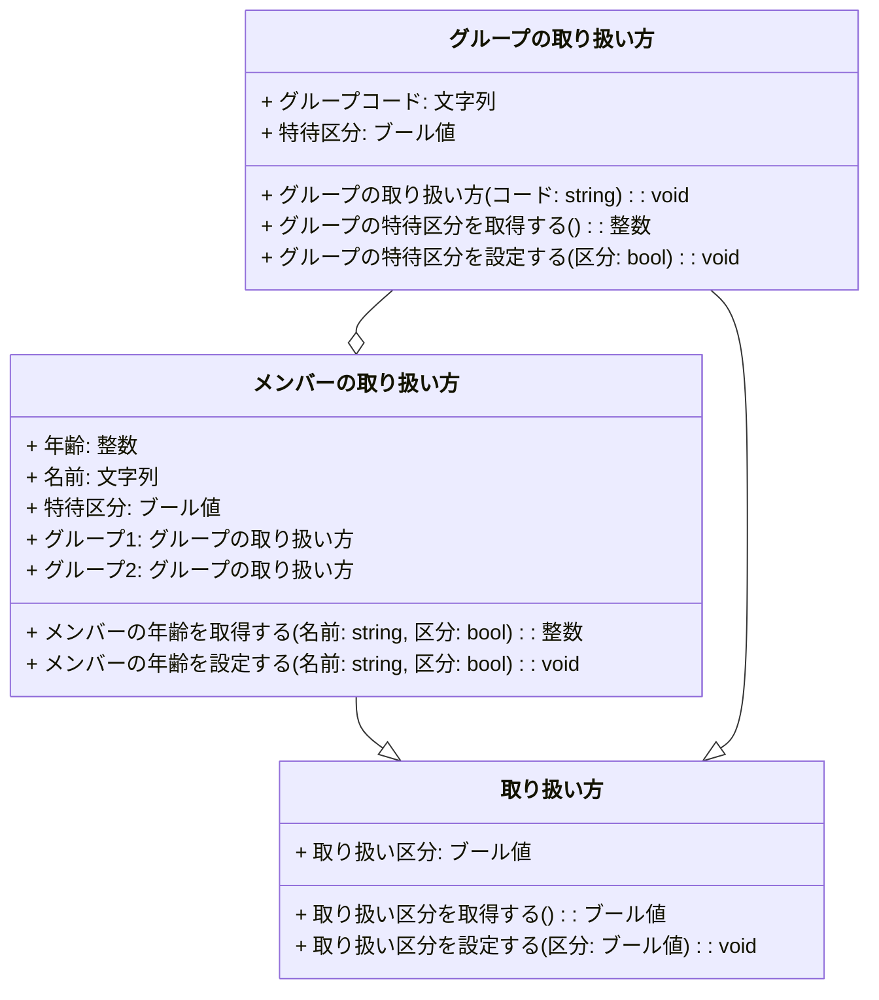
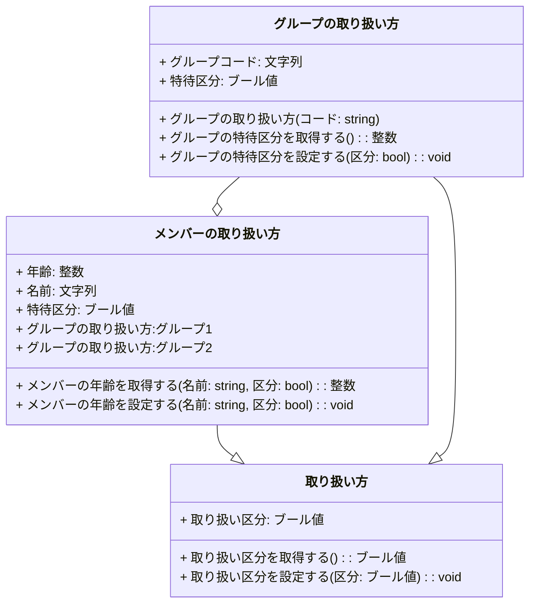

# はじめに
Mermaidのソースコードの代わりに日本語記述のロジック仕様記述言語が間接的なソースコードになるとうれしいなというお話の続きです。前回の記事 [Ph3 派生のほか、集約とかの続き](https://qiita.com/mylifewithviolin/items/9d739580ff9c9f8807d5)では、ChatGPT3.5と対話するのがちょっとめんどくさくなって、僭越ながら、ここはこうでしょ的なmermaidのソースコードを提示する状況に陥っていました。

## この記事内容の作業目的
あくまで自作ロジック仕様記述言語Re:Mindの構文仕様をAIに学習してもらい、UMLクラス図を作図してもらうことから、日本語ロジック仕様記述言語がUMLクラス図の間接的なソースコードになりうるか検討することではあるのですが、今回はAIとの対話をちょっとお休みします。

## この記事内容の保証
※この記事にはAIが自動生成した情報が含まれます。AIが自動生成して書かれた内容の妥当性は保証されません。なぜかというと前回の記事の状態から始まるので。

# これまでのまとめ
## Ph2でChatGPTに提示したお題
下記のロジック記述言語のクラス定義をMermaidのクラス図にしてください。
```remind:
   ▽class 取り扱い方
        ・変数ブール値 取り扱い区分
        ▽ブール値 取り扱い区分を取得する()
            □取り扱い区分を 返す
        △
        ▽取り扱い区分を設定する(bool 区分)
             □取り扱い区分=区分
        △
    △
    
    ▽class メンバーの取り扱い方 : 取り扱い方
        ・変数整数 年齢
        ・変数文字列 名前
        ・変数ブール値 特待区分
        ・グループの取り扱い方 グループ1("A")
        ・グループの取り扱い方 グループ2("B")
        ▽整数 メンバーの年齢を取得する(string 名前,bool 区分)
             //todo
            □(齢)を 返す
        △
        ▽メンバーの年齢を設定する(string 名前,bool 区分)
             //todo
        △
    △
    
    ▽class グループの取り扱い方 : 取り扱い方
        ・変数文字列 グループコード
        ・変数ブール値 特待区分
        ▽グループの取り扱い方(string コード)
             □グループコード=コード
        △
        ▽整数 グループの特待区分を取得する()
            □特待区分を 返す
        △
        ▽グループの特待区分を設定する(bool 区分)
             □特待区分=区分
        △
    △
```
## Ph3の最終状態
```:mermaid
classDiagram

class 取り扱い方 {
  + 取り扱い区分: ブール値
  + 取り扱い区分を取得する(): ブール値
  + 取り扱い区分を設定する(区分: ブール値): void
}

class メンバーの取り扱い方 {
  + 年齢: 整数
  + 名前: 文字列
  + 特待区分: ブール値
  + グループ1: グループの取り扱い方
  + グループ2: グループの取り扱い方
  + メンバーの年齢を取得する(名前: string, 区分: bool): 整数
  + メンバーの年齢を設定する(名前: string, 区分: bool): void
}

class グループの取り扱い方 {
  + グループコード: 文字列
  + 特待区分: ブール値
  + グループの取り扱い方(コード: string): void
  + グループの特待区分を取得する(): 整数
  + グループの特待区分を設定する(区分: bool): void
}

メンバーの取り扱い方 --|> 取り扱い方
グループの取り扱い方 --|> 取り扱い方
グループの取り扱い方 --o メンバーの取り扱い方
```



## ロジック仕様記述言語の構文理解に感動させられても、Mermaidのソースはしれっと間違えてくるところがまさに人間っぽい

ChatGPT：
>了解しました！Re:Mind リマインドのクラスのインスタンスに関する記述ルールについて、クラスのインスタンス宣言、変数操作、関数実行についての詳細を説明いたします。
>
>クラスのインスタンス宣言
>クラスのインスタンスを宣言する際のルールは以下の通りです：

```remind:
    ・メンバーの取り扱い方 メンバー取り扱い方法
```
>クラスのインスタンス名は、同じ主旨の別名として設定します。
>クラスのコンストラクタにオーバーロードがある場合、かっこ内に引数を記述します。
例:
```remind:
    ・クラス名 インスタンス名
    ・クラス名 インスタンス名(引数1, 引数2)
```


このあたりのやりとりはけっこう感動していました。引数つきの構文例はChatGPTが追加してくれました。

下記の記述はコンストラクタだと理解してくれたのかなと勝手に思ったのですが、
```remind:
    ▽class グループの取り扱い方 : 取り扱い方
        ・変数文字列 グループコード
        ▽グループの取り扱い方(string コード)
             □グループコード=コード
        △
    △
```
下記のインスタンスの宣言のヶ所が
```remind:
    ▽class メンバーの取り扱い方 : 取り扱い方
        ・グループの取り扱い方 グループ1("A")
        ・グループの取り扱い方 グループ2("B")
    △
```
生成されたMermaidのソースでは
```:mermaid
classDiagram
class メンバーの取り扱い方 {
  + グループ1: グループの取り扱い方
  + グループ2: グループの取り扱い方
}
```
てなっていたり、下記のグループの取り扱い方(コード: string)はコンストラクタなので。戻り値のvoidは書いてほしくないなと思ってみたり。
```:mermaid
classDiagram
class グループの取り扱い方 {
  + グループコード: 文字列
  + グループの取り扱い方(コード: string): void
}
```

といってもMermaidのソースとして、コンストラクタって明確に戻り値のない関数とわけて書くものかどうか知らなかったものですから、

https://mermaid.js.org/syntax/classDiagram.html

とか、見てみたのですがちょっとよくわからなかったです。

一般的なUMLで、C++/Java/C#のソースコードからリバース生成されたようなクラス図のコンストラクタって、voidは書かない気がします。

# Ph4の最終状態
とりあえず、今回はChatGPTには関与していただかず、人間系でMermaidのソースコードを訂正すると、こんな感じかな～的な感じです。
```:mermaid
classDiagram

class 取り扱い方 {
  + 取り扱い区分: ブール値
  + 取り扱い区分を取得する(): ブール値
  + 取り扱い区分を設定する(区分: ブール値): void
}

class メンバーの取り扱い方 {
  + 年齢: 整数
  + 名前: 文字列
  + 特待区分: ブール値
  + グループの取り扱い方:グループ1 
  + グループの取り扱い方:グループ2
  + メンバーの年齢を取得する(名前: string, 区分: bool): 整数
  + メンバーの年齢を設定する(名前: string, 区分: bool): void
}

class グループの取り扱い方 {
  + グループコード: 文字列
  + 特待区分: ブール値
  + グループの取り扱い方(コード: string)
  + グループの特待区分を取得する(): 整数
  + グループの特待区分を設定する(区分: bool): void
}

メンバーの取り扱い方 --|> 取り扱い方
グループの取り扱い方 --|> 取り扱い方
グループの取り扱い方 --o メンバーの取り扱い方
```




クラスのインスタンス宣言のとき、引数ありのコンストラクタで初期化しているとすると、かっこはメソッドと認識してしまうなので、クラスのメンバとしてはどんな値で初期化されているかはオミットしています。
