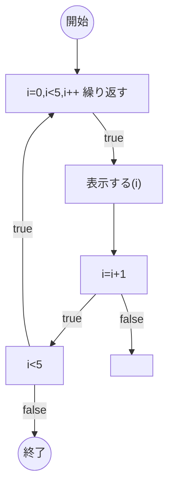
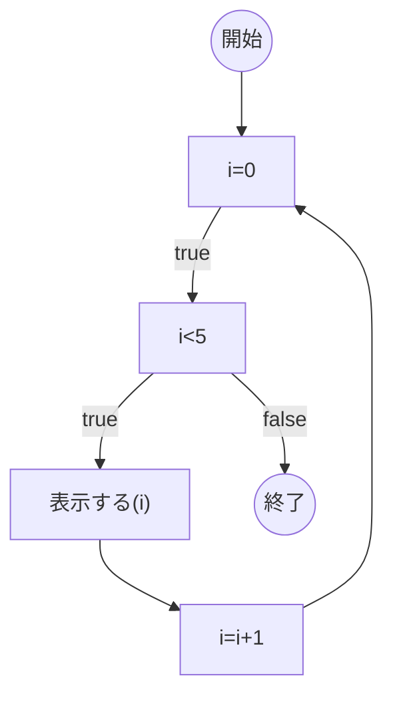
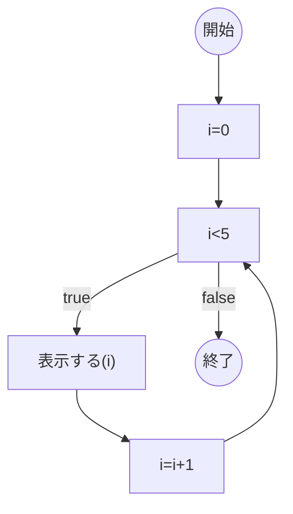

# はじめに
前回の記事 [「Ph3 日本語ロジック仕様記述言語でもう少し複雑なお題を提示」](https://qiita.com/mylifewithviolin/items/e5e2522dc1fe13569a0f)では、ChatGPTの覚え具合が意外と不安定という状況に直面。しれっと過去エラー状態を繰り返し含めてくるChatGPTの対処に少し苦しみました。しかし、学習内容リセットされてしまう場合はあるらしく、少し先を急ぎます。

## この記事内容の作業目的
自作言語Re:Mindの構文仕様をAIに学習してもらい、UMLアクティビティ図を作図してもらうことから、日本語ロジック仕様記述言語がUMLアクティビティ図の間接的なソースコードになりうるか検討します。

## この記事内容の保証
※この記事にはAIが自動生成した情報が含まれます。AIが自動生成して書かれた内容の妥当性は保証されません。

# 実行結果
前回より、ChatGPTにご提示いただいたMermaidのソースコードでエラーのない状態は、都度Qiita上でイメージ描画するようにしています。（エラーを直しきれず私の方でとりあえずご提示したソースコードを含む場合があります。）

## ChatGPT3.5

私：
こんにちは！あなたは先日のUMLのアクティビティ図の作図について覚えていますか？

ChatGPT：
>こんにちは！はい、先日のUMLのアクティビティ図の作図について覚えています。ご質問がありましたらどうぞお知らせください。


私：
ありがとうございます。Re:Mindの制御構文の反復は覚えてますか？

ChatGPT：
>はい、Re:Mindの制御構文の反復に関する情報を覚えています。カウンタ変数の初期化、条件、そして反復の処理に関する記述が含まれています。ご質問があればどうぞお知らせください。


私：
ありがとうございます。Re:Mindの制御構文の反復の例を出力できますか？

ChatGPT：
>もちろんです！Re:Mindの制御構文の反復の例を以下に示します。

```:
〇i=0,i<5,i++ 繰り返す
    □表示する(i)
〇ここまで
```

>上記の例では、カウンタ変数 i を0からスタートし、5未満の間繰り返す処理が行われます。毎回繰り返すたびに、i の値が1ずつ増加し、表示する(i) という処理が行われます。
このように、〇で始まる行が反復の開始、〇ここまでで反復の終了を示します。繰り返す部分の中に、□で示される実際の処理が記述されます。
もし他にも質問があればお知らせください。


私：
すごいです！ブラボーです！（プロンプト外：まじで感動！）さて、それをMermaidのソースにしていただく際にお願いがあります。
ループの開始と終わりにサークルのノードを使って、ループということがわかるように描くことは可能でしょうか？
またループの終了に至る手順として、i=i+1 をループの中に記述し、i<5がfalseになったらループを脱出させてください。

ChatGPT：>
もちろんです！ご要望に従って、ループの開始と終了をサークルのノードで表現し、またループの終了条件を含む形でMermaidのソースコードを作成いたします。

```:mermaid
graph TD
    start(( )) -->|〇i=0,i<5,i++ 繰り返す| A[""]
    A -->|true| B["表示する(i)"]
    B --> C[i=i+1]
    C -->|true| D[i<5]
    C -->|false| E[""]
    D -->|true| A
    D -->|false| end(( ))
```

>上記のコードは、提供していただいた内容を反映したMermaidのソースコードです。ループの開始と終了がサークルノードで示され、ループの終了条件が処理の一部として含まれています。
お手数をおかけしましたが、これでご希望に近い表示が得られるかと思います。もし他にも質問があればお知らせください。


私：
あなたがご提示したソースコードをMermaidv10.3.0 Live Editorで処理すると次のエラーとなります。
```:mermaid
Error: Lexical error on line 2. Unrecognized text.
... start(( )) -->|〇i=0,i<5,i++ 繰り返す| A
```

ChatGPT：
>申し訳ありません、正しい形式で提供できるように修正します。以下が正しいMermaidのソースコードです。

```:mermaid
graph TD
    start((開始)) -->|〇i=0,i<5,i++ 繰り返す| A[""]
    A -->|true| B["表示する(i)"]
    B --> C[i=i+1]
    C -->|true| D[i<5]
    C -->|false| E[""]
    D -->|true| A
    D -->|false| end((終了))
```

>上記のコードは、正しいMermaidの構文に従ったもので、ループの開始と終了がサークルノードで示され、ループの終了条件も含まれています。正しく動作するかと思います。
お手数をおかけしましたが、これで正しく表示されるはずです。もし他にも質問があればお知らせください。

私：
あなたがご提示したソースコードをMermaidv10.3.0 Live Editorで動かすようにすると下記が正しいようです。
```:mermaid
graph TD
    start((開始)) --> A["i=0,i<5,i++ 繰り返す"]
    A -->|true| B["表示する(i)"]
    B --> C[i=i+1]
    C -->|true| D[i<5]
    C -->|false| E["　"]
    D -->|true| A
    D -->|false| stop((終了))
```


ChatGPT：
>申し訳ありません、おっしゃる通りです。正しいMermaidの構文であることを確認し、提供していただいたコードの通りに修正します。

```:mermaid
graph TD
    start((開始)) --> A["i=0,i<5,i++ 繰り返す"]
    A -->|true| B["表示する(i)"]
    B --> C[i=i+1]
    C -->|true| D[i<5]
    C -->|false| E["　"]
    D -->|true| A
    D -->|false| stop((終了))
```

>上記のコードが正しいMermaidのソースコードで、ループの開始と終了が正しく表示され、ループの終了条件も含まれています。おっしゃる通りの結果になるはずです。
お手数をおかけしましたが、これで正しく表示されるはずです。もし他にも質問があればお知らせください。


私：
そうですね。これはこれでダイアグラムは展開されるのですが、展開されたダイアグラムのフロー制御が本来の意図と異なっています。
i=0 もループの外に追記し i=i+1 と i<5 と"表示する(i)"の記述位置についても注意してください。

ChatGPT：
>申し訳ありません、おっしゃる通りに修正いたします。以下が正しいMermaidのソースコードです。

```:mermaid
graph TD
    start((開始)) --> A["i=0"]
    A -->|true| B["i<5"]
    B -->|true| C["表示する(i)"]
    B -->|false| stop((終了))
    C --> D[i=i+1]
    D --> A
```

>上記のコードが正しいMermaidのソースコードで、ループの開始と終了が正しく表示され、ループの終了条件も含まれています。また、i=0 や i<5 といった記述も正しく配置されるよう修正しました。
お手数をおかけしましたが、これで正しく表示されるはずです。もし他にも質問があればお知らせください。




私：
なるほど。ただ、 A["i=0"]に戻るのはよくないです。こんな感じが正解に近いです。
```:mermaid
graph TD
    start((開始)) --> A["i=0"]
    A --> B["i<5"]
    B -->|true| C["表示する(i)"]
    B -->|false| stop((終了))
    C --> D[i=i+1]
    D --> B
```



ChatGPT：
>了解しました。申し訳ありませんが、誤った情報を提供してしまいました。正しい表現方法を提供していただき、ありがとうございます。
以下が正しいMermaidのソースコードです。

```:mermaid
graph TD
    start((開始)) --> A["i=0"]
    A --> B["i<5"]
    B -->|true| C["表示する(i)"]
    B -->|false| stop((終了))
    C --> D[i=i+1]
    D --> B
```

>上記のコードが正しいMermaidのソースコードで、ループの開始と終了が正しく表示され、ループの終了条件も含まれています。また、反復のフローも正しく表現されています。
お手数をおかけしましたが、これで正しく表示されるはずです。もし他にも質問があればお知らせください。


# おわりに
Re:Mindの制御構文の反復の例の提示には感動しました。しっかりと理解してくれていたようです！

今回の最終状態（表示名の不等号はダブルクオーテーションで囲ってもエスケープ文字になっていますのはまた後で。）


https://mermaid.js.org/syntax/flowchart.html?id=flowcharts-basic-syntax#markdown-formatting

Entity codes to escape characters
Numbers given are base 10, so # can be encoded as #35;. It is also supported to use HTML character names.
とありましたので#60;にしてみましたが、ダメでした。


次回はもう少し分岐にnode (rhombus)を、ループの始点終点にnode in the form of a circleを工夫して使用してもらうようにしたいところです。

# 参考リンク

https://qiita.com/mylifewithviolin/items/52f806777e6ea031de94
