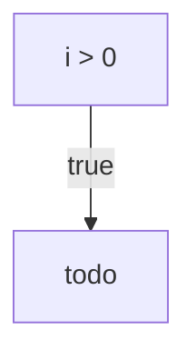
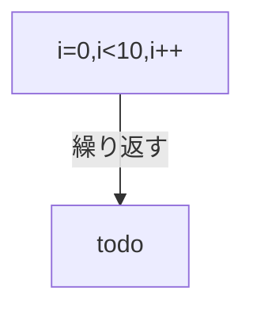

# はじめに
日本語ロジック仕様記述言語 Re:Mindは、制御構文の開始シンボルとして、◇、〇、□、・などの全角記号を用い、箇条書きされた日本文としての体裁を[日本語トランスコンパイラ言語 Re:Mind](https://qiita.com/mylifewithviolin/items/9214582528edcbd606ad)の構文と共有しています。

◇は分岐構文、〇はループ構文の開始と終了を表し、冗長な日本語表記がなくてもフロー図の表現に慣れている方が直感的に認識できることを考慮しています。

## この記事内容の作業目的
自作言語Re:Mindの構文仕様をAIに学習してもらい、UMLアクティビティ図を作図してもらって、ロジック仕様記述言語がUMLアクティビティ図のソースコードになりうるか検討します。

## この記事内容の保証
※この記事にはAIが自動生成した情報が含まれます。AIが自動生成して書かれた内容の妥当性は保証されません。

# 実行結果

## ChatGPT3.5

私：
こんにちは！あなたはUMLのアクティビティ図を作図することができますか？

ChatGPT：
>こんにちは！はい、私はUMLのアクティビティ図を作図することができます。UMLのアクティビティ図は、システムやプロセスの動作を表現するために使用される図です。アクティビティ図は、アクション、決定、ループ、並列処理などの制御フローを示すことができます。
>
>アクティビティ図を作成するためには、以下のような要素が利用されます：
>
>アクティビティ（Activity）: 処理ステップや操作が表現される矩形の形状。
>開始ノード（Initial Node）: プロセスの開始を示す小さい黒い点。
>終了ノード（Final Node）: プロセスの終了を示す矩形内に円が描かれた形状。
>アクション（Action）: 特定の処理を表すアクティビティの中に含まれる小さな矩形の形状。
>制御フロー（Control Flow）: 矢印で表現され、アクティビティ間の順序や制御の流れを示す。
デシジョン（Decision）: 短冊形状で表現され、条件分岐を示す。
マージ（Merge）: デシジョンからのフローを結合するためのダイヤモンド形状。
もしご希望であれば、具体的なアクティビティ図の例を作成することができます。どのようなアクティビティ図が必要か、あるいは特定のシナリオに基づいて図を描きたいかをお知らせいただければ、適切な例を提供いたします！

私：
下記はわたしが考案した日本語ロジック仕様記述言語Re:Mind リマインド のアルゴリズム記述ルールです。
このセッション内で覚えておいていただくことは可能ですか？下記は分岐の構文ですが、覚えていただける場合は繰り返しの構文もこの後、ご説明いたします。

・制御構文　分岐

    ◇i > 0 の場合
        //todo
    ◇ここまで
    
・全角記号のひし形◇が条件分岐の開始となります。
・続いて論理式を書きます。半角かっこは不要。
・続いて「の場合」と書きます。半角で書かれた論理式とはくっついていても可。
・全角記号のひし形◇が条件分岐の終了となります。
・つづいて「ここまで」と書くことができます。省略も可。

ChatGPT：
>Re:Mind リマインドのアルゴリズム記述ルールを以下のように要約しました。繰り返しの構文もご説明いただける場合は、お知らせください。
>
>制御構文: 分岐
>全角記号のひし形◇が条件分岐の開始を示す。
>続いて論理式を書く（半角かっこは不要）。
>続いて「の場合」と書く（半角で書かれた論理式とはくっついていても可）。
>全角記号のひし形◇が条件分岐の終了を示す。
「ここまで」と書くことができる（省略も可）。
>上記の記述を覚えておきますので、繰り返しの構文についての説明をお待ちしています。詳細な説明を提供するために準備しておりますので、お知らせください。

私：
ありがとうございます。Re:Mindの制御構文をご認識いただいた後に、UMLのアクティビティ図にしていただくロジックをRe:Mindでご提示します。その前に、反復の制御構文は下記のとおりです。

・制御構文　反復

    〇i=0,i<10,i++ 繰り返す
        //todo
    〇ここまで
    
・全角記号の丸印〇が繰り返しの開始となります。
・続いてカウンタ論理式をカンマ区切りで書きます。カウンタ変数の型名と半角かっこは不要。
・続いて「繰り返す」と書きます。半角で書かれた論理式とはくっついていても可。
・全角記号の丸印〇が繰り返しの終了となります。
・つづいて「ここまで」と書くことができます。省略も可。

ChatGPT：
>了解しました。Re:Mindの反復の制御構文についても認識しましたので、次にRe:Mindの制御構文を使用したロジックをUMLのアクティビティ図に変換してみましょう。
>
>以下は、Re:Mindの制御構文を使用したロジックをUMLのアクティビティ図に変換した例です：

Re:Mindの制御構文分岐：

```:less
◇i > 0 の場合
    //todo
◇ここまで
```

対応するUMLのアクティビティ図：

```:lua
+----------------------+
|                      |
|                      v
+-----+       true     +--------+
| i>0 | -------------> |  todo  |
+-----+                +--------+
```

Re:Mindの制御構文反復：

```:less
〇i=0,i<10,i++ 繰り返す
    //todo
〇ここまで
```

対応するUMLのアクティビティ図：

```:diff
+-------+
|       v
| i=0 ? |
|       v
+---+---+
    |
    |
    v
+---+----+
|         |
|  todo   |
|         |
+---------+
```

>これは簡単なロジックの例ですが、Re:Mindの制御構文をUMLのアクティビティ図に変換する方法を示しています。より複雑なロジックの場合も同様の手順で描画できます。
>
>もし他にも続きがあればお知らせください。お手伝いできることがあれば喜んで対応いたします！


私：
すばらしい！ちなみに出力形式はMermaidで出力することは可能でしょうか？
(プロンプト外で思ったこと　まだ変換してほしくなかったんだけどね。でも、先方のノリを遮ると予期せぬ状況になるかもしれないので、このまま進めてみますか…）

ChatGPT：
>ありがとうございます！Mermaidはテキストベースのダイアグラム記述言語であり、UMLのようなさまざまなダイアグラムを作成するために使用されます。Re:Mindの制御構文をMermaid形式で出力することは可能です。
>
>以下は、先ほど示したRe:Mindの制御構文をMermaid形式のコードに変換した例です：

制御構文分岐：

```:mermaid
graph TD
    A[i > 0] -->|true| B[//todo]
```

制御構文反復：

```:mermaid
graph TD
    A[i=0,i<10,i++] --繰り返す--> B[//todo]
```

>Mermaidでは、graph TDといったキーワードでアクティビティ図の記述を始めます。矢印-->はフローを示し、条件やループの部分は角括弧[ ]内に記述します。Re:Mindの制御構文に対応する形式になっています。
>
>これらのMermaidコードを適切なエディタやMermaidのオンラインエディタで実行すると、対応するアクティビティ図が描画されるはずです。
>
>お手伝いできることがあればどんな形式でもお知らせください！


私：
ありがとうございます。長くなりましたので、いったんここまでとします。また、Re:Mindの制御構文の内容を次のセッションでも覚えていていただくと幸いです。もしお忘れになっても、またご説明しますのでご安心ください。

ChatGPT：
>どういたしまして！Re:Mindの制御構文についての内容を覚えておきますので、次回以降でもサポートいたします。もし何か質問があればいつでもお知らせください。楽しい学習セッションをお待ちしています！良い一日をお過ごしください！


# おわりに
まだ、構文仕様の学習依頼の途中だったのですが、基本形の構文制御パターンに対して、対応するUMLアクティビティ図を意欲的に出力されてきたので、なんだかイケそうな感じです。続きはPH2（フェーズ2）として、もう少し合わせ技のお題を提示してみます。

現状ではChatGPTが出力したMermaidのソースコードはそのままでは正常に解釈できませんでした。todoのコメント文の意のダブルスラッシュがよくないようです。これは次回、お伝えすればやってくれそうな感じ。それを除去すると下図のように作図されました。

制御構文分岐：


制御構文反復：



# 参考リンク
https://qiita.com/ShigemoriMasato/items/73d25705f7db1b692047

https://qiita.com/kujirahand/items/59ca3664dca2cbe1b18c


