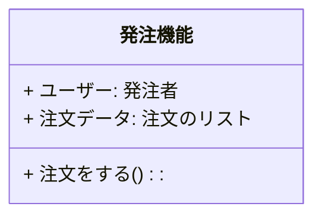

# はじめに

日本語プログラミング言語をモデリング言語としてシステム開発上中流工程に導入した場合、そのメリット・デメリットについて考察する記事の10回目です。

本記事の内容はいくつかに分割されて記載されます。本記事中の「本記事」とは分割された内容の総体を指す場合があります。

https://qiita.com/advent-calendar/2023/remind

この記事は日本語構造化仕様記述言語 Re:Mind（リマインド）アドベントカレンダー2023の23日向けの記事です。

## 対象読者
とりあえずこの記事の想定読者はシステムエンジニアさんです。とくに日本語で要求仕様や内部設計資料を書いている方向けのお話です。

# 想定しているシステム開発フロー
オーソドックスなリレーショナルデータベースを使用している業務システムであることを[1回目](https://qiita.com/mylifewithviolin/items/b7cc85911507cf1a2a55)[2回目](https://qiita.com/mylifewithviolin/items/4ce62e0d5473626347e1)の記事で説明しております。

## 想定しているレイヤードアーキテクチャ・業務
一般的なWebアプリケーションシステムであり、簡単な受発注業務をインターネットで支援するシステムであることを[3回目](https://qiita.com/mylifewithviolin/items/d10d59e98c4d2d7dca3d)[4回目](https://qiita.com/mylifewithviolin/items/68dbf00cebb1bc8f6209)の記事で説明しております。

## 想定しているユビキタス言語
[5回目](https://qiita.com/mylifewithviolin/items/e1a7915efbf369117c97)の記事ではドメイン駆動設計（DDD）の文脈で用いられる意味でのユビキタス言語を例示しました。

## ユビキタス言語化された日本語プログラミング言語
[6回目](https://qiita.com/mylifewithviolin/items/f49c48241d8f72d6839a)[7回目](https://qiita.com/mylifewithviolin/items/8823d08c79bf70464bc0)の記事ではドメインエキスパートからプログラマレベルまで共有可能な言語のことをユビキタス言語化された日本語プログラミング言語とし、例示・解説しました。
[8回目](https://qiita.com/mylifewithviolin/items/4db1d402ed273ec784dc)の記事ではそれをシステム開発の上中流工程に導入した場合のメリット・デメリットについて、いったんまとめてみました。

## 数学的形式言語で日本語識別子を使った場合との対比
また、[前回](https://qiita.com/mylifewithviolin/items/7236c136e43b8b220098)の記事では、この上流工程で実績のある数学的形式言語で日本語識別子を使った場合について言及しました。とりわけVDM++の導入案内書では日本語識別子を使った例事例が多数存在します。

7回目の記事ではユビキタス言語化された日本語プログラミング言語のソースコードを簡単なモデリング例で例示しましたが、今回はそれらといっしょにVDM++で記述した場合を併記し、具体的に両者の違いをさぐっていきます。

6回目7回目と重複しますが、今回の説明対象となるクラス図を再掲いたします。


このUMLで表現されたクラスを日本語識別子を使ったVDM++と本記事の日本語プログラミング言語で各工程別に記述したのが下記のイメージです。注意事項がありますので、6回目7回目の記事を未読の場合はそちらを読んでから来てくれると助かります。

#### 上流工程　モデリング言語（VDM++の場合は陰定義主体）
```mind:VDM++
class 発注機能クラス

instance variables
    ユーザー: 発注者クラス;
    注文データ: set of 注文型;
operations
    注文をする():==> ()
    注文をする()==
        is not yet specified;
end 発注機能クラス
```
VDM++にはリスト型がないみたいなので集合型としています。
また導入ガイドの例に従い、クラス名、型名に〇〇クラス、〇〇型の後置装飾を行っています。VDM++にこの装飾の解析能力はないので、あくまで記述運用ルールです。本記事の日本語プログラミング言語でも名称がインスタンス名とユニークに識別できればよいので、同様の装飾を行うこともできます。

また、数学的形式言語としての不変条件・事前条件・事後条件の記述は割愛しています。これが数学的形式言語導入のメリットの本丸ではあると認識しておりますが、今回想定しているシステム開発のターゲットでは数学的形式言語による要件証明はウォント要件（マスト要件ではない）と想定しています。これはもう少し後で説明します。

```mind:Re:Mind
▽クラス 発注機能
    ・発注者　ユーザー
    ・注文のリスト 注文データ

    ▽△注文をする()
△
```
上記の注文をするの記法は下記の記法の簡略として検討しています。下記の場合の未定義はあくまで注釈です。
```
    ▽注文をする()
        //未定義
    △
```
VDM++の「is not yet specified」はシステムで予約されています。

#### 中流工程　ロジック記述言語（VDM++の場合は陽定義主体）
モデリング言語の場合はロジックの中身の定義がなくても可としていますが、ロジック記述言語レベルでは、中身の定義を書いていきます。
```mind:VDM++
class 発注機能クラス

instance variables
    ユーザー: 発注者クラス;
    注文データ: set of 注文型;
operations
    注文をする():==> ()
    注文をする()==(
		注文型:注文
   		if 在庫がある then (
       		注文データに追加する(注文);
         )
    );
    在庫がある():==> ()
    在庫がある()==(
        //定義がある
    );
    注文データに追加する(c注文 注文):==> ()
    注文データに追加する()==(
        //定義がある
    );
end 発注機能クラス
```

```mind:Re:Mind
▽クラス 発注機能 : 共通機能
    ・発注者　ユーザー
    ・注文のリスト 注文データ

    ▽注文をする()
        □注文データを 新規作成し
        ・注文を 新規作成し
        ◇在庫がある 
           □注文データに追加する(注文)
        ◇ここまで
    △
    ▽boolean 在庫がある()
        //定義がある
    △
    ▽注文データに追加する(c注文 注文)
        //定義がある
    △
    
△
```


#### 中流工程　トランスコンパイラ言語（VDM++の場合は陽定義からのコード生成）
VDM++の場合は陽定義からのコード生成となりますので、ソースコード上の差異はありませんので割愛します。日本語識別子を使用している場合、生成された実装言語上でも、操作名、変数名は日本字で出力されます。

```mind:Re:Mind
/**
* OrderLogic : AbstractLogic
*/
▽class public 発注機能 : 共通機能
    /** 
    * doOrder 
    */
    ▽public 注文をする()
        □注文データを 新規作成し
        ・注文を 新規作成し
        ◇在庫がある 
           □注文データに追加する(注文)
        ◇ここまで
    △
    /** 
    * inStock 
    */
    ▽private boolean 在庫がある()
        //定義がある
    △
    /** 
    * addOrderData
    * @param 注文 order 
    */
    ▽private void 注文データに追加する(c注文 注文)
        //定義がある
    △
△
```
ソースコードを例示するクラス図が単純すぎて、想定しているシステムのイメージから離れてしまっておりますが、この記事が想定しているシステムはデータベースを使用した業務システムであり、電子商取引を支援するWebアプリケーションであることをこれまでの記事の中で説明しております。

このようなシステムの要件の合目的性を数学的に検証するのは難度が高いと推察されます。電子商取引システムが具備すべき要件の中には、法的な規制も含まれます。大企業の製造業メーカがサプライヤーの製造業に注文し取引する上では、下請け法の制約もあり、電子取引であるため電子帳簿保存法なども関係します。

これらの適合要件は自然言語で列挙的宣言的に記述しておき、構造化言語でモデル化したシステムのソースコードが適合しているかの判定は基本的には人間系を想定しています。

もし可能であれば両者をAIに読み込ませ、適合性判定を評価させるようなことも今日的にはできそうです。自然言語でモデル化された情報よりは、構造化された言語の情報の方が、AIによる判定の確度精度も各段に向上することが考えられるからです。

本記事での上流のモデリング言語の役割は、設計者の意図を実装者まで確実に伝えることを主たるものと想定しております。数学的形式言語の機能を活用するような場合はVDM++へのトランスコンパイル機能も有用かと考えらますが、本記事ではそこに主眼はおいていません。数学的形式言語か自然言語かの２択の中間を行く選択です。

# この回のまとめ
上中流工程においては、競合でありパートナーでもある日本語識別子を使った数学的形式言語の存在について考察してみました。

# 次回
現存する代表的な日本語プログラミング言語を適用した場合について考察します。
