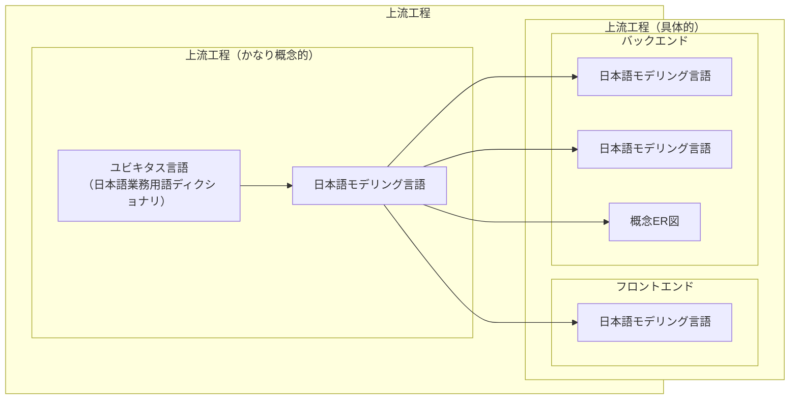
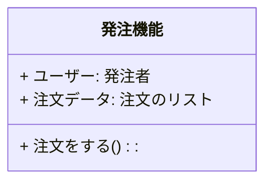

# はじめに

日本語プログラミング言語をモデリング言語としてシステム開発上中流工程に導入した場合、そのメリット・デメリットについて考察する記事の6回目です。

本記事の内容はいくつかに分割されて記載されます。本記事中の「本記事」とは分割された内容の総体を指す場合があります。

https://qiita.com/advent-calendar/2023/remind

この記事は日本語構造化仕様記述言語 Re:Mind（リマインド）アドベントカレンダー2023の16日向けの記事です。

## 対象読者
とりあえずこの記事の想定読者はシステムエンジニアさんです。とくに日本語で要求仕様や内部設計資料を書いている方向けのお話です。

また、参考にプログラマさん。ぐだぐだの内部設計書から実装してひどいめにあったことのあるひと（力量のあるデベロッパはそれを乗り越える）

# 想定しているシステム開発フロー
オーソドックスなリレーショナルデータベースを使用している業務システムであることを[1回目](https://qiita.com/mylifewithviolin/items/b7cc85911507cf1a2a55)[2回目](https://qiita.com/mylifewithviolin/items/4ce62e0d5473626347e1)の記事で説明しております。

## 想定しているレイヤードアーキテクチャ・業務
一般的なWebアプリケーションシステムであり、簡単な受発注業務をインターネットで支援するシステムであることを[3回目](https://qiita.com/mylifewithviolin/items/d10d59e98c4d2d7dca3d)[4回目](https://qiita.com/mylifewithviolin/items/68dbf00cebb1bc8f6209)の記事で説明しております。

## 想定しているユビキタス言語
[前回の記事](https://qiita.com/mylifewithviolin/items/e1a7915efbf369117c97)ではドメイン駆動設計（DDD）の文脈で用いられる意味でのユビキタス言語を例示しました。

# ユビキタス言語化された日本語プログラミング言語とは

ここでの「ユビキタス言語」とはドメイン駆動設計（DDD）の文脈で用いられる意味での「ユビキタス言語」とは少し異なっています。

DDDにおいてはドメインエキスパート（システム開発プロジェクトのエンドユーザー参画者、業務のプロ）とシステム開発チームの実現側メンバー（要求仕様策定・設計者・実装開発プログラマ）が共有する概念や用語集として「ユビキタス言語」が使われます。

これは、とくに、実装担当者・プログラマは、自然言語の日本語で「ユビキタス言語」の語彙を認識しながらも、実装言語はASCII半角英字文字を主体としたプログラミング言語を用いて実装しており、実装しなければならない要件やロジックは自然言語の日本語を再解釈して翻訳する作業をしています。

この記事（今回を含めて本記事のテーマ）に関連して使われる「ユビキタス言語」は上記の狭い意味での「ユビキタス言語」を起点として展開されるモデリング設計言語のことです。

それは、システムエンジニアリングのプロではないドメインエキスパートから、実際のプロダクトの実装担当者・プログラマレベルまでを、一貫した、構造化された言語で（工程により詳細度は異なるものの）共有可能な言語のこと意味します。


実装担当者は往々にして「完成」が検証されていないロジック仕様をあいまいな表現のまま推測し判断し、動く動かないで白黒がついていく、つまり「完成」が判定される実装言語の成果物を書き起こしています。（それって不公平では？という意識も一部あります。）

## ユビキタス言語化された日本語プログラミング言語の工程別イメージ

### 上流工程でのレイヤードアーキテクチャ

ここではレイヤードアーキテクチャの詳細を論じることは主題ではなく、境界がどうのこうのという点はざっくり割愛しますが、通常上流工程でもシステムの画面イメージや機能分割が定義はされていきます。したがって中流工程の内部設計ほど明確ではないにしても、実際のクラスやオブジェクトの定義は画面別機能別くらいまでには落とし込まれますでの、上流工程内でもレイヤーを考慮しない概念レベルでのモデリングと画面別機能別に分割整理された論理レベルでのモデリングでは若干の工程の差異があります。

したがって実際には上流工程にもいくつかの工程があって、ざっくり図示すると下図のようなイメージが考えられます。


このように実際のシステム開発においては、機能の役割分担をどのようにするか上流工程側でも意識することが求められます。

このことを念頭におきながら、非常にまたざっくりとした話で1回目の記事で説明した大枠のシステム開発のフロー上流、中流、下流またがった場合のユビキタス言語としての日本語プログラミング言語のソースコードの状態を説明します。

そのため、4回目の対象業務で説明したクラス図をユビキタス言語化された日本語プログラミング言語で記述されるとどういう違いとなるかを説明します。実際にはこの概念レベルでクラスがそのまま下流まで定義されていくことはありませんのでご留意ください。あくまで違いを説明するイメージ情報です。


#### 上流工程　モデリング言語
```mind:Re:Mind
▽クラス 発注機能
    ・発注者　ユーザー
    ・注文のリスト 注文データ

    ▽注文をする()
        //未定義
    △
△
```
#### 中流工程　ロジック記述言語
```mind:Re:Mind
▽クラス 発注機能 : 共通機能
    ・発注者　ユーザー
    ・注文のリスト 注文データ

    ▽注文をする()
        □注文データを 新規作成し
        ・注文を 新規作成し
        ◇在庫がある 
           □注文データに追加する(注文)
        ◇ここまで
    △
    ▽boolean 在庫がある()
        //定義がある
    △
    ▽注文データに追加する(c注文 注文)
        //定義がある
    △
    
△
```
#### 中流工程　トランスコンパイラ言語
```mind:Re:Mind
/**
* OrderLogic : AbstractLogic
*/
▽class public 発注機能 : 共通機能
    /** 
    * doOrder 
    */
    ▽public 注文をする()
        □注文データを 新規作成し
        ・注文を 新規作成し
        ◇在庫がある 
           □注文データに追加する(注文)
        ◇ここまで
    △
    /** 
    * inStock 
    */
    ▽private boolean 在庫がある()
        //定義がある
    △
    /** 
    * addOrderData
    * @param 注文 order 
    */
    ▽private void 注文データに追加する(c注文 注文)
        //定義がある
    △
△
```
日本語プログラミング言語によっても設計思想によって構文の扱い方が異なります。この記事で例示する日本語プログラミング言語はJava C#などの経験者向けに設計されていますので、語順まで含めて日本語らしさを強調する言語とは設計思想がことなっています。
これらのプログラミング言語経験者が設計資料を技術文書として箇条書きする際に使われる言い回しを想定しており、自然言語らしさはあまりないです。詳しくは次回説明します。

# この回のまとめ
前回の上流工程の対象業務のユビキタス言語のざっくりとした例示を受けて、今回は各工程をまたがるユビキタス言語としての日本語プログラミング言語のソースコード上のイメージの違いを例示しました。

# 次回
各工程の詳細について引き続き検討していきます。
